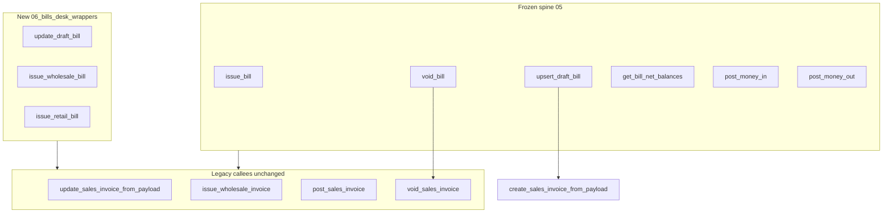
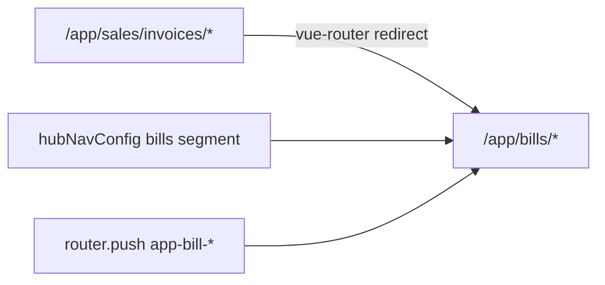

# Bills desk — URLs, navigation, APIs, fetch discipline

## User intent (clarified)

**Navigation** means **where the app routes users**: path segments, redirects, and `router.push` / `:to` links — not only sidebar labels. The UI already says **Bill**; URLs still use **`/app/sales/invoices`** and docs reference **invoice** paths. Target: **bill** in the path tree; **route names** stay `app-bill-*` (already correct); param **`billId`** (already correct).

---

## Invariant — money kernel RPCs are frozen

**Do not change** any function body, signature, or grant in [`supabase/schemas/bills_pays/05_money_spine.sql`](supabase/schemas/bills_pays/05_money_spine.sql) or migration [`20261027220000_bills_pays_money_spine.sql`](supabase/migrations/20261027220000_bills_pays_money_spine.sql) for this desk work.

| Frozen surface | Role |
| :--- | :--- |
| `get_bill_net_balances` | Kernel read — call directly |
| `issue_bill` | Kernel write — call directly |
| `void_bill` | Wrapper → `void_sales_invoice` — UI calls **`void_bill` only** |
| `upsert_draft_bill` | Wrapper → `create_sales_invoice_from_payload` — UI create draft calls **`upsert_draft_bill` only** |
| `post_money_in` / `post_money_out` | Wrappers — UI pays call these, not legacy receipt/payout names |

**Phase 0 (below) adds new wrappers** so the desk does **not** call legacy names from the client. Legacy remains **inside** Postgres as callees only.

**Web rule (after Phase 0):** `bills_pays/` calls **only** kernel + Phase 0 wrapper names — never `void_sales_invoice`, `create_sales_invoice_from_payload`, `update_sales_invoice_from_payload`, `issue_wholesale_invoice`, `post_sales_invoice` directly.

---

## Phase 0 — Extend kernel public API (do first)

**Goal:** Bills desk has a **complete kernel-facing API** without editing [`05_money_spine.sql`](supabase/schemas/bills_pays/05_money_spine.sql). Implements [BP9](docs/features/bills_pays/00-gaps.md) desk slice + [BP17](docs/features/bills_pays/00-gaps.md) boundary (FIFO stays **outside** `issue_bill`).

**Files**

| File | Action |
| :--- | :--- |
| [`supabase/schemas/bills_pays/06_bills_desk_wrappers.sql`](supabase/schemas/bills_pays/06_bills_desk_wrappers.sql) | **Create** — new functions only |
| [`supabase/migrations/YYYYMMDDHHMMSS_bills_desk_wrappers.sql`](supabase/migrations/) | **Create** — copy from schema split |
| [`supabase/schemas/bills_pays/04_rls.sql`](supabase/schemas/bills_pays/04_rls.sql) or new grants file | `GRANT` authenticated on new RPCs |
| [`docs/features/bills_pays/kernel-schema.md`](docs/features/bills_pays/kernel-schema.md) | Add rows to kernel RPC table |
| `pnpm run backend:local` + `backend:types:local` | Apply + regenerate types |

**New wrappers (delegate only — copy args/behavior from legacy, do not reimplement business logic)**

| New RPC | Delegates to | Returns | Desk use |
| :--- | :--- | :--- | :--- |
| `update_draft_bill(p_tenant_id bigint, p_bill_id bigint, p_payload jsonb)` | `update_sales_invoice_from_payload` | same jsonb success shape as legacy | Compose save (edit draft) |
| `issue_wholesale_bill(p_bill_id bigint, p_items jsonb default null)` | `issue_wholesale_invoice` | `bills` row or void | Compose/issue with stock FIFO |
| `issue_retail_bill(p_bill_id bigint)` | `post_sales_invoice` | void | Walk-in / retail issue |
| *(no change)* `get_bill_detail_bundle` | *(already exists)* | jsonb bundle | Detail — **sanctioned desk read**; list in kernel-schema; no duplicate SQL unless rename needed later |
| *(no change)* `list_global_invoice_items` | *(already exists)* | item rows | Lines — document as desk read; optional future `list_bill_items(p_bill_id)` alias in same migration if naming desired |

**Issue routing (compose / repo, after wrappers exist)**

```text
if retail / walk-in     → issue_retail_bill
elif stock lines (FIFO) → issue_wholesale_bill
else                      → issue_bill          (frozen kernel)
```

**Explicitly not in Phase 0 (later product track):** `v_kernel_bill_summaries` (BP23), `apply_settlement_to_bill` UI (BP11), replacing `post_ap_payout_with_allocations_snapshot` with `post_money_out` + read refresh (BP24).

**Tests:** extend [`supabase/tests/bills_pays_bp18_settlements.sql`](supabase/tests/bills_pays_bp18_settlements.sql) or add `bills_desk_wrappers_smoke.sql` — call `update_draft_bill` + `issue_bill` on fixture draft only.



---

## Phase 1 — Bill URLs and in-app navigation

| Screen | Today | Target |
| :--- | :--- | :--- |
| List | `/:slug/app/sales/invoices` | `/:slug/app/bills` |
| Compose | `.../create` | `/:slug/app/bills/create` |
| Brands | `.../brands` | `/:slug/app/bills/brands` |
| Detail | `.../:billId` | `/:slug/app/bills/:billId` |
| Print | `.../:billId/preview` | `/:slug/app/bills/:billId/preview` |

**Route names (unchanged):** `app-bills-page`, `app-bill-compose-page`, `app-bill-brands-page`, `app-bill-detail-page`, `app-bill-preview-page`.

### Implementation

**Files — routes**

- [`web/src/modules/bills_pays/routes/index.ts`](web/src/modules/bills_pays/routes/index.ts): change parent `path` to `/:tenantSlug?/app/bills`; keep child paths (`create`, `brands`, `:billId`, `:billId/preview`).

**Files — legacy redirects (bookmarks, external links)**

- [`web/src/modules/navigation/moneyUiRedirects.ts`](web/src/modules/navigation/moneyUiRedirects.ts):
  - Add redirect: `/:tenantSlug?/app/sales/invoices` → same tenant `app/bills` (preserve `query`, `hash`).
  - Add redirect: `/:tenantSlug?/app/sales/invoices/:billId` → `app/bills/:billId` (and `.../preview`, `.../create`, `.../brands` via optional catch-all or explicit child redirects).
  - Update `.../sales/invoices/:billId/returns` → redirect to `app/bills/:billId` (or dashboard if returns desk is still out of scope).
  - Consider: `/:tenantSlug?/app/invoices/:pathMatch(.*)*` → `app/bills` instead of dashboard (today L15–17).

**Files — nav config & active highlight**

- [`web/src/modules/navigation/hubNavConfig.ts`](web/src/modules/navigation/hubNavConfig.ts): `routeSegment: 'bills'`.
- [`web/src/modules/navigation/moduleRegistry.ts`](web/src/modules/navigation/moduleRegistry.ts): `global_invoice` route `routeSegment: 'bills'`.
- [`web/src/modules/navigation/modulePermissions.ts`](web/src/modules/navigation/modulePermissions.ts): verify hub active path uses updated segment (grep `sales/invoices`).

**Files — deep links (use `name: 'app-bill-*'` where possible)**

| File | Change |
| :--- | :--- |
| [`web/src/modules/reporting_treasury/pages/MonthSnapshotReportPage.vue`](web/src/modules/reporting_treasury/pages/MonthSnapshotReportPage.vue) | `to` → `app/bills` or `{ name: 'app-bills-page' }` |
| [`web/src/modules/procurement_stock/components/ProcurementDemandDesk.vue`](web/src/modules/procurement_stock/components/ProcurementDemandDesk.vue) | already `app-bill-compose-page` — OK |
| Shop order / shipment pages using `app-bill-detail-page` | OK (names unchanged) |

**Optional helper (recommended):** `web/src/modules/bills_pays/utils/billRoutes.ts` — `billListRoute()`, `billDetailRoute(billId)`, `billComposeRoute()`, `billPreviewRoute(billId)` wrapping `router` / `buildModuleRoutePath` so future links never hardcode path strings.

**Docs (same phase):**

- [`docs/features/bills_pays/spec.md`](docs/features/bills_pays/spec.md), [`kernel-schema.md`](docs/features/bills_pays/kernel-schema.md), in-app [`module-money.md`](web/src/modules/docs/content/md/module-money.md), [`module-wholesale.md`](web/src/modules/docs/content/md/module-wholesale.md): replace `/app/sales/invoices` with `/app/bills`.



---

## Phase 2 — Sidebar / catalog labels (secondary to URLs)

- [`moduleRegistry.ts`](web/src/modules/navigation/moduleRegistry.ts): `global_invoice.name` → **Bills**; parent `sales_invoice` → **Bills & pays**; `universal_wallet` → **Cashbook**.
- [`routes/index.ts`](web/src/modules/bills_pays/routes/index.ts) meta: **Bill brands** (not Invoice brands).
- Hub group title in [`hubNavConfig.ts`](web/src/modules/navigation/hubNavConfig.ts): keep **Bills & pays** or shorten to **Bills** (product choice).

---

## Phase 3 — `billsRepository` facade (kernel API only from client)

Create [`web/src/modules/bills_pays/repositories/billsRepository.ts`](web/src/modules/bills_pays/repositories/billsRepository.ts) **after Phase 0**. No direct legacy RPC names from `bills_pays/`.

| UI action | Call from repo | Layer |
| :--- | :--- | :--- |
| Void | `void_bill` | Frozen wrapper |
| Create draft | `upsert_draft_bill` | Frozen wrapper |
| Update draft | **`update_draft_bill`** | Phase 0 wrapper |
| Issue simple | `issue_bill` | Frozen kernel |
| Issue wholesale + stock | **`issue_wholesale_bill`** | Phase 0 wrapper |
| Issue retail | **`issue_retail_bill`** | Phase 0 wrapper |
| Net balances | `get_bill_net_balances` | Frozen kernel |
| Detail bundle | `get_bill_detail_bundle` | Existing desk read |
| List lines | `list_global_invoice_items` | Existing desk read |
| Pay on bill (when wired) | `post_money_in` / `post_money_out` | Frozen wrappers |

---

## Phase 4 — Per-page API catalog

**Shared client state (not bill APIs) — store-first rule:**

Load **billing profiles** and **currency** from Pinia when the store already has data for the current scope. Call the API only on first visit, `force` refresh, or when a search needs rows not in cache.

| Store / composable | Scope | API behind store (once) | Use on Bills desk |
| :--- | :--- | :--- | :--- |
| **`customerProfileStore`** + [`useCustomerProfiles`](web/src/modules/sales_invoice/composables/useCustomerProfiles.ts) | Parent tenant id (`parent_id ?? id`) | `listCustomerProfiles` (up to 1000 rows per tenant) | Compose party pickers; hydrate `profile_id` / `from_profile` / `to_profile` via **`profileById`** — **no** `profiles.select('*')` per id |
| **`tenantStore`** + [`useBooksCurrencyCode`](web/src/modules/bills_pays/composables/useBooksCurrencyCode.ts) | Books tenant (`parent_id ?? selected.id`) | None if `availableAdminTenants` already has `base_currency_code` | Default books / settlement baseline on detail pay dialogs, AP FX |
| **`globalReferenceStore`** + [`useGlobalCurrenciesQuery`](web/src/modules/global_reference/composables/useGlobalReferenceQuery.ts) or [`useGlobalCurrencies`](web/src/modules/global_reference/composables/useGlobalCurrencies.ts) | App-wide currency catalog | `global_currencies` select once | Settlement currency dropdowns (`RecordBillPaymentDialog`, vendor refund) — query **`enabled` only when `currencies.length === 0`** (already in composable) |
| `authStore` (Pinia) | Session | — | Tenant scope for all of the above |
| Vue Query + `billsQueryKeys` | Per bill id / list params | Bill RPCs + list | `staleTime` 20–30s; do not refetch profiles/currencies when store is warm |

**Not billing profile (do not use for bill parties):** `recipientProfileStore` — delivery recipients only ([spec](docs/features/bills_pays/spec.md)).

**Anti-patterns to remove in implementation:**

- `BillComposePage`: repeated PostgREST `profiles` search/update-by-id loops → `useCustomerProfiles` + local filter on cached list; optional server search only when needle non-empty **and** zero local matches.
- Any direct `supabase.from('global_currencies')` in bills_pays → `globalReferenceRepository` / `useGlobalCurrenciesQuery`.
- Re-fetching books currency: extend `useBooksCurrencyCode` or workspace bootstrap to **`tenantRepository.getById(booksId)` once** if `base_currency_code` missing from `tenantStore`, then merge into `availableAdminTenants` (no per-dialog fetch).

**Legend — kernel column:**

- **Kernel** — money spine RPC in [`05_money_spine.sql`](supabase/schemas/bills_pays/05_money_spine.sql)
- **Wrapper** — thin RPC that calls another writer/read
- **Legacy** — pre-spine invoice RPC (still authoritative today)
- **PostgREST** — table select/insert/update/delete

---

### 1. Bills list — `BillsPage.vue`

| | |
| :--- | :--- |
| **Route name** | `app-bills-page` |
| **Target URL** | `/:slug/app/bills` |
| **Composable** | `useBillsListQuery` → `invoiceRepository.listGlobalInvoices` |

| # | API | Kind | When | Response payload |
| :--- | :--- | :--- | :--- | :--- |
| 1 | PostgREST `bills` `.select(..., { count: 'exact' })` | PostgREST | Page load, filters, load more | **`PaginatedGlobalInvoices`:** `{ data: GlobalInvoiceRow[], total: number }`. Each **GlobalInvoiceRow:** `id`, `parent_tenant_id`, `issued_by_tenant_id`, `invoice_no`, `invoice_type`, `invoice_status`, `payment_status`, `invoice_date`, `due_date?`, `total_amount`, `due_amount`, `paid_amount`, `profile_id`, nested `profiles: { name, email, color }`, `issued_by: { name }`, `shop_order_id`, `retail_billing_mode`, `channel_meta`, `recipient_name`, `source_*`, `source_context_label?` (UI-only, filled next) |
| 2 | PostgREST `shop_orders` `.select('id, order_no, name, global_invoice_id')` | PostgREST ancillary | After list rows | Rows used only to set `source_context_label` on list items (not returned as separate API to UI) |
| 3 | PostgREST `product_based_costing_files` `.select('id, name, order_for, invoice_id')` | PostgREST ancillary | After list rows | Same — label enrichment only |

**Future:** `v_kernel_bill_summaries` / keyset list (BP23) — same UI type, different `queryFn`.

**Pinia:** none for list data.

---

### 2. New / edit bill — `BillComposePage.vue`

| | |
| :--- | :--- |
| **Route name** | `app-bill-compose-page` |
| **Target URL** | `/:slug/app/bills/create` (edit: open detail → compose flow uses same page with loaded id) |
| **Mutations** | `useBillComposeMutation` |

| # | API | Kind | When | Response payload |
| :--- | :--- | :--- | :--- | :--- |
| 1 | **Store:** `useCustomerProfiles(parentTenantId)` → `customerProfileStore.ensureLoaded` | Pinia (API once per tenant) | Party pickers, tenant-side default profile | **`CustomerProfile[]`** in `byTenantId[tenantId]`; **`profileById(id)`** for labels — replaces row #1 PostgREST unless search misses cache |
| 1b | PostgREST `profiles` (fallback only) | PostgREST | Rare: id not in cache after ensureLoaded | Single row **`CustomerProfile`** |
| 2 | PostgREST `bills` `.select('id, invoice_no, invoice_date')` | PostgREST | Parent bill autocomplete (CN/DN) | `{ id, invoice_no, invoice_date }[]` |
| 3 | `getGlobalInvoiceById` → PostgREST `bills` + profile joins | PostgREST | Edit existing draft | **`GlobalInvoiceDetail`** (extends row + `profiles`, `from_profile`, `to_profile`, charges, `document_kind`, …) — see [`types/index.ts`](web/src/modules/sales_invoice/types/index.ts) |
| 4 | `list_global_invoice_items(p_invoice_id)` | Legacy | Edit draft lines | **`GlobalInvoiceItemRow[]`:** `id`, `invoice_id`, `global_stock_id`, `name_snapshot`, `quantity`, `sell_price_amount`, `line_discount_amount`, `line_total_amount`, `return_quantity`, `available_atp?`, `unit_cost_price?`, `costing?`, `image_url?` |
| 5 | `search_sales_invoice_stock` (via `BillStockSearch.vue`) | Legacy | Stock line picker | **`SalesInvoiceStockItem[]`:** `global_stock_id`, `shipment_item_id`, `product_id`, `name`, `barcode`, `product_code`, `image_url`, `quantity`, `available_atp`, `unit_cost_price`, `suggested_sell_price`, … |
| 6 | **`upsert_draft_bill(p_payload)`** (includes `tenant_id`) | Frozen wrapper | Save new draft | **`bills` row** (map to compose result in repo) |
| 7 | **`update_draft_bill(p_tenant_id, p_bill_id, p_payload)`** | Phase 0 wrapper | Update draft | jsonb success shape (same as legacy payload RPC) |
| 8 | **`issue_retail_bill`** / **`issue_wholesale_bill`** / **`issue_bill`** | Kernel + Phase 0 | Issue per routing rules | `bills` row or void |
| 9 | PostgREST `bills` `.update(patch)` | PostgREST | `persistBillMeta` after save (direction, parties, `document_kind`, `source_type`) | void |
| 10 | PostgREST `bills` `.delete` / `deleteGlobalInvoice` | PostgREST | Delete draft | void |

**Pinia:** `authStore`, **`customerProfileStore`** via `useCustomerProfiles`; **`tenantStore`** for books currency; **`globalReferenceStore`** if compose adds FX fields later.

**Currency on compose:** use **`useBooksCurrencyCode`** only (no currency list fetch unless UI needs multi-currency picker).

---

### 3. Bill detail — `BillDetailPage.vue`

| | |
| :--- | :--- |
| **Route name** | `app-bill-detail-page` |
| **Target URL** | `/:slug/app/bills/:billId` |
| **Reads** | `useBillDetailBundleQuery`, `useBillDetailQuery` |
| **Writes** | `useVoidBillMutation`, `useCreateBillAdjustmentMutation`, `useRecordBillPaymentMutation`, `usePostVendorCreditRefundMutation`, `useIssueApBillMutation` |

| # | API | Kind | When | Response payload |
| :--- | :--- | :--- | :--- | :--- |
| 1 | `get_bill_detail_bundle(p_tenant_id, p_bill_id)` | Desk bundle (nested legacy + kernel read) | Primary load | **jsonb** mapped to **`BillDetailBundle`:** `{ bill, paymentHistory, netBalances, adjustments }` |
| 1a | ↳ `bill` | composed in RPC | inside bundle | **`GlobalInvoiceDetail`** JSON (bill row + `profiles`, `from_profile`, `to_profile`) |
| 1b | ↳ `payment_history` | Legacy `list_invoice_payment_history` | inside bundle | **`InvoicePaymentHistoryEntry[]`:** `entry_type`, `entry_id`, `payment_id`, `payment_date`, `amount`, `receipt_amount`, `voided_at`, `method`, `note`, `write_off_reason`, `settlement_currency_code`, `foreign_amount`, `exchange_rate`, `instruments[]`, `payment_source`, `related_invoice_no`, `related_document_kind` |
| 1c | ↳ `net_balances` | **Kernel** `get_bill_net_balances(p_bill_id)` | inside bundle | **jsonb:** `{ bill_id, invoice_no, original_total, paid_amount, credits_issued, debits_issued, due_amount, open_books, open_txn, credit_open, document_kind }` |
| 1d | ↳ `adjustments` | Legacy `list_bill_adjustments` | inside bundle (standard bills only) | **`bills` row[]** (child CN/DN documents) |
| 2 | `list_global_invoice_items(p_invoice_id)` | Legacy | Stock / legacy lines | **`GlobalInvoiceItemRow[]`** (same as compose) |
| 3 | PostgREST `bill_lines` `.select(...)` | PostgREST | Modular / AP / adjustment lines | **`BillLineDisplayRow[]`:** `id`, `name_snapshot`, `currency_code`, `line_total_amount`, `books_amount`, `quantity` |
| 4 | `void_bill(p_bill_id)` | **Wrapper** → `void_sales_invoice` | Void action | void |
| 5 | `create_bill_adjustment(p_parent_bill_id, p_kind, p_amount, p_reason, p_issue, …)` | Legacy writer | Issue CN/DN | **`bills` row** (issued child note) |
| 6 | `post_customer_receipt_with_allocations(...)` | Legacy pay writer | Record customer receipt on bill | **`pays` row** (full pay record) |
| 7 | `post_ap_payout_with_allocations_snapshot(...)` | Legacy pay writer | AP payout from bill | **`ApPayoutBillDetailSnapshot`:** `{ pay, bill?, net_balances?, payment_history? }` — used to patch bundle cache |
| 8 | `post_vendor_credit_refund(...)` | Legacy | Vendor credit cash refund | RPC return (pay / ledger side; UI invalidates bundle) |
| 9 | `issue_shipment_ap_bill_for_kind(p_shipment_id, p_ap_kind)` | Legacy (procurement) | Issue shipment AP bill | **`number`** (bill id) |
| 10 | `sync_shipment_ap_bills(p_shipment_id)` | Legacy (procurement) | Refresh shipment AP bills after edit | void |

**Do not call** standalone `get_bill_net_balances` on this page when bundle is enabled (balances come from 1c).

**Pinia:** `authStore`; **`useBooksCurrencyCode`** + **`useGlobalCurrenciesQuery`** in payment/refund dialogs (store-backed, no duplicate `global_currencies` if already loaded app-wide).

**Profiles on detail:** party names come from **`get_bill_detail_bundle`** embedded `profiles` / `from_profile` / `to_profile` — do not re-fetch `profiles` for display.

---

### 4. Print bill — `BillPreviewPage.vue`

| | |
| :--- | :--- |
| **Route name** | `app-bill-preview-page` |
| **Target URL** | `/:slug/app/bills/:billId/preview` |
| **Reads** | `useBillDetailQuery` (no bundle today), `brandsQuery` |

| # | API | Kind | When | Response payload |
| :--- | :--- | :--- | :--- | :--- |
| 1 | PostgREST `bills` + joins (`getGlobalInvoiceById`) | PostgREST | Bill header | **`GlobalInvoiceDetail`** |
| 2 | `list_global_invoice_items(p_invoice_id)` | Legacy | Line items on paper | **`GlobalInvoiceItemRow[]`** |
| 3 | PostgREST `bill_lines` `.select(...)` | PostgREST | Modular lines on paper | **`BillLineDisplayRow[]`** |
| 4 | PostgREST `invoice_brands` `.select('*, tenants(name)')` | PostgREST | Letterhead picker | **`(InvoiceBrand & { tenants?: { name } })[]`:** `InvoiceBrand` = `{ id, parent_tenant_id, name, address, created_at?, updated_at? }` |

**Pinia:** `authStore`.

**Optional improvement:** use `get_bill_detail_bundle` once instead of separate header + balances if print shows due/settlement.

---

### 5. Bill brands — `BillBrandsPage.vue`

| | |
| :--- | :--- |
| **Route name** | `app-bill-brands-page` |
| **Target URL** | `/:slug/app/bills/brands` |

| # | API | Kind | When | Response payload |
| :--- | :--- | :--- | :--- | :--- |
| 1 | PostgREST `invoice_brands` select | PostgREST | List | **`InvoiceBrand[]`** (+ optional `tenants.name`) |
| 2 | PostgREST `invoice_brands` insert | PostgREST | Create | **`InvoiceBrand`** |
| 3 | PostgREST `invoice_brands` update | PostgREST | Edit | **`InvoiceBrand`** |
| 4 | PostgREST `invoice_brands` delete | PostgREST | Delete | void |

**Pinia:** none; Vue Query `['invoice_brands', parentTenantId]`.

---

### Phase 4 doc deliverable

Mirror this catalog in [`docs/features/bills_pays/bills-desk.md`](docs/features/bills_pays/bills-desk.md) (one section per page name above) when implementing Phase 4 todo.

---

## Phase 5 — Store-first fetch policy (billing profile + currency)

### Billing profile (`profiles` / money party)

| Page | Rule |
| :--- | :--- |
| **BillComposePage** | On mount: `useCustomerProfiles(parentTenantId)` with `immediate` watch → single list load per tenant. Autocomplete: **filter `profiles` in memory** by name/email/phone. Hydrate selected ids with **`profileById`**; call PostgREST by id only if missing from cache after `ensureLoaded`. |
| **BillDetailPage** | Display parties from bundle JSON only. Payment dialogs: `profile_id` from bill row — no extra profile fetch for display. |
| **BillsPage** | List row shows `profiles` join from **list query** only (one request per list page, not per row). |
| **BillPreviewPage** | Parties from `getGlobalInvoiceById` joins — no separate profile API. |

Invalidate `customerProfileStore` only after create/update profile elsewhere (existing store actions already `upsertInTenantCaches`).

### Currency

| Need | Source | Rule |
| :--- | :--- | :--- |
| **Books / tenant base code** (BDT default) | `tenantStore.availableAdminTenants` + `useBooksCurrencyCode` | Never call `global_currencies` for books code. If `base_currency_code` absent, **one** `tenantRepository` fetch for books tenant id, patch store, then reuse. |
| **Settlement / FX pickers** | `globalReferenceStore` via `useGlobalCurrenciesQuery` | Shared 24h stale Vue Query key `globalReferenceQueryKeys.currencies()`; **`enabled: currencies.length === 0`**. Prefer `currencyByCode` / `currencyById` getters after first load. |
| **Payment method / bank meta** | `globalReferenceRepository` (payments pages) | Out of Bills list/compose; on Bill detail use existing dialog composables — ensure they use repository (store-backed currencies) not raw Supabase. |

### Vue Query (bill data only)

- List/detail/bundle: `staleTime` 30s; brands key under `billsQueryKeys`.
- Do not nest profile or currency fetches inside bill queryFns — read stores synchronously in components/composables.
- Prefer `{ name: 'app-bill-*' }` over hardcoded paths.

### Implementation checklist (fetch-dedup todo)

1. Refactor `BillComposePage` profile pickers to `useCustomerProfiles`.
2. Audit `bills_pays/**` for `from('profiles')` and `from('global_currencies')` — route through stores.
3. Add small `useBillsDeskCurrency()` wrapper if helpful: `{ booksCode: useBooksCurrencyCode(), currencies: useGlobalCurrenciesQuery() }` for consistent use on detail dialogs.
4. Document store usage in `bills-desk.md` next to API tables.

---

## Phase 6 — Remove unused legacy endpoints and RPCs

**Order:** (1) wire kernel in client → (2) delete dead UI + repo methods → (3) optional SQL `DROP` only with proof. Do **not** drop SQL functions that **kernel wrappers still call** (e.g. `void_bill` → `void_sales_invoice`, `upsert_draft_bill` → `create_sales_invoice_from_payload`, `post_money_in` → `post_customer_receipt_with_allocations`).

### 6a — URL / route endpoints (Bills desk)

| Action | Detail |
| :--- | :--- |
| **Remove as primary** | `/:slug/app/sales/invoices` route definition — replaced by `/:slug/app/bills` (Phase 1). |
| **Keep as redirect only** | `sales/invoices` (+ children) in [`moneyUiRedirects.ts`](web/src/modules/navigation/moneyUiRedirects.ts) so old bookmarks work; not duplicate route trees. |
| **Fix dead redirects** | `/:slug/app/invoices/*` → **`/app/bills`** (today sends users to dashboard). |
| **Payments aliases** | Keep `collect` / `payout` redirects to `PaymentsPage` query params — still used; do not delete. |

### 6b — Dead UI (no route, safe to delete after grep)

| Artifact | Evidence | Action |
| :--- | :--- | :--- |
| [`RemitPayPage.vue`](web/src/modules/bills_pays/pages/RemitPayPage.vue) | Not registered in [`routes/index.ts`](web/src/modules/bills_pays/routes/index.ts); courier flow uses `CollectPayPage` | Delete file + any-only imports |
| [`PayoutPayPage.vue`](web/src/modules/bills_pays/pages/PayoutPayPage.vue) | Not in router; payout desk is `PaymentsPage` + query | Delete file + any-only imports |

### 6c — Dead client composables / duplicate fetches (Bills desk)

| Artifact | Evidence | Action |
| :--- | :--- | :--- |
| [`useBillPaymentHistoryQuery.ts`](web/src/modules/bills_pays/composables/useBillPaymentHistoryQuery.ts) | No page imports; history from `get_bill_detail_bundle` | Delete; keep type imports from `sales_invoice/types` |
| [`useBillAdjustmentsQuery.ts`](web/src/modules/bills_pays/composables/useBillAdjustmentsQuery.ts) | No page mounts query; adjustments from bundle | Delete **`useBillAdjustmentsQuery` function**; keep `BillAdjustmentRow` type in a small `types.ts` or re-export from bundle types |
| [`useBillNetBalancesQuery.ts`](web/src/modules/bills_pays/composables/useBillNetBalancesQuery.ts) | Detail uses bundle only; type still needed | Keep **type** `BillNetBalances`; remove standalone query if nothing calls `useBillNetBalancesQuery()` after grep |

Remove `billsQueryKeys.paymentHistory` / `adjustments` if no query uses them.

### 6d — `invoiceRepository` methods with **zero web callers** (trim now or when moving to `billsRepository`)

Repo-only today (grep `web/` — no imports outside [`invoiceRepository.ts`](web/src/modules/sales_invoice/repositories/invoiceRepository.ts)):

| RPC / method | Notes |
| :--- | :--- |
| `create_sales_invoice` / `createGlobalInvoice` | Legacy single-shot create; desk uses payload RPC |
| `unpost_sales_invoice` / `unpostGlobalInvoice` | No UI caller |
| `record_recipient_invoice_collection` / `recordRecipientInvoiceCollection` | No UI caller |

**Remove from exported `invoiceRepository`** after `billsRepository` owns bill desk calls. Do **not** `DROP FUNCTION` in Postgres until adapters (shop_order, SQL internals) are grepped.

### 6e — Bills desk: no legacy RPC names in client (enforced after Phase 0 + 3)

| Forbidden from `bills_pays/` | Use instead |
| :--- | :--- |
| `void_sales_invoice` | `void_bill` |
| `create_sales_invoice_from_payload` | `upsert_draft_bill` |
| `update_sales_invoice_from_payload` | `update_draft_bill` |
| `issue_wholesale_invoice` | `issue_wholesale_bill` |
| `post_sales_invoice` | `issue_retail_bill` |

Direct PostgREST `bills.update` in compose `persistBillMeta` → fold into payload via **`update_draft_bill`** or dedicated meta fields in `p_payload` where RPC supports it.

**Payments desk (follow-up):** `post_customer_receipt_with_allocations` / AP snapshot RPCs → `post_money_in` / `post_money_out` in `paysRepository` (BP24) — separate from Bills slice.

### 6f — Database `DROP FUNCTION` (last, optional)

**Out of scope for this desk slice:** do not `DROP` or `ALTER` any function defined in the money spine migration.

Legacy `DROP` only when **all** are true:

1. Grep shows **no** references in web, schemas, or adapter bodies.
2. **Frozen** kernel wrappers (`void_bill`, `upsert_draft_bill`, `post_money_in`, …) are **not** modified; they may still call legacy internally.
3. `backend:reset` + pgTAP green.

Never drop legacy functions that spine wrappers still `PERFORM` until wrappers are redesigned in a **future** kernel version (separate project).

### 6g — Verification for cleanup

- `rg 'void_sales_invoice|create_sales_invoice[^_]|unpost_sales_invoice|record_recipient_invoice' web/src/modules/bills_pays` → no matches (except types).
- `rg 'RemitPayPage|PayoutPayPage' web/` → no matches.
- `rg 'sales/invoices' web/src` → only redirect definitions + docs (update docs).
- Router: only one bills route tree under `/app/bills`.

---

## Verification

- Open `/:slug/app/bills`; old `/:slug/app/sales/invoices` redirects to list.
- Deep link `.../sales/invoices/123` → `.../bills/123`.
- Sidebar Bills link hits `/app/bills`.
- Detail: one `get_bill_detail_bundle` request; void calls `void_bill`.
