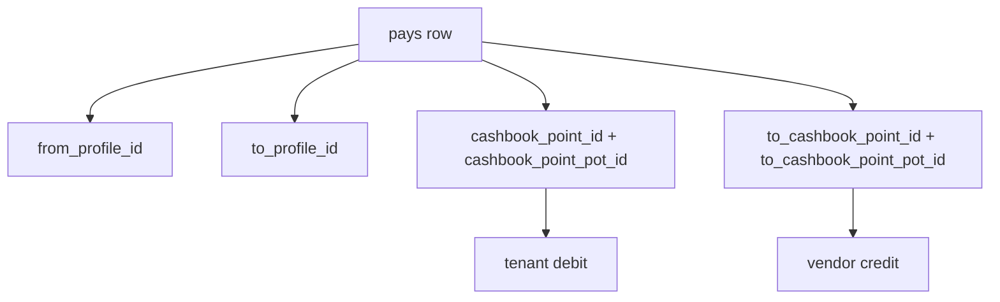

# Essential AP payout + dual cashbook legs

## API identity — money spine, not a wrapper

| Layer | Role |
| :--- | :--- |
| **Spine writer (canonical)** | [`post_ap_payout_with_allocations`](supabase/schemas/bills_pays/15_pay_payout_alloc.sql) + `_snapshot` — bill allocations, profiles, instruments, FX, **dual cashbook legs**, dual ledger, optional atomic prefund |
| **Procurement adapter (legacy)** | [`post_shipment_ap_money_out*`](supabase/schemas/bills_pays/07_shipment_money_wrappers.sql) — lock/assert then delegate; **not** used from bill desk after this work |
| **Generic router** | [`post_money_out`](supabase/schemas/bills_pays/05_money_spine.sql) — thin delegate to AP writer for `ap_payout` |

Dual entry is **inside the spine writer** (two `record_ledger_transaction` calls + one `pays` row), not a second feature RPC.

Shipment rules (`_assert_shipment_ap_allocations_payable`, advisory lock) run **inside** the spine writer when allocations reference `shipment_cost` bills — still no `p_shipment_ids` on the client.

## User intent

When recording AP pay (e.g. **AP-2611-0008**):

1. **Profiles**: `from` (tenant) and `to` (vendor) — no redundant `p_profile_id` when both set.
2. **Bill-only API**: `p_allocations` only — no client `p_shipment_ids` ([kernel_only routing](essential_ap_payout_dual_cashbook)).
3. **Cashbook**: For **each** profile, show every **point + pot** as selectable **chips** (`Office — BDT`), pick **one from** and **one to**, send ids in payload.
4. **Ledger** (chosen): **dual** — debit **from** pot (tenant), credit **to** pot (payee profile) at **source** amount/currency.
5. **Insufficient from-pot**: staff may lack cash in the selected **from** pot. **Atomic compose** (chosen): optional `p_from_prefund_amount` tops up that pot in the **same transaction** as the payout, then debit + payee credit + bill alloc run.
6. **Cache**: reuse Vue Query for points/pots/balances on chips; invalidate after pay (and optimistically after prefund in same response).

## Data model



| Column / param | Semantics |
| :--- | :--- |
| Existing `pays.cashbook_point_id` / `cashbook_point_pot_id` | **From** leg (cash leaves payer) |
| New `pays.to_cashbook_point_id` / `to_cashbook_point_pot_id` | **To** leg (cash arrives at payee pot) |
| RPC `p_from_cashbook_point_id` / `p_from_cashbook_point_pot_id` | Preferred names; default from legacy `p_cashbook_point_id` when omitted |
| RPC `p_to_cashbook_point_id` / `p_to_cashbook_pot_id` | Required for AP when dual-ledger enabled |

Resolve payee ledger axes: [`_kernel_cashbook_axes_for_profile`](supabase/schemas/bills_pays/20_cashbook_profile_spine.sql) from `p_to_profile_id`.

## Backend

### Schema ([`02_tables.sql`](supabase/schemas/bills_pays/02_tables.sql))

- Add nullable `to_cashbook_point_id`, `to_cashbook_point_pot_id` on `pays` + indexes/FKs mirroring from leg.

### Writer ([`15_pay_payout_alloc.sql`](supabase/schemas/bills_pays/15_pay_payout_alloc.sql))

- Params: `p_from_cashbook_point_id` / `p_from_cashbook_point_pot_id` (optional aliases of current point params), `p_to_cashbook_point_id`, `p_to_cashbook_point_pot_id`.
- Require both legs for `ap_payout` (or when `p_to_profile_id` is custody class).
- Validate pots sit on accounts for `from_profile_id` / `to_profile_id` (join `cashbook_point_pots` → `cashbook_points` → `cashbook_accounts.profile_id`).
- `_kernel_lock_cashbook_point_pots` on **both** points.
- Insert pay with both pot ids.
- **Prefund (same transaction, before debit)** when `p_from_prefund_amount > 0`:
  - Credit **from** pot: `record_ledger_transaction` credit on tenant axes, `p_cashbook_point_pot_id` = selected from pot, `source_type` `ap_payout_prefund`, same `pays.id` in metadata (or staging id before pay insert — order: lock pots → optional prefund credit → insert pay → debit → credit to → allocations).
  - `p_from_prefund_amount` must be ≥ shortfall: `max(0, source_debit_amount - pot.amount)` when `allow_overdraft` is false.
- **Debit** from pot: tenant debit at **source** amount/currency; **`p_allow_overdraft => false`** when explicit `p_from_cashbook_point_pot_id` set (enforces real pot cash after prefund).
- **Credit** payee to pot: second ledger on payee axes from `_kernel_cashbook_axes_for_profile(p_to_profile_id)` with explicit **`p_cashbook_point_pot_id`** (requires [`record_ledger_transaction`](supabase/schemas/bills_pays/12_cashbook_wiring.sql) param — today pot id is often inferred from point + currency only).

**Today:** AP debit uses `p_allow_overdraft => true`, which can skip pot tracking when short ([`15_pay_payout_alloc.sql`](supabase/schemas/bills_pays/15_pay_payout_alloc.sql) ~347). This plan **tightens** that when staff pick a from-pot.

### Snapshot + previous plan items

- Optional `p_profile_id`; `p_from_profile_id` / `p_to_profile_id` / `p_description`; call `_assert_shipment_ap_allocations_payable` on allocations.
- [`post_ap_payout_with_allocations_snapshot`](supabase/database/schemas/public/functions/post_ap_payout_with_allocations_snapshot.sql): forward all new params.
- Web: **always** `post_ap_payout_with_allocations_snapshot` (no `post_shipment_ap_money_out_*` from bill desk).

### Reverse pay ([`11_pay_reverse.sql`](supabase/schemas/bills_pays/11_pay_reverse.sql))

- If pay has `to_cashbook_*`, post compensating **debit** on payee + **credit** on tenant (mirror AP payout).

## Frontend

### Load points/pots per profile

- By `profiles.id`: query `cashbook_accounts` where `profile_id = ?` (BDT), then existing [`listCashbookPoints`](web/src/modules/bills_pays/repositories/cashbookRepository.ts) + [`useCashbookPointPotsBatchQuery`](web/src/modules/bills_pays/composables/useCashbookPointPotsQuery.ts).
- If no account: `ensure_cashbook_account_for_profile` is server-side on first pay — UI may show empty until account exists (or call read that triggers ensure via profile bundle).

### UI — [`RecordBillPaymentDialogPanel.vue`](web/src/modules/bills_pays/components/RecordBillPaymentDialogPanel.vue)

Replace single AP “pay from” dropdown with two sections:

| Section | Profile | Control |
| :--- | :--- | :--- |
| **From** | `bill.to_profile_id` (tenant) | Chips: `{point.name} — {currency} · {pot.amount}`; one selected |
| **To** | `bill.from_profile_id` (vendor) | Same chip pattern (credit leg — balance display optional) |

- Extract `CashbookLegPotChips.vue` (props: `profileId`, `booksTenantId`, `modelValue`).
- **Cache**: [`useCashbookPointPotsBatchQuery`](web/src/modules/bills_pays/composables/useCashbookPointPotsQuery.ts) + `cashbookQueryKeys` with `staleTime` (align [`useCashbookEntitiesQuery`](web/src/modules/bills_pays/composables/useCashbookEntitiesQuery.ts) pattern); include `amount` in pot select; invalidate root cashbook keys on successful payout snapshot.
- **Shortfall UX**: compare selected from-pot `amount` to instrument **source** total; if low, show field **“Add cash to this pot”** defaulting to shortfall; map to `p_from_prefund_amount` on submit (single RPC, no separate deposit pay row).
- Default selection: account `default_cashbook_point_pot_id` when present; else first BDT pot (same as [`useCashbookPayFromPotSelect`](web/src/modules/bills_pays/composables/useCashbookPayFromPotSelect.ts)).
- Submit validation: both legs chosen; **to** pot currency should match **from** pot for v1 (or show error if mismatched with FX pay).
- Map bill paper → pay direction: `from_profile_id = bill.to_profile_id`, `to_profile_id = bill.from_profile_id`.

### Service ([`apPayoutService.ts`](web/src/modules/bills_pays/services/apPayoutService.ts))

Payload fields:

```json
{
  "p_tenant_id": 15,
  "p_from_profile_id": 73,
  "p_to_profile_id": 78,
  "p_from_cashbook_point_id": 16,
  "p_from_cashbook_point_pot_id": 23,
  "p_from_prefund_amount": 0,
  "p_to_cashbook_point_id": "<vendor point>",
  "p_to_cashbook_point_pot_id": "<vendor pot>",
  "p_settlement_currency_code": "GBP",
  "p_foreign_amount": 4695,
  "p_exchange_rate": 166,
  "p_source_currency_code": "BDT",
  "p_transaction_rate": 166,
  "p_allocations": [{ "bill_id": 99, "amount": 4695 }],
  "p_instruments": [{ "payment_method_code": "bank_transfer", "amount": 779370, "cashbook_point_id": 16 }]
}
```

(No `p_profile_id`, no `p_shipment_ids`.)

## Docs

- [`money-spine.md`](docs/features/bills_pays/money-spine.md): AP spine writer = dual profile + dual pot + dual ledger + optional atomic from-prefund; writers table lists params.
- [`money/spec.md`](docs/features/money/spec.md): one-line PR checklist for new payout params and no overdraft-on-implicit-pot when from-pot explicit.
- Thin UI note in [`tests.md`](docs/features/bills_pays/tests.md) or golden test for dual entry.

## Out of scope

- Collect / customer receipt dual-leg UI (AP bill payment first).
- `post_shipment_ap_money_out` deprecation cleanup (legacy SQL only).
