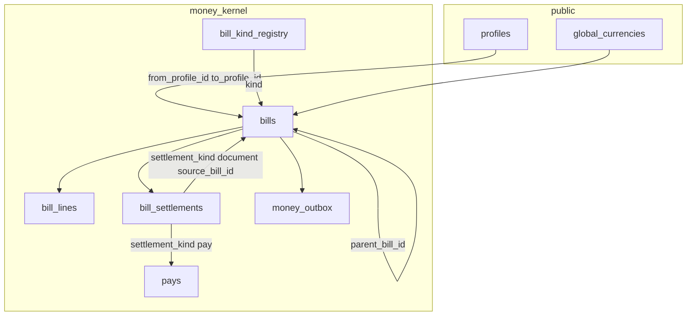

# Bills — spec

## Status

| | |
| :--- | :--- |
| **What** | Obligation paper: issue, lines, credit notes, write-off. **No** live cash balance. |
| **SQL** | `supabase/schemas/money_kernel_v2/` — schema `money_kernel` (shared with money until physical split) |
| **UI** | `web/src/modules/sales_invoice/` · AP desks |
| **Not here** | Cash bundles, `rpc_pay_bills` cash legs — [money](../money/spec.md), [bridge](../money_bill_bridge/spec.md) |
| **System map** | [bridge § Atlas](../money_bill_bridge/spec.md#atlas) |

**Paper truth:** `money_kernel.bills.due_amount`, `paid_amount`, `written_off_amount`, `status`. Cash truth is [money](../money/spec.md).

**Target:** no **`bill_events`** table — history comes from `bills` + `bill_settlements` (+ linked `pays`). **Live SQL** still has `bill_events` / `v_bill_events` until cutover migration.

---

## What it is

A **bill** is who owes whom how much, in which currency, with frozen lines after issue. **Settlements** record satisfaction:

| `settlement_kind` | Meaning |
| :--- | :--- |
| `pay` | Cash via `money_kernel.pays` — orchestrated by [bridge](../money_bill_bridge/spec.md) |
| `document` | Credit note applied onto another bill — **no** cash |

**Parties:** `from_profile_id` = debtor, `to_profile_id` = creditor. **AR:** from = customer, to = **tenant self-profile**. **AP:** from = tenant self-profile, to = vendor (`cashbook_enabled=false` — no vendor wallet; obligation stays on the bill).

**Currency:** `currency_code` / target `currency_id` → `public.global_currencies` ([money spec](../money/spec.md)) — not `money_kernel.currencies` at cutover.

Modules call **`public.rpc_*` only**. No client DML on kernel tables.

---

## Data model (`money_kernel`)

**Tenant integrity:** composite FKs `(tenant_id, id)` on bills, lines, settlements; `tenant_id` immutable on update.

**DDL source of truth:** [`21_money_kernel_tables.sql`](../../../supabase/schemas/money_kernel_v2/21_money_kernel_tables.sql).

---

## What each table does

| Table | Does what |
| :--- | :--- |
| `public.profiles` | Names the debtor and creditor on every bill; not stored balances. |
| `public.global_currencies` | **Target** — which currencies bills may use (`symbol` for UI). |
| `bill_kind_registry` | Product catalog of bill types — controls numbering, meta rules, and whether cash pay is allowed. |
| `invoice_no_counters` | Hands out the next invoice number per tenant + prefix at issue time. |
| `bills` | **The obligation** — who owes whom, how much total / paid / due / written off, status, link back to shipment/order/etc. |
| `bill_lines` | Line items on the bill; frozen when the bill is issued. |
| `bill_settlements` | **Proof of satisfaction** — also the audit trail for pay/CN apply (amount, time, linked pay). |
| `money_outbox` | Optional machine feed for async consumers (not audit spine). |
| `money_kernel.pays` | Cash movement header when a settlement is `pay` — owned by [money](../money/spec.md); bills only hold the FK link. |

---

## Table schemas (fields)

Live `bills.currency_code` → `money_kernel.currencies` today; **target** → `public.global_currencies.id` ([money spec](../money/spec.md)).

### `money_kernel.bill_kind_registry`

| Field | Purpose |
| :--- | :--- |
| `kind` | PK — bill type key (`sales_invoice_wholesale`, `shipment_cost_ap`, `credit_note`, …) |
| `numbering_prefix` | Prefix for `invoice_no` at issue (e.g. `INV-WS`, `AP-SC`) |
| `default_status` | Status on create (usually `draft`) |
| `can_be_issued` | Whether `rpc_issue_bill` is allowed |
| `can_be_paid` | Whether cash `pay` settlements allowed (`false` for `credit_note`) |
| `required_meta` | Keys that must exist in `bills.meta` at issue |
| `description` | Human label for desk / RPC list |
| `is_active` | Hide retired kinds from `rpc_list_bill_kinds` |
| `created_at` | Row audit |

### `money_kernel.invoice_no_counters`

| Field | Purpose |
| :--- | :--- |
| `tenant_id` | Tenant scope (PK part) |
| `prefix` | Matches registry `numbering_prefix` (PK part) |
| `next_seq` | Next sequence; bumped by `rpc_allocate_invoice_no` at issue |

### `money_kernel.bills`

| Field | Purpose |
| :--- | :--- |
| `id` | Surrogate PK |
| `tenant_id` | RLS + composite FK parent |
| `kind` | FK → `bill_kind_registry.kind` |
| `status` | `draft` \| `issued` \| `partial` \| `paid` \| `voided` \| `written_off` |
| `invoice_no` | Null in draft; unique per tenant when set (at issue) |
| `request_hash` | Idempotency payload fingerprint (`idempotency_conflict` guard) |
| `invoice_date` | Document date on paper |
| `due_date` | When due is expected (AR/AP lists) |
| `from_profile_id` | Debtor — FK `profiles(tenant_id, id)` |
| `to_profile_id` | Creditor — FK `profiles(tenant_id, id)` |
| `counterparty_profile_id` | Desk “the other party” — must be `from` or `to` |
| `counterparty_tenant_id` | When counterparty is another tenant’s profile (rare cross-tenant) |
| `currency_code` | Bill currency (must match cash pay currency) |
| `total_amount` | Document total |
| `paid_amount` | Sum satisfied by settlements |
| `due_amount` | Remaining collectible / payable |
| `written_off_amount` | Forgiven via `rpc_write_off_bill` |
| `parent_bill_id` | FK → parent bill (required for `credit_note`) |
| `source_entity` | Parent **table** name (e.g. `public.global_shipments`) — no FK |
| `source_type` | Module filter label (`shipment_cost`, `shop_order`, …) |
| `source_id` | Parent row PK as text |
| `source_key` | Discriminator (bucket+currency, delivery leg, …) |
| `idempotency_key` | Permanent per tenant create key |
| `meta` | Kind-specific json (`ap_kind`, `shipment_id`, retail flags, …) |
| `note` | Free text on header |
| `created_by` | Auth user uuid |
| `created_at` / `updated_at` | Audit |

**Checks:** amounts ≥ 0; unless `voided`, `paid + due + written_off = total`.

### `money_kernel.bill_lines`

| Field | Purpose |
| :--- | :--- |
| `id` | Surrogate PK |
| `tenant_id` | Composite FK with `bill_id` |
| `bill_id` | FK → `bills` |
| `line_no` | Stable order (unique per bill) |
| `item_kind` | Line type (`stock`, charge, …) |
| `product_id` | Optional product link |
| `description` | Line label on paper |
| `quantity` | Units |
| `unit_price` | Price per unit in bill currency |
| `line_total` | Extended amount (frozen at issue) |
| `shipment_item_id` | Optional procurement / invoice bridge |
| `global_stock_id` | Optional stock line |
| `shipment_id` | Denorm for shipment reports |
| `meta` | Line extras (`cost_component` on AP, …) |
| `created_at` | Audit |

**Rule:** immutable after bill issue; Σ `line_total` = `bills.total_amount` at issue.

### `money_kernel.bill_settlements`

| Field | Purpose |
| :--- | :--- |
| `id` | Surrogate PK |
| `tenant_id` | Composite FK scope |
| `bill_id` | FK → bill receiving allocation |
| `settlement_kind` | `pay` (cash) \| `document` (credit note apply) |
| `pays_id` | Required when `pay`; FK → `money_kernel.pays` |
| `source_bill_id` | Required when `document`; FK → credit note bill |
| `allocated_amount` | Cash/document amount in bill currency |
| `allocated_books_amount` | BDT books slice for this allocation |
| `idempotency_key` | Permanent per tenant when set |
| `request_hash` | Payload hash for idempotency |
| `created_by` / `created_at` | Audit |

**Bridge** creates `pay` rows; bills RPCs create `document` rows. Cash rules: [bridge/spec.md](../money_bill_bridge/spec.md).

### `money_kernel.money_outbox`

| Field | Purpose |
| :--- | :--- |
| `id` | Surrogate PK |
| `tenant_id` | Consumer filter |
| `xid` | Postgres transaction id for ordered poll |
| `event_type` | Feeder-specific type string |
| `payload` | Delivery body |
| `bill_id` | Optional link for bill lifecycle events |
| `created_at` | Insert time |

---

## Locked decisions (paper)

| Topic | Rule |
| :--- | :--- |
| Create / issue | `rpc_create_bill` → always `draft`; issue via `auto_issue` or `rpc_issue_bill`; `total_amount > 0` at issue |
| Invoice number | Null on draft; allocated at issue only (`rpc_allocate_invoice_no` internal) |
| Credit note | Bill with swapped parties vs parent; apply via **`rpc_apply_document_settlement`** only — never `rpc_pay_*` on CN |
| CN apply | Target must share party pair (`target.from = CN.to`, `target.to = CN.from`); partial OK |
| Debit note | Normal bill; cash pay only |
| Document idempotency | `bill_settlements.idempotency_key` unique per tenant when set |
| Write-off | `rpc_write_off_bill` on remaining due; no write-off on CN (void or apply) |
| Void bill | Refuse if bill sits on **multi-bill** pays — void pays first ([bridge](../money_bill_bridge/spec.md)) |
| Lines | Immutable after issue (T8); totals freeze once any settlement exists |
| FX on bill pay | Payment pay: bill + cash share one currency; `exchange_rate=1`; FX first via `rpc_transfer_p2p` ([money](../money/spec.md)) |
| Feature parent | `source_entity` + `source_id` + `source_key` on bill row |

---

## Bill RPCs (this pack)

| RPC | Job |
| :--- | :--- |
| `rpc_create_bill` | Draft + lines payload; optional `auto_issue` |
| `rpc_issue_bill` | Draft → issued; lines frozen |
| `rpc_void_bill` | Void bill (settlement guards) |
| `rpc_write_off_bill` | Forgive remaining due |
| `rpc_apply_document_settlement` | Apply credit note to target bill |
| `rpc_void_document_settlement` | Undo one document apply |
| `rpc_allocate_invoice_no` | **Internal** — only from issue |

**Read:** `rpc_get_bill`, `rpc_query_bills` (cursor, `p_source_*` filters), `rpc_list_bill_kinds`.

**Views:** `v_bills_unified`, `v_bill_lines_unified` (drop `v_bill_events` with `bill_events` table).

Cash RPCs (`rpc_deposit`, `rpc_pay_bills`, …): [money](../money/spec.md) · [bridge](../money_bill_bridge/spec.md).

---

## Source plug (modules)

On `rpc_create_bill`:

| Field | Example |
| :--- | :--- |
| `source_entity` | `public.global_shipments`, `public.shop_orders`, … |
| `source_type` | `shipment_cost`, `shop_order`, `delivery_close`, … |
| `source_id` | Parent PK as text |
| `source_key` | Discriminator (AP bucket + currency, delivery `take` / `condition`, …) |

`kind` (invoice vs AP) and `source_type` (which module) are **different** fields.

**List for parent:** `rpc_query_bills` with matching `p_source_*`, or legacy desk merge until cutover.

**Do not call:** direct DML on bills; `rpc_allocate_invoice_no` from feature code.

---

## Shipment cost AP (Option A) {#shipment-cost-ap}

**Target:** International **Costs** tab edits draft `shipment_cost_ap` kernel bills; **Issue** locks; drop `global_shipment_cost_entries` after cutover (no dual-write).

| Layer | Stored |
| :--- | :--- |
| Bucket (material, freight, …) | `bills.meta.ap_kind` + `global_shipments.buckets` index |
| Bill | `money_kernel.bills` (many per bucket, many currencies) |
| Line / component | `bill_lines` + `meta.cost_component` |

**`source_key`:** e.g. `material:GBP` — one bill per bucket/currency combo. **Actions:** Add bill → `rpc_create_bill`; Issue → `rpc_issue_bill`; delete draft → `rpc_void_bill`; lock costs → batch issue drafts.

**Interim:** per-row `issue_shipment_cost_entry_ap_v2` → `rpc_create_bill` + cost entry stamp — retire under Option A.

Procurement detail: [procurement spec](../procurement_stock/spec.md) · gap [PS35](../procurement_stock/00-gaps.md).

---

## Security (summary)

| Rule | Detail |
| :--- | :--- |
| EXECUTE | `REVOKE` money `rpc_*` from `PUBLIC`, `anon`; grant `authenticated` + `assert_kernel_money_access` |
| Bill writes | `rpc_create_bill` / issue / void / write-off / document settle — module grants on action |
| Tables | No `authenticated` DML on `money_kernel.bills` / lines / settlements |
| Internal | `rpc_allocate_invoice_no` — deny to clients |

Full matrix: grep `assert_kernel_money_access` in `money_kernel_v2/`.

---

## Invariants (paper)

| Id | Rule |
| :--- | :--- |
| I8 | `bills.kind` in registry |
| I9 | `total = sum(lines)` at issue |
| I10–I11 | Non-negative; `paid+due+written_off=total` unless voided |
| I12–I13 | Structural cols / totals frozen after issue or settle |
| I14 | `paid` / `due` / `status` from triggers + RPCs |
| I17 | Document apply: source remaining ≥ alloc; target due ≥ alloc |
| I18 | Both party profiles required to issue |
| I25 | CN parties = swap of parent |
| I33 | Σ non-voided CN totals ≤ parent total |
| I34 | Lines immutable after issue |

Cash invariants (I5, I7, …): [money/spec.md](../money/spec.md).

---

## Change feed (optional)

If needed, consumers poll `money_kernel.money_outbox` by `xid` (at-least-once). Rows written from bill lifecycle RPCs — not a substitute for `bill_settlements` truth.

**Bill history in UI:** `rpc_get_bill` / detail — use header `status`, `updated_at`, `created_by`, and settlement list (no event table).

---

## Gaps {#gaps}

| ID | Type | Plan / doc | Code today | Fix |
| :--- | :--- | :--- | :--- | :--- |
| B1 | not_built | Shipment AP on kernel bills | Adjunct Option A in this spec | Costs tab + drop `global_shipment_cost_entries` |
| B2 | doc_wrong | Desk dual-read legacy + kernel | `list_bills_desk_page` merge | [bills_pays/00-gaps.md](../bills_pays/00-gaps.md) |
| B3 | sql_split | Logical bills owner | DDL in `money_kernel_v2` | Future schema split |
| B4 | cutover | Drop `bill_events` | Table + T5/T6 triggers + `v_bill_events` | Migration; remove event includes from `rpc_get_bill` |

---

## Legacy cutover {#legacy-cutover}

**Do not drop** until [bills_pays/00-gaps.md](../bills_pays/00-gaps.md) blockers clear.

| Legacy | v2 |
| :--- | :--- |
| `pay_allocations` | `bill_settlements` |
| `post_money_in` / `out` | `rpc_deposit` / `rpc_withdraw` |
| `upsert_draft_bill` / `issue_bill` | `rpc_create_bill` / `rpc_issue_bill` |
| `cashbook_entries` | pays + bundles ([money](../money/spec.md)) |
| `sales_invoice_counters` | `invoice_no_counters` |
| `bill_events` | **Drop** — use settlements + bill header |

**Backfill:** [07-backfill-cutover.sql](07-backfill-cutover.sql). **SQL cutover notes:** `supabase/schemas/bills_pays/99_legacy_kernel_cutover.sql`.

---

## PR checklist

- [ ] Bill paths use kernel RPCs only (no direct DML)
- [ ] CN never paid with cash RPCs
- [ ] Source plug set for feature-originated bills
- [ ] Bridge tests if settlement rules change — [bridge/spec.md § Test matrix](../money_bill_bridge/spec.md#test-matrix)
