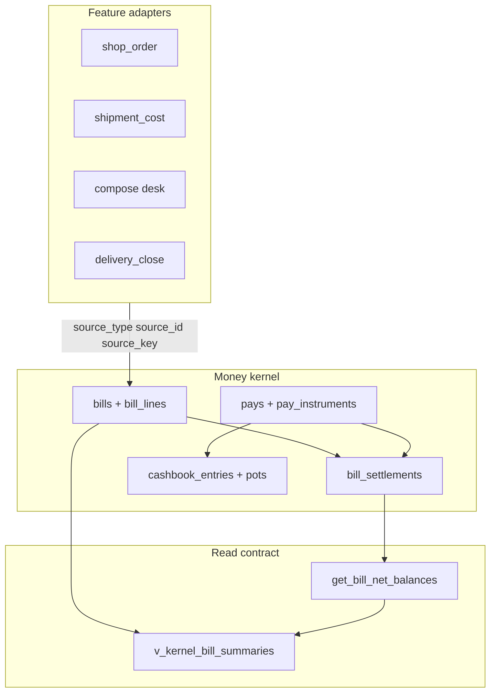
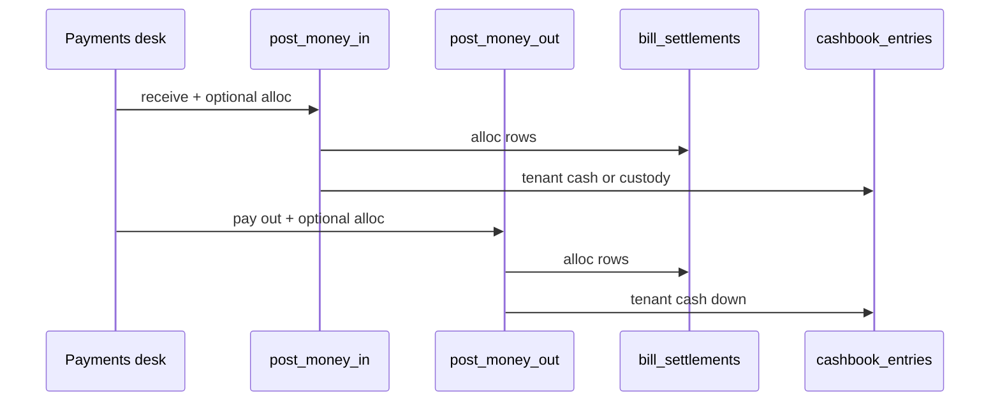

# Bills & pays — feature map (target)

**Job:** One **money kernel** per tenant. Shop orders, shipments, compose, delivery close **plug in** — they do not own bills or pays.

**Not:** a second invoice table, a “wallet” product, full GL, delivery proforma, packing-slip COD as sales, Koba/thrift ledgers.

---

## Agent read order

| Order | Doc | Use when |
| :--- | :--- | :--- |
| 1 | **This file** | Mental model, graphs, boundaries |
| 2 | [kernel-schema.md](kernel-schema.md) | Tables, columns, target RPC names, lock order |
| 3 | [REFERENCE](../../kernel/REFERENCE.md) | Money PR invariants (1–20) |
| 4 | [money-story.md](money-story.md) | Worked numbers (wholesale, dropship, shipment AP) |
| 5 | [tests.md](tests.md) | Golden scenarios + what to assert |
| 6 | [spec.md](spec.md) | Desk routes, scope in/out, rename map to live DB |
| 6b | [bills-desk.md](bills-desk.md) | Bills desk pages, RPCs, stores (as-built UI) |
| 7 | [00-gaps.md](00-gaps.md) | Only when you need live vs target delta |

Live SQL: grep `supabase/schemas/bills_pays/`. UI: `web/src/modules/bills_pays/`.

---

## Layers (always this order)

```text
profile  →  bill (paper)  →  bill_settlements  →  pay (cash event)  →  cashbook (where cash sat)
```

| Layer | Question it answers | Main tables |
| :--- | :--- | :--- |
| **Profile** | Who is the money party? | `profiles` |
| **Bill** | What paper exists (owed / we owe)? | `bills`, `bill_lines` |
| **Settlement** | What reduced the bill? | `bill_settlements` (pay, credit note, custody apply) |
| **Pay** | What cash moved, with whom? | `pays`, `pay_instruments` |
| **Cashbook** | Which till/safe/pot and books amount? | `cashbook_entries`, `cashbook_point_pots`, `cashbook_points` |

**Custody** = profile cashbook (customer/vendor advance), not tenant drawer cash.

---

## System graph



Features **never** `INSERT` kernel tables. They call **SECURITY DEFINER** RPCs with `assert_kernel_money_access`.

---

## Bill: two independent axes

```mermaid
stateDiagram-v2
  direction LR
  state lifecycle {
    draft --> issued --> voided
  }
```

```mermaid
stateDiagram-v2
  direction LR
  state settlement {
    unpaid --> partial --> settled
    partial --> unpaid: reverse_pay
    settled --> partial: reverse_pay
  }
```

| Axis | Column / source | Meaning |
| :--- | :--- | :--- |
| **Lifecycle** | `bills.status` | `draft` → `issued` → `voided` (guarded) |
| **Settlement** | derived from `bill_settlements` | `unpaid` / `partial` / `settled` — not stored as “paid” on lifecycle |

**Rules:** Issued bill face (`total_amount`, parties, txn currency) is **immutable** — fix with **credit_note** / **debit_note** child rows (`parent_bill_id`). `reverse_pay` only moves settlement; lifecycle stays `issued`.

---

## Direction: who owes whom

Derived from profiles — **do not** use `invoice_type`.

| If tenant profile is… | Direction | Staff action |
| :--- | :--- | :--- |
| `from_profile_id` | **They owe** (AR) | Collect |
| `to_profile_id` | **We owe** (AP) | Pay out |

Print **From** / **To** blocks use `from_profile_id` / `to_profile_id`. COD recipient is **not** from/to — adapter `channel_meta` only.

---

## Plug-in: how features attach

One **standard** bill per adapter slice (partial unique on `source_*`, void excluded):

| Field | Example |
| :--- | :--- |
| `source_type` | `shop_order`, `shipment_cost`, `compose`, `delivery_close`, `commission` |
| `source_id` | order id, shipment id, bill id |
| `source_key` | `freight:GBP`, courier AP slice, optional |

**No new FK** from shop_order / shipment → `bills`. Discovery = `list_bills_for_source(source_type, source_id)`.

---

## Pay flows (one writer family)



| Flow | Typical `pays.source` | Alloc? | Overflow |
| :--- | :--- | :--- | :--- |
| Customer collect | `customer_cash` / `bank` | → AR bills | profile custody |
| Courier remittance | `courier_remittance` | → merchant AR | merchant custody |
| AP vendor payout | `ap_payout` | → AP bills | vendor custody |
| Merchant profit | `commission` via `post_money_out` | no alloc to AR | custody draw |

**Idempotency:** `pays.idempotency_key` per tenant — duplicate POST returns same pay.

---

## Settlement kind (stock AR only)

| `settlement_kind` | Sales recognized | Bill stays due until… |
| :--- | :--- | :--- |
| `take` | At **issue** | collected |
| `condition` | When **paid** | paid (unpaid ≠ firm sale) |

Walk-in: `take` only. AP / fee bills: `null`.

---

## Three desks (product)

| Desk | User job | Target behavior |
| :--- | :--- | :--- |
| **Bills** | Create paper, issue, void, print, CN/DN | Modular compose: stock optional; lines = stock / description / charge |
| **Payments** | Receive or pay out; alloc optional | One dialog: instrument or cashbook; same RPCs for collect, remittance, AP |
| **Cashbook** | Audit pots, custody, leftover | Append-only entries; pots by place × currency |

Warehouse **FIFO** runs in the **feature** before `issue_bill` — not inside the kernel.

---

## Target write RPCs

| RPC | Job |
| :--- | :--- |
| `upsert_draft_bill` / `issue_bill` / `void_bill` | Paper + lines + source plug |
| `create_bill_adjustment` / `issue_bill_adjustment` | CN/DN child |
| `post_money_in` / `post_money_out` | Pay + optional settlements + cashbook |
| `apply_settlement_to_bill` | Custody or open CN → another bill |
| `reverse_pay` | Unwind pay; bill stays issued |
| `get_bill_net_balances` | Face ± notes − settlements |
| `list_*_for_source` / `v_kernel_bill_summaries` | Lists without feature-side alloc math |

---

## Concurrency (writers must follow)

1. Advisory lock `shipment_money:{shipment_id}` for AP sync + payout on same shipment  
2. `bills` `FOR UPDATE` (ids ascending) before alloc  
3. Pots `FOR UPDATE` order: `cashbook_point_id`, `currency_code`  

Detail: [kernel-schema §0b](kernel-schema.md).

---

## Golden paths (numbers)

| Story | Doc |
| :--- | :--- |
| Wholesale take + overpay | [money-story § Wholesale](money-story.md) |
| Dropship COD ≠ sales, remittance, merchant 620 | [money-story § Dropship](money-story.md) · [tests A](tests.md) |
| Shipment AP buckets + FX on pay | [money-story § AP](money-story.md) · [tests B](tests.md) |

Automated asserts: [tests.md](tests.md) (target columns: `status`, `from_profile_id`, `to_profile_id`, `source_*`).

---

## Adapter cheat sheet

| Feature | `source_type` | `source_key` (if any) |
| :--- | :--- | :--- |
| POS / manual bill | `compose` | — |
| Dropship order | `shop_order` | merchant bill / courier AP |
| Inbound shipment cost | `shipment_cost` | `{bucket}:{currency}` — wiring map: [procurement money-kernel-wiring.md](../procurement_stock/money-kernel-wiring.md) |
| Commission payout | `commission` | order id |
| Delivery close | `delivery_close` | paper id |

Shipment AP: **one issued bill per bucket × currency**; after issue, commercial change = CN only.
