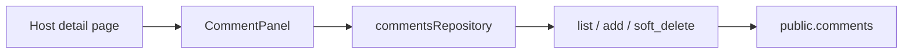

# Comments kernel — spec

## As-built

| | |
| :--- | :--- |
| Spec | `docs/features/comments/spec.md` |
| UI | `web/src/modules/comments/` (kernel; no routes until a host mounts) |
| SQL | `supabase/schemas/comments/` (`02_tables`, `03_rpcs`, `04_rls`) |
| Model | Cross-cutting — any tenant-scoped record |
| State | Vue Query — list query + add/delete mutations |
| Access | Tenant membership; host surface gates visibility (not a standalone `modules` hub entry in v1) |

## Where to look

| Need | Path |
| :--- | :--- |
| Tables, RPCs, RLS | `supabase/schemas/comments/` |
| Panel + repository | `web/src/modules/comments/components/CommentPanel.vue`, `repositories/commentsRepository.ts` |
| Query keys | `web/src/modules/comments/shared/queryKeys/commentsQueryKeys.ts` |
| Wiring | Grep `list_comments`, `add_comment`, `soft_delete_comment` |
| Prior art (do not copy) | Legacy tasks `comments` (`item_id`) — dropped in `20261124255400_drop_tasks_module.sql` |
| Polymorphic pattern | Same attachment shape as `entity_tags`: `entity_type` + `entity_id` (text) |

## Scope

| | |
| :--- | :--- |
| Surfaces | None in v1 — **host detail pages** mount `CommentPanel` later (`app` first) |
| In | `public.comments` table, three RPCs, RLS, reusable `CommentPanel`, repository, composables |
| Out | Host-module integration, rich text, edit, threaded replies, @mentions, attachments, notification enqueue, separate inbox UI |

See [scopes](../../architecture/scopes.md).

## What / who

Staff and other tenant members leave **plain-text notes** on a domain record (bill, order, shipment, etc.) without changing that record’s primary fields. The kernel does not own the host entity — it only stores `(tenant_id, entity_type, entity_id)` plus body and author metadata.

| Role | Actions |
| :--- | :--- |
| Tenant member (can view host) | List comments for the entity; add a comment |
| Comment author | Soft-delete own comment |
| Platform / parent admin | Same as member via tenant RLS helpers (no cross-tenant reads) |

## Rules (only what is not in `docs/README.md`)

- **Plain text only** in v1: store `body` as `text`; no HTML, no TipTap; UI uses `q-input` / `textarea`.
- **Polymorphic attachment:** `entity_type` (stable string agreed by host, e.g. `bill`, `shop_order`) and `entity_id` (`text`, so bigint/uuid hosts stringify). **No FK** to host tables.
- **Tenant scope:** every row has `tenant_id`; RPCs lead with `p_tenant_id`.
- **Writes via RPCs** only (`add_comment`, `soft_delete_comment`); list may use RPC or guarded `SELECT` under RLS.
- **Soft delete:** `deleted_at` set by RPC; `list_comments` omits deleted rows; no hard delete in v1.
- **No edit** in v1; author deletes and re-adds if needed.
- **Author:** `created_by` = `public.current_user_email()` on insert; delete allowed only when `created_by` matches caller (staff with elevated policy deferred).
- **Ordering:** list returns `created_at ASC` (oldest first).
- **Do not revive** old tasks-module `comments.item_id` model.

### Target schema (implementation phase)

| Column | Type | Notes |
| :--- | :--- | :--- |
| `id` | `bigserial` | PK |
| `tenant_id` | `bigint` | NOT NULL |
| `entity_type` | `text` | NOT NULL |
| `entity_id` | `text` | NOT NULL |
| `body` | `text` | NOT NULL, trimmed non-empty |
| `created_by` | `text` | NOT NULL, default `current_user_email()` |
| `created_at` | `timestamptz` | NOT NULL |
| `updated_at` | `timestamptz` | NOT NULL |
| `deleted_at` | `timestamptz` | NULL |

Index: `(tenant_id, entity_type, entity_id)` partial `WHERE deleted_at IS NULL`.

### Target RPCs

| RPC | Purpose |
| :--- | :--- |
| `list_comments(p_tenant_id, p_entity_type, p_entity_id)` | Active comments for one entity |
| `add_comment(p_tenant_id, p_entity_type, p_entity_id, p_body)` | Insert; returns new row |
| `soft_delete_comment(p_tenant_id, p_comment_id)` | Sets `deleted_at`; author-only |

### Target web layout

```
web/src/modules/comments/
  types/index.ts
  repositories/commentsRepository.ts
  shared/queryKeys/commentsQueryKeys.ts
  composables/useCommentsQuery.ts
  composables/useCommentMutations.ts
  components/CommentPanel.vue
```

`CommentPanel` props: `entityType`, `entityId`. Optional: `readonly`, `emptyLabel`.

Host usage (later): `<CommentPanel entity-type="bill" :entity-id="String(billId)" />` inside an existing detail page that already enforces grants.



## Stories

### US-1: List comments for an entity
- Given `tenant_id`, `entity_type`, `entity_id`, return non-deleted comments with author and timestamp.
  - [x] `list_comments` validates tenant membership.
  - [x] Response includes `id`, `body`, `created_by`, `created_at`.
  - [x] Sorted `created_at ASC`.
  - [x] Empty list is valid (no error).

### US-2: Add plain-text comment
- User submits non-empty trimmed text from `CommentPanel`.
  - [x] `add_comment` rejects empty/whitespace-only body.
  - [x] Sets `created_by` from session.
  - [x] Panel invalidates list query on success.
  - [x] Errors surface via standard app notify pattern.

### US-3: Soft-delete own comment
- Author may remove their comment from the thread.
  - [x] `soft_delete_comment` sets `deleted_at` only for matching `id`, `tenant_id`, and `created_by`.
  - [x] Non-authors receive permission error.
  - [x] Deleted rows never appear in `list_comments`.

### US-4: Host module mounts the panel (deferred)
- A future feature (bills, shop orders, thrift, etc.) embeds `CommentPanel` on its detail page.
  - [ ] Host defines stable `entity_type` string documented in that feature’s spec.
  - [ ] Host passes stringified `entity_id`.
  - [ ] Host page access rules remain the gate; comments kernel does not add a new grant module in v1.