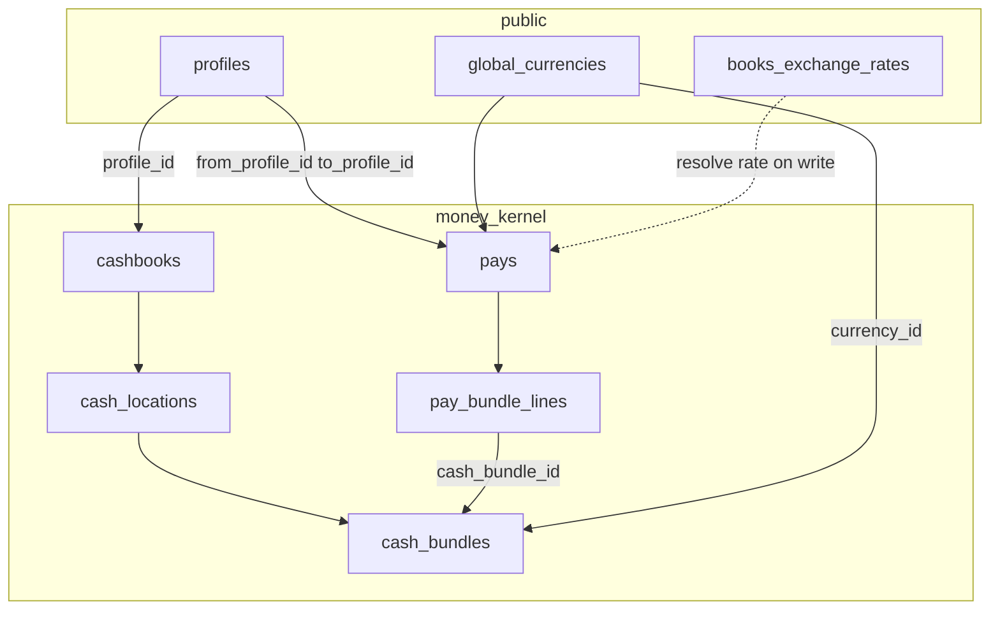

# Money — spec

## Status

| | |
| :--- | :--- |
| **What** | Where cash lives and how it moves (cashbooks, bundles, pays). |
| **Target SQL** | `supabase/schemas/money_kernel_v2/` — schema `money_kernel` (cutover: lots → bundles) |
| **UI** | `web/src/modules/wallet/` · bundle legs on collect/AP pay ([bridge](../money_bill_bridge/spec.md)) |
| **Not here** | Bill due, settlements — [bills](../bills/spec.md), [bridge](../money_bill_bridge/spec.md) |
| **System map** | [bridge § Atlas](../money_bill_bridge/spec.md#atlas) |

**Cutover:** live code may still use `cashbook_account` / `cashbook_point` / `cashbook_lot` / `pay_lot_lines`. Behaviour below is the **target** model; table map at end.

---

## What it is

Every party is a **`public.profiles`** row. A wallet exists only when the profile has **`cashbook_enabled`** and a **`money_kernel.cashbooks`** row (provision creates location + bundles together — no second flag). Hierarchy:

```text
public.profiles → money_kernel.cashbooks → money_kernel.cash_locations → money_kernel.cash_bundles
money_kernel.pays → money_kernel.pay_bundle_lines → apply → money_kernel.cash_bundles.amount
```

**Money-kernel cash location** (`money_kernel.cash_locations`): physical or logical place within a cashbook (`main`, `bank-brac`, till bucket). No balance.

**Money-kernel cash bundle** (`money_kernel.cash_bundles`): balance row at a location — currency tranche + `drawer_group` + `books_rate` + `amount`.

A **pay** is one posted cash event: `deposit`, `withdrawal`, `transfer`, or `payment`. Staff work in **Pay** language; **`money_kernel.pay_bundle_lines`** are storage legs (one row per bundle debit/credit), not a separate product entity.

**Balance truth:** `money_kernel.cash_bundles.amount` changes only through **`money_kernel.pay_bundle_lines`** in the apply trigger (same role as today’s `fn_pays_apply` on lot lines).

**Books:** `books_rate` = BDT per 1 unit of bundle currency; copied onto each line. Server resolves rates from `public.books_exchange_rates`.

**`drawer_group`:** text on the bundle for UI grouping (e.g. till vs safe); **not** a table. Many bundles per location per currency at different `books_rate` values are allowed.

---

## Profiles (`public.profiles`)

Money, bills, and pays all key party identity through **`public.profiles`**, scoped by **`tenant_id`**.

**Uniqueness:** `(tenant_id, profile_type, subject_id)` — one profile per party. **`cashbook_enabled`** provisions cashbook + default location + BDT bundle. Party columns: grep `public.profiles` in `money_kernel_v2/`.

**Tenant self-profile:** `profile_type = tenant`, `subject_id = tenant_id`. Default payer/payee for treasury and AR pay-ins. Bootstrap via `rpc_provision_tenant_cashbook`.

| `profile_type` | `cashbook_enabled` (default) | Meaning |
| :--- | :---: | :--- |
| `tenant`, `customer`, `courier`, `investor` | true | Cashbook provisioned; locations and bundles on demand |
| `vendor`, `cargo`, `company` | false | Bills/pays party only; **no** `money_kernel.cashbooks` |

**Pays:** `from_profile_id` and `to_profile_id` on the header. Null on a side = external (bank, cash drawer handoff, anonymous). When `cashbook_enabled=false` on a profile, lines touch only the **other** side’s cashbook (e.g. debit tenant bundles; no credit row on vendor).

**Provision:** On insert/update of a profile with `cashbook_enabled`, server ensures cashbook + default location (`main`) + default BDT bundle (today: `trg_provision_kernel_cashbook_for_profile` → maps to cashbook provision after cutover).

**Not a profile:** `recipient_profiles` — delivery recipients without a wallet; dropship money stays on the **customer** (dropshipper) profile + bills.

**Dropship:** customer has wallet; recipient profile has none — bills only.

---

## Currencies (`public.global_currencies`)

Same catalog as stock/shop — not `money_kernel.currencies` (drop at cutover). New cash rows: **BDT, USD, GBP** only (`list_global_currencies`). Rates from `public.books_exchange_rates` — copied to bundle/line at write. Books base = BDT. Bill pay: one currency per payment pay ([bridge](../money_bill_bridge/spec.md)); FX first via `rpc_transfer_p2p`. Column DDL: grep `money_kernel_v2/`.

---

## Data model



`books_exchange_rates` is tenant-scoped; not an FK on bundle rows (rate copied to `books_rate` on bundle/line).

No drawer table. **DDL (target):** grep `supabase/schemas/money_kernel_v2/`; bill paper rules: [bills/spec.md](../bills/spec.md).

---

## What each table does

| Table | Does what |
| :--- | :--- |
| `public.profiles` | Party on pays and cashbooks — customer, tenant, vendor (no wallet), investor, … |
| `public.global_currencies` | Allowed currencies and symbols for bundles and pays. |
| `public.books_exchange_rates` | Tenant rate book used when **writing** a pay/bundle; rate is copied onto the row, not joined at read. |
| `money_kernel.cashbooks` | **Target** — one wallet container per profile with `cashbook_enabled`. |
| `money_kernel.cash_locations` | **Target** — where within that wallet (main, bank, till). |
| `money_kernel.cash_bundles` | **Target** — **the cash balance** — one FX tranche (currency + `books_rate` + `amount`). |
| `money_kernel.pays` | One cash event (deposit, withdraw, transfer, payment) between profiles or external. |
| `money_kernel.pay_bundle_lines` | **Target** — how a pay debits/credits each bundle (split-FX legs). |
| `money_kernel.cashbook_accounts` | **Live** — maps profile/entity to cashbook (→ `cashbooks`). |
| `money_kernel.cashbook_points` | **Live** — location under account (→ `cash_locations`). |
| `money_kernel.cashbook_lots` | **Live** — balance tranche (→ `cash_bundles`). |
| `money_kernel.pay_lot_lines` | **Live** — bundle legs (→ `pay_bundle_lines`). |

Bill paper and settlements: [bills/spec.md § What each table does](../bills/spec.md#what-each-table-does).

---

**Column DDL:** `supabase/schemas/money_kernel_v2/` (live names: `cashbook_accounts` / `points` / `lots` / `pay_lot_lines` — see [Legacy → target map](#legacy--target-map)).

## Write RPCs

All writes via `public.rpc_*` only. Signatures: grep `24_money_kernel_rpcs_write.sql`.

| RPC | Job |
| :--- | :--- |
| `rpc_deposit` | External in → credit bundle (`p_pot_id` or open tranche at `p_location_code`); idempotent |
| `rpc_withdraw` | Debit bundle → external out; reject if over balance |
| `rpc_transfer_same_profile` | Debit + credit bundles, same profile, same currency |
| `rpc_transfer_p2p` | Cross-profile transfer; FX per line (I22); not for bill pay FX |
| `rpc_provision_cashbook_currency` / `rpc_provision_tenant_cashbook` | Ensure cashbook + location + zero bundle |
| `rpc_void_pays` | Reverse posted pay if payee credit still available (I20) |

**`kind=payment`** pays come from [bridge `rpc_pay_bills`](../money_bill_bridge/spec.md) only — not deposit/withdraw.

---

## Read paths

| Need | RPC (names stable until cutover) |
| :--- | :--- |
| Currency pick list | **`list_global_currencies`** (replaces `list_money_kernel_currencies`) |
| Bundle balance | `rpc_get_pot_balance`, `rpc_get_pot_balances` → bundle ids |
| Ledger | `rpc_profile_transactions` |
| People / desk activity | `list_profile_activity_for_staff` — kernel `deposit` / `withdrawal` / `transfer` **and** `payment` (bill settlements). Kernel rows map to desk list fields: `amount` = BDT `books_amount`, `foreign_amount` = currency `amount` when `currency_code` ≠ BDT. |

---

## Invariants (cash)

| # | Rule |
| :---: | :--- |
| 1 | No client DML on `money_kernel.cash_bundles` / `pays` / `pay_bundle_lines` |
| 2 | Bundle `amount` only via apply on posted lines |
| 3 | Posted pays immutable except void |
| 4 | Transfer credit rounding (I22); `amount ≥ 0` on bundles |
| 5 | Lines’ bundles belong to the profile cashbook for that leg |
| 6 | `cashbook_enabled=false`: no `money_kernel.cashbooks`; pays never post bundle lines on that profile |

Bill rules: [bills/spec.md](../bills/spec.md).

---

## Legacy → target map

| Today | Target |
| :--- | :--- |
| `cashbook_account` | `money_kernel.cashbooks` |
| `cashbook_point` | `money_kernel.cash_locations` |
| `cashbook_lot` | `money_kernel.cash_bundles` |
| `pay_lot_lines` | `money_kernel.pay_bundle_lines` |
| `p_lot_debits` (bridge arg) | `p_bundle_debits` |
| `money_kernel.currencies` | `public.global_currencies` (FK by `id`; validate `code`) |
| `list_money_kernel_currencies` | `list_global_currencies` |

---

## PR checklist

Kernel RPCs only; bridge test matrix if apply logic changes.
