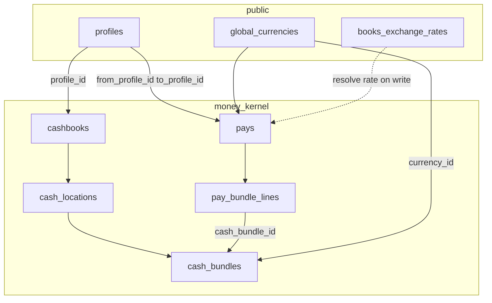

# Money — spec

## Status

| | |
| :--- | :--- |
| **What** | Where cash lives and how it moves (cashbooks, bundles, pays). |
| **Target SQL** | `supabase/schemas/money_kernel_v2/` — schema `money_kernel` (cutover: lots → bundles) |
| **UI** | `web/src/modules/wallet/` · bundle legs on collect/AP pay ([bridge](../money_bill_bridge/spec.md)) |
| **Not here** | Bill due, settlements — [bills](../bills/spec.md), [bridge](../money_bill_bridge/spec.md) |
| **System map** | [bridge § Atlas](../money_bill_bridge/spec.md#atlas) |

**Cutover:** live code may still use `cashbook_account` / `cashbook_point` / `cashbook_lot` / `pay_lot_lines`. Behaviour below is the **target** model; table map at end.

---

## What it is

Every party is a **`public.profiles`** row. A wallet exists only when the profile has **`cashbook_enabled`** and a **`money_kernel.cashbooks`** row (provision creates location + bundles together — no second flag). Hierarchy:

```text
public.profiles → money_kernel.cashbooks → money_kernel.cash_locations → money_kernel.cash_bundles
money_kernel.pays → money_kernel.pay_bundle_lines → apply → money_kernel.cash_bundles.amount
```

**Money-kernel cash location** (`money_kernel.cash_locations`): physical or logical place within a cashbook (`main`, `bank-brac`, till bucket). No balance.

**Money-kernel cash bundle** (`money_kernel.cash_bundles`): balance row at a location — currency tranche + `drawer_group` + `books_rate` + `amount`.

A **pay** is one posted cash event: `deposit`, `withdrawal`, `transfer`, or `payment`. Staff work in **Pay** language; **`money_kernel.pay_bundle_lines`** are storage legs (one row per bundle debit/credit), not a separate product entity.

**Balance truth:** `money_kernel.cash_bundles.amount` changes only through **`money_kernel.pay_bundle_lines`** in the apply trigger (same role as today’s `fn_pays_apply` on lot lines).

**Books:** `books_rate` = BDT per 1 unit of bundle currency; copied onto each line. Server resolves rates from `public.books_exchange_rates`.

**`drawer_group`:** text on the bundle for UI grouping (e.g. till vs safe); **not** a table. Many bundles per location per currency at different `books_rate` values are allowed.

---

## Profiles (`public.profiles`)

Money, bills, and pays all key party identity through **`public.profiles`**, scoped by **`tenant_id`**.

| Field (as-built + target) | Role in money |
| :--- | :--- |
| `id` | FK on `money_kernel.cashbooks.profile_id`, `money_kernel.pays.from_profile_id` / `to_profile_id`, bill counterparty fields |
| `tenant_id` | Which books tenant owns this profile |
| `profile_type` | `profile_party_type` enum — drives default cashbook flags (below) |
| `subject_id` | Underlying row id (`tenants.id` for tenant profile, `customers.id`, `vendors.id`, …) |
| `name`, `phone`, `email`, … | Desk display; not on ledger lines |
| **`cashbook_enabled`** (target) | If true, kernel provisions **`money_kernel.cashbooks`** + default **`money_kernel.cash_locations`** + default BDT **`money_kernel.cash_bundles`**; if false, no cashbook row and no bundles |

**Uniqueness:** `(tenant_id, profile_type, subject_id)` — one profile per party per tenant.

**Tenant self-profile:** `profile_type = tenant`, `subject_id = tenant_id`. Default payer/payee for treasury and AR pay-ins. Bootstrap via `rpc_provision_tenant_cashbook`.

| `profile_type` | `cashbook_enabled` (default) | Meaning |
| :--- | :---: | :--- |
| `tenant`, `customer`, `courier`, `investor` | true | Cashbook provisioned; locations and bundles on demand |
| `vendor`, `cargo`, `company` | false | Bills/pays party only; **no** `money_kernel.cashbooks` |

**Pays:** `from_profile_id` and `to_profile_id` on the header. Null on a side = external (bank, cash drawer handoff, anonymous). When `cashbook_enabled=false` on a profile, lines touch only the **other** side’s cashbook (e.g. debit tenant bundles; no credit row on vendor).

**Provision:** On insert/update of a profile with `cashbook_enabled`, server ensures cashbook + default location (`main`) + default BDT bundle (today: `trg_provision_kernel_cashbook_for_profile` → maps to cashbook provision after cutover).

**Not a profile:** `recipient_profiles` — delivery recipients without a wallet; dropship money stays on the **customer** (dropshipper) profile + bills.

**Dropship customer:** still `customer` with `cashbook_enabled=true`; recipient has no wallet — AR/supply flows use bills, not a second cashbook on the recipient profile.

---

## Currencies (`public.global_currencies`)

Money uses the **same global catalog** as stock, shipments, and shop — not a duplicate kernel table.

| Column | Meaning |
| :--- | :--- |
| `id` | PK — target FK on bundles and pays |
| `code` | Unique ISO-like code (`BDT`, `GBP`, `USD`) — joins `books_exchange_rates` |
| `symbol` | UI label (`৳`, `£`, `$`) |
| `name`, `country` | Display |
| `is_active`, `is_system` | Desk may list via `list_global_currencies`; only active rows for new money rows |

**Cutover (live SQL today):** `money_kernel.currencies` + `list_money_kernel_currencies` still exist. **Target:** drop kernel catalog; FK kernel rows to `global_currencies`; wallet/desk calls **`list_global_currencies`** (same as procurement).

| Where used | Field (target) |
| :--- | :--- |
| `money_kernel.cash_bundles` | `currency_id` → `global_currencies.id`; keep `currency_code` in sync with `code` for rates |
| `money_kernel.pays` | `currency_id` / `currency_code` on header (movement currency) |
| `money_kernel.pay_bundle_lines` | amount in bundle currency; `books_rate` / `books_amount` for BDT books |

**Books currency:** Reporting and `books_amount` on lines use **BDT** as base. **`books_rate`** on a bundle/line = BDT per **1 unit** of the bundle’s `currency_code` at the time the tranche opened or the line posted.

**Live FX pick:** `public.books_exchange_rates` — per `tenant_id`, pair `base_currency_code` (usually BDT) / `quote_currency_code`, `rate`, `rate_date`, `source`. Deposit and transfer RPCs **copy** the resolved rate onto the new bundle or line; they do not rewrite old tranches.

**Rules:**

- One pay settling a bill in currency X: debit bundles must be currency X (bridge); no mixed-currency single payment pay.
- Cross-currency **transfer** between two managed profiles: debit bundle in source currency, credit bundle in target currency; each line keeps its own `books_rate` / `books_amount`.

---

## Data model



`books_exchange_rates` is tenant-scoped; not an FK on bundle rows (rate copied to `books_rate` on bundle/line).

No drawer table. **DDL (target):** grep `supabase/schemas/money_kernel_v2/`; bill paper rules: [bills/spec.md](../bills/spec.md).

---

## What each table does

| Table | Does what |
| :--- | :--- |
| `public.profiles` | Party on pays and cashbooks — customer, tenant, vendor (no wallet), investor, … |
| `public.global_currencies` | Allowed currencies and symbols for bundles and pays. |
| `public.books_exchange_rates` | Tenant rate book used when **writing** a pay/bundle; rate is copied onto the row, not joined at read. |
| `money_kernel.cashbooks` | **Target** — one wallet container per profile with `cashbook_enabled`. |
| `money_kernel.cash_locations` | **Target** — where within that wallet (main, bank, till). |
| `money_kernel.cash_bundles` | **Target** — **the cash balance** — one FX tranche (currency + `books_rate` + `amount`). |
| `money_kernel.pays` | One cash event (deposit, withdraw, transfer, payment) between profiles or external. |
| `money_kernel.pay_bundle_lines` | **Target** — how a pay debits/credits each bundle (split-FX legs). |
| `money_kernel.cashbook_accounts` | **Live** — maps profile/entity to cashbook (→ `cashbooks`). |
| `money_kernel.cashbook_points` | **Live** — location under account (→ `cash_locations`). |
| `money_kernel.cashbook_lots` | **Live** — balance tranche (→ `cash_bundles`). |
| `money_kernel.pay_lot_lines` | **Live** — bundle legs (→ `pay_bundle_lines`). |

Bill paper and settlements: [bills/spec.md § What each table does](../bills/spec.md#what-each-table-does).

---

## Table schemas (fields)

**Cutover:** live SQL uses `cashbook_accounts` / `cashbook_points` / `cashbook_lots` / `pay_lot_lines` — same roles as target names in [Legacy → target map](#legacy--target-map).

### `public.profiles` (money-relevant)

| Field | Purpose |
| :--- | :--- |
| `id` | FK on cashbooks, pays, bills parties |
| `tenant_id` | Owner tenant |
| `profile_type` | Drives default `cashbook_enabled` |
| `subject_id` | Underlying entity id |
| `cashbook_enabled` | **Target** — provision cashbook when true |
| `name`, `phone`, `email` | UI only |

### `public.global_currencies`

| Field | Purpose |
| :--- | :--- |
| `id` | FK on bundles and pays (**target**) |
| `code` | ISO code; joins `books_exchange_rates` |
| `symbol` | Desk display |
| `name`, `country` | Labels |
| `is_active` | Exclude from new cash rows when false |
| `is_system` | Protect seed rows |

### `money_kernel.cashbooks` (target)

| Field | Purpose |
| :--- | :--- |
| `id` | PK |
| `tenant_id` | RLS |
| `profile_id` | Unique — one cashbook per enabled profile |
| `default_cash_bundle_id` | Default bundle for deposits / AR |
| `available_balance` | Optional cache (not spine truth) |
| `created_at` / `updated_at` | Audit |

### `money_kernel.cash_locations` (target)

| Field | Purpose |
| :--- | :--- |
| `id` | PK |
| `tenant_id` | Composite FK |
| `cashbook_id` | FK → `cashbooks` |
| `location_code` | Stable key (`main`, `bank-brac`, …) |
| `name` | Desk label |
| `is_active` | Soft-disable a location |
| `created_at` / `updated_at` | Audit |

### `money_kernel.cash_bundles` (target)

| Field | Purpose |
| :--- | :--- |
| `id` | PK |
| `tenant_id` | Composite FK |
| `cash_location_id` | FK → `cash_locations` |
| `currency_id` | FK → `global_currencies` |
| `currency_code` | Denorm for rates and UI |
| `drawer_group` | UI grouping (till vs safe); not a table |
| `books_rate` | BDT per 1 unit of currency when tranche opened |
| `amount` | **Balance truth** — only via `pay_bundle_lines` apply |
| `opened_pay_id` | Pay that opened this tranche (audit) |
| `created_at` / `updated_at` | Audit |

### `money_kernel.pays`

| Field | Purpose |
| :--- | :--- |
| `id` | PK |
| `tenant_id` | RLS + composite FK |
| `kind` | `deposit` \| `withdrawal` \| `transfer` \| `payment` |
| `from_profile_id` | Payer profile; null = external in |
| `to_profile_id` | Payee profile; null = external out |
| `amount` | Header amount in `currency_code` |
| `currency_code` | Movement currency (today FK `money_kernel.currencies`; target `global_currencies`) |
| `books_amount` | BDT books total on header |
| `books_rate` | Rate snapshot on header |
| `exchange_rate` | Cross-rate when needed (`1` on same-currency payment) |
| `payment_date` | Business date |
| `status` | `posted` \| `voided` |
| `voided_at` / `voided_by` | Void audit |
| `idempotency_key` | Permanent per tenant |
| `request_hash` | Idempotency payload guard |
| `from_balance_after` / `to_balance_after` | Snapshots after post (recon) |
| `refs` | Small json refs (rate id, source ids) |
| `meta` | Extra context |
| `created_by` / `created_at` / `updated_at` | Audit |

**Live:** `from_lot_id` / `to_lot_id` on header until profile-first cutover; multi-leg via `pay_lot_lines`.

### `money_kernel.pay_bundle_lines` (target; live: `pay_lot_lines`)

| Field | Purpose |
| :--- | :--- |
| `id` | PK |
| `tenant_id` | Composite FK |
| `pay_id` | FK → `pays` |
| `direction` | `debit` \| `credit` |
| `cash_bundle_id` | FK → `cash_bundles` (live: `lot_id`) |
| `amount` | Delta in bundle currency |
| `books_rate` | BDT rate copied on line |
| `books_amount` | BDT amount for this leg |
| `created_at` | Apply order / audit |

### Live today: `cashbook_accounts` → `cashbook_points` → `cashbook_lots`

| Table | Field | Purpose |
| :--- | :--- | :--- |
| `cashbook_accounts` | `entity_type`, `entity_id`, `profile_id` | Links account to profile / legacy entity |
| `cashbook_accounts` | `default_cashbook_lot_id` | Default lot for quick pay |
| `cashbook_points` | `code`, `name` | Point = future `cash_location` |
| `cashbook_lots` | `cashbook_point_id`, `currency_code`, `books_rate`, `amount` | Lot = future `cash_bundle` |

---

## Actions (example data + expected behaviour)

All writes via `public.rpc_*` only.

### Deposit — `rpc_deposit`

**Story:** Bank sends BDT into tenant Main.

| Input (example) | |
| :--- | :--- |
| Profile | Tenant self-profile `prof-tenant` |
| Location | `main` on tenant cashbook |
| Amount | `50000` |
| Currency | `BDT` |
| Server `books_rate` | `1` |

**Before:** no bundle, or existing BDT bundle @ 1 with `amount = 200000`.

**Stored:**

- New or credited `cash_bundles` row: `currency_code=BDT`, `books_rate=1`
- `pays`: `kind=deposit`, `from_profile_id` null (external), `to_profile_id=prof-tenant`, `amount=50000`, `currency_code=BDT`, `books_amount=50000`
- `pay_bundle_lines`: one **credit** `50000` on that bundle (`books_amount=50000`)

**After (expected):** bundle `amount` increases by `50000` (e.g. `250000`). No bill rows. Idempotency: same key → same pay id, no double credit.

**FX deposit (example):** `1000` `USD`, server rate `122` → new bundle `books_rate=122`, credit `1000` USD, `books_amount=122000` BDT on the line.

---

### Withdraw — `rpc_withdraw`

**Story:** Take cash out of a specific bundle.

| Input (example) | |
| :--- | :--- |
| Bundle | `bundle-gbp-166` with `amount=500`, `currency=GBP`, `books_rate=166` |
| Amount | `100` GBP |

**Before:** `bundle-gbp-166.amount = 500`.

**Stored:**

- `pays`: `kind=withdrawal`, `from_profile_id=prof-tenant`, `to_profile_id` null (external), `amount=100`, `currency_code=GBP`, `books_amount=16600`
- `pay_bundle_lines`: **debit** `100` on `bundle-gbp-166`

**After (expected):** `bundle-gbp-166.amount = 400`. Reject if amount &gt; bundle balance.

---

### Transfer (same profile) — `rpc_transfer_same_profile`

**Story:** Move BDT from till location to bank location (same tenant).

| Input (example) | |
| :--- | :--- |
| From bundle | Till BDT bundle `amount=30000` |
| To bundle | Bank BDT bundle `amount=100000` |
| Amount | `15000` BDT |

**Before:** till `30000`, bank `100000`.

**Stored:**

- `pays`: `kind=transfer`, `from_profile_id` = `to_profile_id` = tenant, same currency both sides
- Lines: **debit** `15000` from till bundle; **credit** `15000` to bank bundle

**After (expected):** till `15000`, bank `115000`. Total BDT across bundles unchanged.

---

### Transfer (two managed profiles) — `rpc_transfer_p2p`

**Story:** Pay a customer from tenant GBP bundle into customer BDT bundle.

| Input (example) | |
| :--- | :--- |
| From | Tenant `bundle-gbp-166`, `amount=200` GBP available |
| To | Customer default BDT bundle on `main` |
| Move | `50` GBP |
| Server cross-rate | Credit side `books_amount` per rate book (I22) |

**Before:** tenant GBP bundle `200`; customer BDT bundle `0`.

**Stored:**

- `pays`: `kind=transfer`, `from_profile_id` tenant, `to_profile_id` customer
- **Debit** `50` GBP on tenant bundle; **credit** BDT on customer bundle at rounded books amounts

**After (expected):** tenant GBP `150`; customer BDT bundle + credited amount. **Not** used for bill pay FX — pay bills in one currency per payment pay.

**Counterparty:** If `to_profile_id` has `cashbook_enabled=false`, no credit line — treat as external outflow (debit bundles only); bill/bridge records obligation if needed.

---

### Provision — `rpc_provision_cashbook_currency` / `rpc_provision_tenant_cashbook`

**Story:** First time customer needs a GBP wallet.

| Input (example) | |
| :--- | :--- |
| Profile | Customer `prof-cust-88` (`cashbook_enabled=true`) |
| Currency | `GBP` |

**Before:** no GBP bundle on customer `main` location.

**Stored:**

- `cash_bundles`: new row `amount=0`, `books_rate=1`, `currency_code=GBP`
- Tenant bootstrap also ensures **tenant self-profile** cashbook for AR payee

**After (expected):** balance `0`; deposits can target this bundle or open a new tranche at deposit rate. Repeat provision can open **another** bundle (no one-bundle-per-currency rule).

**Counterparty profile:** provision no-ops or errors — no cashbook row.

---

### Multi-bundle debit (bill pay leg) — via `rpc_pay_bills` + `p_bundle_debits`

**Story:** Pay vendor AP from two GBP tranches (money movement only; bill settle is [bridge](../money_bill_bridge/spec.md)).

| Input (example) | |
| :--- | :--- |
| `p_bundle_debits` | `[{ "bundle_id": "b-a", "amount": 60 }, { "bundle_id": "b-b", "amount": 40 }]` |
| Both bundles | GBP, `books_rate` 166 and 169 |
| Payee | Vendor profile (`cashbook_enabled=false`) |
| Total pay | `100` GBP |

**Before:** `b-a=60`, `b-b=100`.

**Stored:**

- `pays`: `kind=payment`, `from_profile_id` tenant, `to_profile_id` vendor, `amount=100`, `currency_code=GBP`
- `pay_bundle_lines`: debits `60` + `40` on payer bundles only — **no** vendor bundle credit

**After (expected):** `b-a=0`, `b-b=60`. Bill `due_amount` drops via settlements (bridge). Vendor balance is on the **bill**, not a wallet.

**Inflow to cashbook payee (e.g. customer AR collect):** debit payer bundles and **credit** payee’s bundle when `to_profile_id` has `cashbook_enabled=true`.

---

### Void pay — `rpc_void_pays`

**Story:** Undo deposit that credited the wrong bundle.

| Input (example) | |
| :--- | :--- |
| Pay id | Posted deposit that credited `+50000` BDT |
| Bundle state | Credit still on bundle (nothing spent from that tranche) |

**Before void:** bundle `250000` after deposit.

**Stored:** reversal lines (or void transition) restoring prior balances; pay status voided; idempotency key still tied to original pay.

**After (expected):** bundle `200000` again. **Reject** if downstream spends consumed the credit — top up or transfer back first.

---

### Payment without bill (not in kernel)

Pure wallet moves use deposit / withdraw / transfer only. **`kind=payment`** on a pay is created when [bridge](../money_bill_bridge/spec.md) settles bills.

---

## Read paths

| Need | RPC (names stable until cutover) |
| :--- | :--- |
| Currency pick list | **`list_global_currencies`** (replaces `list_money_kernel_currencies`) |
| Bundle balance | `rpc_get_pot_balance`, `rpc_get_pot_balances` → bundle ids |
| Ledger | `rpc_profile_transactions` |

---

## Invariants (cash)

| # | Rule |
| :---: | :--- |
| 1 | No client DML on `money_kernel.cash_bundles` / `pays` / `pay_bundle_lines` |
| 2 | Bundle `amount` only via apply on posted lines |
| 3 | Posted pays immutable except void |
| 4 | Transfer credit rounding (I22); `amount ≥ 0` on bundles |
| 5 | Lines’ bundles belong to the profile cashbook for that leg |
| 6 | `cashbook_enabled=false`: no `money_kernel.cashbooks`; pays never post bundle lines on that profile |

Bill rules: [bills/spec.md](../bills/spec.md).

---

## Legacy → target map

| Today | Target |
| :--- | :--- |
| `cashbook_account` | `money_kernel.cashbooks` |
| `cashbook_point` | `money_kernel.cash_locations` |
| `cashbook_lot` | `money_kernel.cash_bundles` |
| `pay_lot_lines` | `money_kernel.pay_bundle_lines` |
| `p_lot_debits` (bridge arg) | `p_bundle_debits` |
| `money_kernel.currencies` | `public.global_currencies` (FK by `id`; validate `code`) |
| `list_money_kernel_currencies` | `list_global_currencies` |

---

## PR checklist

- [ ] Cash paths match [bridge/spec.md](../money_bill_bridge/spec.md)
- [ ] No web DML on kernel money tables
- [ ] Update [bridge/spec.md § Test matrix](../money_bill_bridge/spec.md#test-matrix) if apply logic changes
