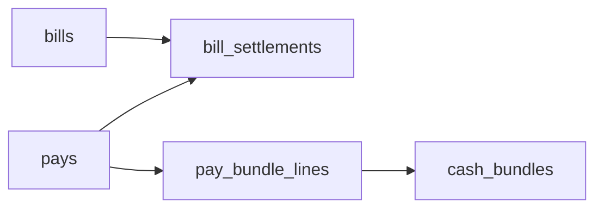

# Money ↔ bills bridge — spec

## Status

| | |
| :--- | :--- |
| **What** | Join cash pays to bill due — `bill_settlements` + `rpc_pay_bills` / `rpc_pay_bill`. One cash writer. |
| **SQL** | `supabase/schemas/money_kernel_v2/` — grep `rpc_pay_bills`, `bill_settlements` |
| **UI** | Collect pay, AP pay — `web/src/modules/bills_pays/` (`MoneyPayDialog`, `CollectPayPage`) |
| **Not here** | Pure deposit/transfer; CN **document** apply (no cash) — [bills](../bills/spec.md) |
| **Related** | [Money](../money/spec.md) · [Bills](../bills/spec.md) · Desk gaps [bills_pays/00-gaps](../bills_pays/00-gaps.md) |

Golden SQL (when present): `supabase/tests/golden_money_spine_v2_*.sql` · desk catalog [bills_pays/tests.md](../bills_pays/tests.md).

---

## Atlas (three packs) {#atlas}

```text
profiles → cashbook → locations → bundles     ← money
bill → bill_settlements → pays → bundle lines  ← bridge + money
bill lines, CN document settle                 ← bills
```

| Pack | Owns | Does not own |
| :--- | :--- | :--- |
| [Money](../money/spec.md) | Bundles/lots, pays, treasury RPCs | `bills.due_amount` |
| [Bills](../bills/spec.md) | Paper, write-off, `document` settlements | Bundle balances |
| **Bridge** (this doc) | `pay` settlements, `rpc_pay_bills` | Bill create/issue; pure deposit |

**Happy path:** `rpc_create_bill` → `rpc_issue_bill` → (FX `rpc_transfer_p2p` if needed) → **`rpc_pay_bills`** → due updates. CN: **`rpc_apply_document_settlement`** only — never `rpc_pay_*` on `credit_note`.

**Out of scope:** investor UX, COD/Curia clearing, reporting warehouses.

---

## What the bridge does

One **`money_kernel.pays`** row with `kind=payment` can satisfy **one or many bills** via **`money_kernel.bill_settlements`** (`settlement_kind = pay`). Each settlement stores how much of that pay closed each bill. Cash legs are **`pay_lot_lines`** today / **`pay_bundle_lines`** target ([money](../money/spec.md)).

**Void:** `rpc_void_pays` reverses bundle/lot movement **and** pay settlements; bill due restored (I20 if payee bundle no longer holds credit).



---

## What each table does

| Table | Does what |
| :--- | :--- |
| `money_kernel.bills` | Open amount to close — [bills](../bills/spec.md) |
| `money_kernel.bill_settlements` | **Bridge join** — links bill ↔ pay (`pay`) or bill ↔ CN bill (`document`) |
| `money_kernel.pays` | Cash header created by `rpc_pay_bills` for `kind=payment` |
| `money_kernel.pay_lot_lines` / `pay_bundle_lines` | Bundle debits/credits for that pay |

---

**`bill_settlements`:** `settlement_kind` `pay` \| `document`; `pays_id` or `source_bill_id`; `allocated_amount` in bill currency. DDL: `money_kernel_v2/`. Document rows = bills RPCs only.

---

## Write RPCs (bridge)

| RPC | Job |
| :--- | :--- |
| `rpc_pay_bills` | One `pays` + N `pay` settlements + lot/bundle lines |
| `rpc_pay_bill` | Wrapper: single bill → `rpc_pay_bills` |
| `rpc_void_pays` | Reverse posted pay + its pay settlements + bundle apply |

All other money/bills RPCs: [money/spec.md](../money/spec.md) · [bills/spec.md](../bills/spec.md).

### `rpc_pay_bills` (contract)

Grep `24_money_kernel_rpcs_write.sql`. Core: `p_payer_profile_id`, `p_from_pot_id` / `p_lot_debits`, `p_amount`, `p_allocations` (`bill_id` + `amount`, max 200), optional `p_to_pot_id`, idempotency key. One transaction: lock bills → lock lots/bundles → pays + lines + `bill_settlements`. Rules: I30/I32, I7b same currency, no `credit_note`, AP vendor = debit payer only ([money](../money/spec.md)).

---

## Locked rules

| Topic | Rule |
| :--- | :--- |
| Multi-bill | One pays, N settlements |
| Overpay per bill | Each alloc ≤ that bill’s `due_amount` |
| Multi-bill void bill | `rpc_void_bill` refuses if on multi-bill pays — void pays first |
| Correct multi-bill pay | `rpc_void_pays` + `rpc_pay_bills` — not `rpc_update_pays` |
| AP payee | Debit payer bundle only; `to_cash_bundle_id` NULL; `from_profile_id` / `to_profile_id` on pays = tenant / vendor |
| Books | Settlement books sum ≤ pays.books_amount; 0.01 tolerance on books only (D1) |

---

## Invariants (bridge)

| Id | Rule |
| :--- | :--- |
| I7 | Σ settlement `allocated_books_amount` (pay) ≤ `pays.books_amount` |
| I7b | Payment: same currency on bill + cash legs |
| I19 | Sum of pay allocations ≤ `pays.amount` |
| I20 | Void pays only if payee bundle still holds credit |
| I23 | No `rpc_void_bill` on multi-bill pays |
| I30 | `from_lot` ≠ `to_lot` on pays |
| I31 | Pay settlement’s pays is `posted`, `kind=payment`, same tenant |
| I32 | One `to_profile_id` on multi-bill pay |

Paper invariants: [bills/spec.md](../bills/spec.md). Cash invariants: [money/spec.md](../money/spec.md).

---

## Payment dialog (desk) {#payment-dialog}

**Where:** `BillDetailPage` → **Add payment** → dedicated **`BillPayPage`** (`app-bill-pay-page`). AP and AR collect.

| Phase | Goal | Status |
| :---: | :--- | :--- |
| 1 — FX | Rate from `books_exchange_rates` (auto); no manual **Exchange rate** input on pay dialog | Shipped |
| 2 — Top up | **Add money** / **New bundle** → `ProfileCashDepositPage` with `returnTo` pay page; refetch `pay_cashbook_legs` on return | Shipped |
| 3 — Chunks | Editable payment total (≤ bill due); **Paying now** in summary when partial | Shipped |
| 4 — Multi-bundle | Several payer bundles with amount per line; one `rpc_pay_bills` + `p_bundle_debits` | Shipped |

**AR collect:** When `pay_cashbook_legs` has **both** `from_leg` and `to_leg`, the pay page shows multi-line **pay from** (customer bundles) and **receive at** (tenant bundle). Legacy AR (no customer cashbook) keeps **receive-only** bundle and synthetic customer deposit on submit.

**Rules:** One payment row can debit **multiple** payer bundles via `p_bundle_debits` (same currency as bill, I7b). Reports use BDT via `books_amount` / `exchange_rate` on pays.

**Files:** `BillPayPage.vue`, `useBillPayPage.ts`, `BillPayBundleLinesEditor.vue`, `CollectPayPage.vue`.

---

## Test matrix {#test-matrix}

Canonical ids: [bills_pays/tests.md](../bills_pays/tests.md) · golden SQL `supabase/tests/golden_money_spine_v2_*.sql`. Cover pay/void, multi-bill, I7b currency mismatch, CN document apply, multi-bill void guard.

---

## Gaps {#gaps}

| ID | Type | Plan | Code today | Fix |
| :--- | :--- | :--- | :--- | :--- |
| BR1 | shipped | Pay dialog Phase 2 (top-up deposit) | `MoneyPayDialog` Add money panel | [§ Payment dialog](#payment-dialog) |
| BR2 | shipped | `p_bundle_debits` on bill pay page | `BillPayPage` | [§ Payment dialog](#payment-dialog) |
| BR3 | doc_wrong | Settlement recon vs legacy `pay_allocations` | Cutover | [§ Test matrix](#test-matrix) · `supabase/tests/` |

---

## PR checklist

- [ ] Bill pay uses `rpc_pay_bills` / `rpc_pay_bill` only (no parallel cash writer)
- [ ] CN never paid with cash RPCs
- [ ] Allocations match bill currency (I7b)
- [ ] Update golden tests when settle logic changes
