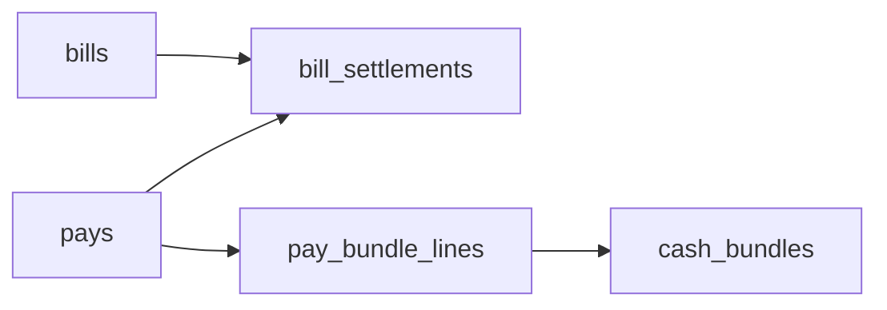

# Money ↔ bills bridge — spec

## Status

| | |
| :--- | :--- |
| **What** | Join cash pays to bill due — `bill_settlements` + `rpc_pay_bills` / `rpc_pay_bill`. One cash writer. |
| **SQL** | `supabase/schemas/money_kernel_v2/` — grep `rpc_pay_bills`, `bill_settlements` |
| **UI** | Collect pay, AP pay — `web/src/modules/bills_pays/` (`MoneyPayDialog`, `CollectPayPage`) |
| **Not here** | Pure deposit/transfer; CN **document** apply (no cash) — [bills](../bills/spec.md) |
| **Related** | [Money](../money/spec.md) · [Bills](../bills/spec.md) · Desk gaps [bills_pays/00-gaps](../bills_pays/00-gaps.md) |

Golden SQL (when present): `supabase/tests/golden_money_spine_v2_*.sql` · desk catalog [bills_pays/tests.md](../bills_pays/tests.md).

---

## Atlas (three packs) {#atlas}

```text
profiles → cashbook → locations → bundles     ← money
bill → bill_settlements → pays → bundle lines  ← bridge + money
bill lines, CN document settle                 ← bills
```

| Pack | Owns | Does not own |
| :--- | :--- | :--- |
| [Money](../money/spec.md) | Bundles/lots, pays, treasury RPCs | `bills.due_amount` |
| [Bills](../bills/spec.md) | Paper, write-off, `document` settlements | Bundle balances |
| **Bridge** (this doc) | `pay` settlements, `rpc_pay_bills` | Bill create/issue; pure deposit |

**Happy path:** `rpc_create_bill` → `rpc_issue_bill` → (FX `rpc_transfer_p2p` if needed) → **`rpc_pay_bills`** → due updates. CN: **`rpc_apply_document_settlement`** only — never `rpc_pay_*` on `credit_note`.

**Out of scope:** investor UX, COD/Curia clearing, reporting warehouses.

---

## What the bridge does

One **`money_kernel.pays`** row with `kind=payment` can satisfy **one or many bills** via **`money_kernel.bill_settlements`** (`settlement_kind = pay`). Each settlement stores how much of that pay closed each bill. Cash legs are **`pay_lot_lines`** today / **`pay_bundle_lines`** target ([money](../money/spec.md)).

**Void:** `rpc_void_pays` reverses bundle/lot movement **and** pay settlements; bill due restored (I20 if payee bundle no longer holds credit).



---

## What each table does

| Table | Does what |
| :--- | :--- |
| `money_kernel.bills` | Open amount to close — [bills](../bills/spec.md) |
| `money_kernel.bill_settlements` | **Bridge join** — links bill ↔ pay (`pay`) or bill ↔ CN bill (`document`) |
| `money_kernel.pays` | Cash header created by `rpc_pay_bills` for `kind=payment` |
| `money_kernel.pay_lot_lines` / `pay_bundle_lines` | Bundle debits/credits for that pay |

---

## `bill_settlements` (bridge fields)

| Field | Purpose |
| :--- | :--- |
| `bill_id` | Bill whose `due_amount` drops |
| `settlement_kind` | `pay` \| `document` |
| `pays_id` | Set when `pay`; FK → `pays` |
| `source_bill_id` | Set when `document` (credit note bill) |
| `allocated_amount` | Amount in **bill currency** |
| `allocated_books_amount` | BDT slice for this allocation (Σ ≤ `pays.books_amount`, D1) |
| `idempotency_key` | Optional; permanent per tenant |

**Document** rows are created by bills RPCs, not `rpc_pay_bills`.

---

## Write RPCs (bridge)

| RPC | Job |
| :--- | :--- |
| `rpc_pay_bills` | One `pays` + N `pay` settlements + lot/bundle lines |
| `rpc_pay_bill` | Wrapper: single bill → `rpc_pay_bills` |
| `rpc_void_pays` | Reverse posted pay + its pay settlements + bundle apply |

All other money/bills RPCs: [money/spec.md](../money/spec.md) · [bills/spec.md](../bills/spec.md).

### `rpc_pay_bills` (contract)

**Signature (live):** `supabase/schemas/money_kernel_v2/24_money_kernel_rpcs_write.sql`

| Param | Purpose |
| :--- | :--- |
| `p_tenant_id` | Tenant |
| `p_payer_profile_id` | Must match each bill’s `from_profile_id` (debtor) |
| `p_from_pot_id` | Debit lot/bundle (today: lot id) |
| `p_amount` | Pay header amount (> 0) |
| `p_allocations` | JSON array: `[{ "bill_id", "amount" }, …]` — unique `bill_id`, max 200 |
| `p_to_pot_id` | Optional; must equal **derived** payee lot/bundle (payee profile + bill currency) |
| `p_lot_debits` | Optional multi-lot debits (`[{ "lot_id", "amount" }, …]`) — split-FX |
| `p_meta` | Extra json on pays |
| `p_idempotency_key` | Permanent; replay returns same pays if params match |

**One transaction:** lock bills (ascending id) → lock lots/bundles → insert `pays` → insert `pay_lot_lines` / lines → insert `bill_settlements` → triggers update `bills.paid/due/status`.

**Rules:**

- All bills in one call: same `to_profile_id` (payee) — I32.
- `from_lot_id` ≠ `to_lot_id` on pays — I30.
- Bill currency = movement currency; `exchange_rate = 1` on payment — I7b. FX first via `rpc_transfer_p2p`.
- Sum of allocations ≤ `p_amount`; leftover may stay **unapplied** on pays.
- Never pay `credit_note` kind with this RPC.

**Target rename:** `p_from_pot_id` / `p_lot_debits` → bundle ids. **AP vendor** (`cashbook_enabled=false`): **no** payee bundle credit; stamp `pays.to_profile_id` = bill creditor ([money](../money/spec.md)). **AR / cashbook payee:** credit payee bundle when `p_to_pot_id` omitted and payee has `cashbook_enabled=true`.

---

## Locked rules

| Topic | Rule |
| :--- | :--- |
| Multi-bill | One pays, N settlements |
| Overpay per bill | Each alloc ≤ that bill’s `due_amount` |
| Multi-bill void bill | `rpc_void_bill` refuses if on multi-bill pays — void pays first |
| Correct multi-bill pay | `rpc_void_pays` + `rpc_pay_bills` — not `rpc_update_pays` |
| AP payee | Debit payer bundle only; `to_cash_bundle_id` NULL; `from_profile_id` / `to_profile_id` on pays = tenant / vendor |
| Books | Settlement books sum ≤ pays.books_amount; 0.01 tolerance on books only (D1) |

---

## Invariants (bridge)

| Id | Rule |
| :--- | :--- |
| I7 | Σ settlement `allocated_books_amount` (pay) ≤ `pays.books_amount` |
| I7b | Payment: same currency on bill + cash legs |
| I19 | Sum of pay allocations ≤ `pays.amount` |
| I20 | Void pays only if payee bundle still holds credit |
| I23 | No `rpc_void_bill` on multi-bill pays |
| I30 | `from_lot` ≠ `to_lot` on pays |
| I31 | Pay settlement’s pays is `posted`, `kind=payment`, same tenant |
| I32 | One `to_profile_id` on multi-bill pay |

Paper invariants: [bills/spec.md](../bills/spec.md). Cash invariants: [money/spec.md](../money/spec.md).

---

## Payment dialog (desk) {#payment-dialog}

**Where:** `BillDetailPage` → `MoneyPayDialog` (AP; AR can follow).

| Phase | Goal | Status |
| :---: | :--- | :--- |
| 1 — FX | Rate from `books_exchange_rates` (auto); no manual **Exchange rate** input on pay dialog | Shipped |
| 2 — Top up | Block pay if insufficient; **Add money** → deposit; refresh balance | **Shipped** — selected bundle or **new bundle** via `rpc_deposit` with null `p_pot_id` (opens on Main at books rate) |
| 3 — Chunks | Pay uses due from summary (no Payment amount input); partial-pay UX polish later | Due-only shipped; partial polish open |

**Rules:** One payment = **one** from-pot/bundle; two pots = two payments. Reports use BDT via `books_amount` / `exchange_rate` on pays.

**Files:** `MoneyPayDialog.vue`, `useBillDetailMoneyPayDialog.ts`, `CollectPayPage.vue`.

---

## Test matrix

| Id | Given | Action | Expect |
| :--- | :--- | :--- | :--- |
| TC-PAY-01 | Issued AR due 1000; customer pot 1000 | `rpc_pay_bill` 1000 | Bill `paid`; pots move |
| TC-PAY-02 | AP partial | `rpc_pay_bill` 200 | Bill `partial` |
| TC-PAY-03b | AP vendor; omit `p_to_pot_id` | `rpc_pay_bill` | Debit payer bundle only; pays stamped tenant→vendor; no vendor wallet credit |
| TC-PAY-04 | Bills due 300 + 200 | `rpc_pay_bills` | One pays; two settlements |
| TC-PAY-05 | Alloc > due | pay | `invalid_amount` |
| TC-PAY-07 | Allocs sum > pays amount | `rpc_pay_bills` | `invalid_amount` |
| TC-PAY-09 | Pot USD, bill BDT | pay | `invalid_arguments` (I7b) |
| TC-PAY-10 | Posted pay | `rpc_void_pays` | Pots + due restored |
| TC-PAY-10c | Credit already spent | `rpc_void_pays` | I20 reject |
| TC-PAY-11 | Bill = credit_note | `rpc_pay_bill` | reject |
| TC-PAY-15 | Duplicate bill_id in allocs | `rpc_pay_bills` | reject |
| TC-PAY-18 | Multi-bill; different payees | `rpc_pay_bills` | I32 reject |
| TC-PAY-19 | from_pot = to_pot | pay | I30 reject |
| TC-DOC-02 | CN + parent | `rpc_apply_document_settlement` | Document row; no pays |
| TC-BILL-04b | Multi-bill pays | `rpc_void_bill` | reject |

Full matrix (cash + document + guards): `supabase/tests/` and [bills_pays/tests.md](../bills_pays/tests.md).

---

## Gaps {#gaps}

| ID | Type | Plan | Code today | Fix |
| :--- | :--- | :--- | :--- | :--- |
| BR1 | shipped | Pay dialog Phase 2 (top-up deposit) | `MoneyPayDialog` Add money panel | [§ Payment dialog](#payment-dialog) |
| BR2 | not_built | `p_lot_debits` / `p_bundle_debits` in pay UI | Kernel live | [bills_pays/00-gaps](../bills_pays/00-gaps.md) |
| BR3 | doc_wrong | Settlement recon vs legacy `pay_allocations` | Cutover | [bills_pays/08-AUDIT](../bills_pays/08-AUDIT-RECONCILIATION-AND-RUNBOOK.md) |

---

## PR checklist

- [ ] Bill pay uses `rpc_pay_bills` / `rpc_pay_bill` only (no parallel cash writer)
- [ ] CN never paid with cash RPCs
- [ ] Allocations match bill currency (I7b)
- [ ] Update golden tests when settle logic changes
