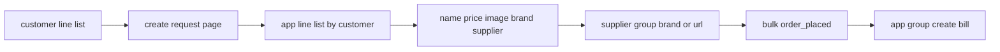

# Proxy purchase — spec

## As-built

| | |
| :--- | :--- |
| Spec | `docs/features/proxy_purchase/spec.md` |
| UI | `web/src/modules/proxy_purchase/` (target) |
| SQL | `supabase/schemas/proxy_purchase/` (target split domain) |
| Model | **Proxy purchase** — customer URL lists → staff bag/price → supplier pay/place → ship + bill. Not BW warehouse, not `shop_order`. See [scopes](../../architecture/scopes.md). |
| State | Vue Query — line list + create page + mutations |
| Access | `app` staff via `effectiveGrants`; `proxy` scope for customer/supplier members |

## Where to look

| Need | Path |
| :--- | :--- |
| Tables, RPCs, RLS | `supabase/schemas/proxy_purchase/` (target) |
| Document numbers | [document-numbering](../../architecture/document-numbering.md) — `next_document_number` |
| Comments | [comments spec](../comments/spec.md), `CommentPanel` |
| Parties (not reused) | `customer_groups`, `vendors` |
| Proxy login | Pattern: investor / shop bootstrap |
| Pages / grant | `proxy_purchase` in `moduleRegistry` |

## Scope

| | |
| :--- | :--- |
| Surfaces | **`app`** — people admin, line ops, bill grouping; **`proxy`** — customer + supplier portal |
| In | Parties, requests, lines, `pp_shipment`, proxy auth, numbering, line-list UI (group/sort), create page, bill grouping |
| Out | Shop `customer_groups` / procurement `vendors` / `global_shipments`; image upload (URLs only); comments `is_internal` |

## What / who

**Primary UI primitive:** a **line list** of `pp_order_lines` (not request-first). Users may **group** by purchase request, status, brand, or URL host; **sort** by status / date. Create request is a **separate page**.

| Role | Surface | Actions |
| :--- | :--- | :--- |
| App ops | `app` | People groups; same line list filtered by customer group; enrich line; assign supplier; status; group for bill / create bill |
| Proxy customer | `proxy` | Dashboard line list; create request page; view status |
| Proxy supplier | `proxy` | Assigned lines; group by brand / URL; bulk place + status |

## UI flows

### Customer (`proxy`)

1. Login → **dashboard** = line list for own customer group.
2. Controls: group by **purchase request** or **status**; sort; expand group to see lines.
3. **Create** → separate page: add order lines (`url`, `needed_qty`, `description`); set request extras (`bucket_description`, `bucket_image_url`); submit → `request_number` allocated; lines `pending_review`.

### App staff (`app`)

1. Same **line list** chrome; filter by **customer group** (required default or picker); group/sort like customer.
2. On a line (drawer/row expand): set `product_name`, `image_url`, `unit_price`, bag flags, `brand` (for supplier grouping), `pp_supplier_group_id`, status transitions, comments.
3. Later: select placed/shipped unbilled lines → **group for bill** → **create bill** and stamp `bill_id` on those lines. Ship via `pp_shipment` as needed.

### Supplier (`proxy`)

1. Login → line list for own supplier group (`assigned`+).
2. Group by **brand** or **URL** (host / path key) to batch same-merchant checkouts.
3. Select group → place order (payment refs, `origin_order_number`, `placed_qty`) → status `order_placed`.

## Workflow (line status)

| Stage | Actor | Line status | Main fields |
| :--- | :--- | :--- | :--- |
| 1 Create | Customer | `pending_review` | `url`, `needed_qty`, `description`; header `bucket_*` |
| 2 Bag & price | App | `bag_confirmed` → `assigned` | `product_name`, `image_url`, `unit_price`, `brand`, bag flags, `pp_supplier_group_id` |
| 3 Pay & place | Supplier | `order_placed` | `placed_qty`, payment + `origin_order_*` |
| 4 Ship & bill | App | `in_shipment` → `delivered` | `shipment_id`; bill group → `bill_id` |

Also: `out_of_stock`, `cancelled`. Parent request header: **v1 customer compose** stores `draft` \| `post` (`request_number` via `proxy_purchase_request` numbering on draft create; lines are `draft` on the request until post, then `pending_review`). **Later:** derived `open` \| `in_progress` \| `completed` \| `cancelled` from lines.

**Supplier bulk place:** one RPC stamps the same payment / origin fields on selected lines.

**Billing:** unbilled queue = `bill_id IS NULL` and status in (`order_placed`, `in_shipment`, `delivered`); create bill stamps `bill_id` on the group.

## Rules (only what is not in `docs/README.md`)

- **Tenant:** `tenant_id bigint`; RPCs lead with `p_tenant_id`.
- **Parties:** dedicated `pp_people_group` (`customer` \| `supplier`); email-match members.
- **Proxy scope:** `/:slug/proxy/*`, `theme-proxy`, bootstrap by membership + group type.
- **App nav:** grant `proxy_purchase`.
- **List-first UX:** shared line-list component; create request is its own route.
- **`brand`:** text on line (staff-filled in bag step) so supplier can group; URL-group uses parsed host from `url`.
- **Shipments:** `pp_shipment` only — not `global_shipments`.
- **Bill:** group selected lines → create bill → write `bill_id` (money-kernel wiring confirmed at implement). Soft stamp required even if create is deferred.
- **Comments:** `entity_type` `pp_purchase_request` \| `pp_order_line`; no `pp_comments`.
- **Numbering:** `next_document_number` — see below.
- **Images:** URL text fields in v1.

### Document `doc_type`s

| doc_type | Stored on | Example |
| :--- | :--- | :--- |
| `proxy_purchase_request` | `request_number` | `PPR-251105-0042` |
| `proxy_shipment` | `shipment_code` | `PPS-251105-0007` |

### Target tables (summary)

| Table | Purpose |
| :--- | :--- |
| `pp_people_group` / `_member` | Proxy orgs + email members |
| `pp_purchase_requests` | Header + bucket + `request_number` |
| `pp_order_lines` | Line ops incl. `brand`, bag, supplier, payment, `shipment_id`, `bill_id`, status |
| `pp_shipment` | Lightweight logistics |

### Target RPCs (intent)

| RPC | Purpose |
| :--- | :--- |
| `get_proxy_bootstrap_context` | Proxy login |
| `list_pp_order_lines` | Shared list; filters: group, status, supplier, customer, unbilled |
| `create_pp_purchase_request_draft` / `post_pp_purchase_request` | Draft create (allocates `request_number`) + customer **Post** |
| `update_pp_order_line_*` | Enrich, assign, bulk place, ship, bill stamp |
| `create_pp_shipment` | Ship number |
| Bill create wrapper | Group lines → bill + set `bill_id` (detail at implement) |

## Stories

### US-1: Proxy people groups (app)
- Create customer/supplier groups and members by email.
  - [ ] Assign only to `type = supplier` groups.

### US-2: Customer dashboard (proxy)
- **Requests | Order lines** tabs (customer): list all group purchase requests; open request page; **Add request**.
  - [x] Requests tab + list RPC; empty state links to create page.
  - [ ] Order lines tab (placeholder); line list, group, sort (later).

### US-3: Create purchase request page (proxy)
- Route `/:slug/proxy/requests/:id`: draft RPC → add lines + bucket instructions → **Post** to admin.
  - [x] Allocates `request_number` on draft create; post sets header `post` and lines → `pending_review`.

### US-4: App line list and enrich
- Same list; filter by customer group; set name, image URL, price, brand, bag, supplier, status.
  - [ ] `CommentPanel` on line.

### US-5: Supplier group and place (proxy)
- Group assigned lines by brand or URL; bulk place + status.
  - [ ] Same payment/origin fields on selection.

### US-6: App bill group
- Select unbilled placed/shipped lines → create bill → stamp `bill_id`.
  - [ ] Badge when `bill_id` set; unbilled filter works.

### US-7: Proxy login
- `/:slug/proxy/login`; role home by group type.
  - [ ] Customer cannot open supplier place UI (and vice versa).
