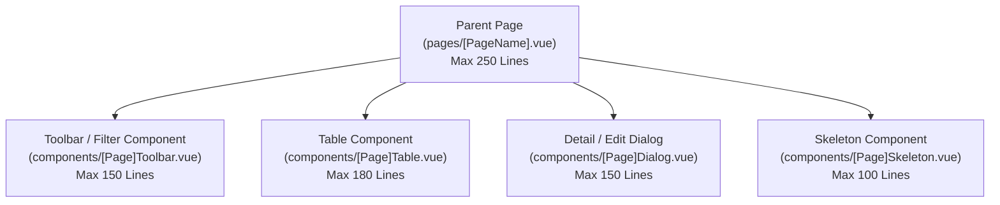

# UI — tokens and ops list layout

Canonical UI file. New UI notes go here or in a module `spec.md`, not a second guide. Law: [STRUCTURE](../STRUCTURE.md).

---

## 🎨 1. Design Tokens & Color Palette

Full token tables: [`design-colors.md`](design-colors.md) (generated from `web/src/css/app.scss`).

### 1.1 Neutrals & Background Surfaces (slate)
| Token | Light | Dark | Usage |
| :--- | :--- | :--- | :--- |
| `--tf-neutral-canvas` | `#f4f6f8` | `#09090b` | Page canvas |
| `--tf-neutral-surface` | `#ffffff` | `#18181b` | Cards, tables, dialogs |
| `--tf-neutral-border` | `#e2e8f0` | `#27272a` | Borders |
| `--tf-neutral-border-strong` | `#cbd5e1` | `#3f3f46` | Inputs (outlined) |
| `--tf-neutral-ink` | `#0f172a` | `#f4f4f5` | Body text |
| `--tf-neutral-muted` | `#475569` | `#a1a1aa` | Captions |
| `--tf-neutral-chrome` | `#94a3b8` | `#71717a` | Decorative borders/icons only |
| `--tf-neutral-chrome-text` | `#5b6b80` | `#8b8b94` | Overlines, table header labels |
| `--tf-disabled-bg` / `--tf-disabled-ink` | `#eef1f5` / `#94a3b8` | `#1f1f23` / `#71717a` | Disabled controls |

- **Default accent (app)**: `--tf-brand-accent` → `#0d6b5c` (trade teal).
- **Primary = actions only**, never state. Pair state with icon + text.

### 1.2 Semantic State Hues
| Token | Light | Dark |
| :--- | :--- | :--- |
| `--tf-success` | `#15803d` | `#4ade80` |
| `--tf-warning` | `#b45309` | `#fbbf24` |
| `--tf-error` | `#b91c1c` | `#f87171` |
| `--tf-info` | `#0e7490` | `#22d3ee` |

Soft tints: light 12% / dark 18% color-mix on surface; pair with icon + label (no side accent bar). Info is cyan (not shop primary / Qty column).

### 1.2b Status groups (central)

Map: `web/src/utils/statusMap.ts`. Tokens: `--tf-status-<group>` (+ `-soft`) in `app.scss`. Pages pass the raw status to `TfStatusBadge`; they never pick colors.

| Group | Token | Meaning |
| :--- | :--- | :--- |
| `wait` | neutral chrome | Nothing to do yet (draft, on hold) |
| `attention` | warning amber | Someone must act (pending, offered) |
| `progress` | info slate-sky | Moving (confirmed, procuring, packed, shipped) |
| `done` | success green | Finished (delivered, paid) |
| `bad` | error red | Failed or late (cancelled, overdue) |

### 1.3 Wrappers (enforce tokens)
| Use | Import |
| :--- | :--- |
| Buttons | `TfBtn.vue` |
| Status chips | `TfStatusBadge.vue` |
| Confirmations | `TfConfirmDialog.vue` |
| Toasts | `useNotify()` |

Build: `check:contrast` (gate). Report: `check:ui-colors`.

### 1.4 Typography & icons

| Role | Token / pattern | Notes |
| :--- | :--- | :--- |
| **UI text** | `--tf-font-ui` → IBM Plex Sans | Loaded in `web/index.html`; do not add Plus Jakarta or Roboto bundles |
| **Numbers / codes** | `--tf-font-mono` → IBM Plex Mono | Tables, KPIs, copyable IDs |
| **Bangla** | `--tf-font-bn` → Noto Sans Bengali | `html[lang='bn']` in `app.scss` |
| **Icons** | `ph ph-*` (Phosphor regular) | Quasar set: `web/src/icon-set/phosphor.ts`. No `@quasar/extras` Material icon fonts or Material ligature names |

---

## 📐 2. Page Container & Layout Standard

All operational dashboard and list pages must adhere to the **Non-Scrolling Page Container** architecture:

```html
<template>
  <!-- 1. Locked Non-Scrolling Outer Container -->
  <q-page class="column no-wrap" style="height: calc(100vh - 55px); overflow: hidden">
    
    <!-- 2. Compact Table Toolbar (Zero in-page H1 headers) -->
    <div class="row items-center justify-between q-px-md q-py-xs bg-surface border-bottom shrink-0">
      <div class="row items-center q-gutter-sm">
        <q-input v-model="search" outlined rounded dense placeholder="Search items..." class="table-search" />
        <q-btn-toggle v-model="statusFilter" dense unelevated rounded :options="statusOptions" />
      </div>
      <div class="row items-center q-gutter-sm">
        <q-btn unelevated color="primary" label="New Record" style="border-radius: 8px" />
      </div>
    </div>

    <!-- 3. Scrollable Middle Table Canvas -->
    <div class="col overflow-auto bg-surface" style="overflow-y: auto">
      <q-markup-table flat class="sticky-header-table full-width">
        <thead class="sticky-th">...</thead>
        <tbody>...</tbody>
      </q-markup-table>
    </div>
  </q-page>
</template>
```

Copy **`InboundShipmentListPage.vue`**, not overview pages with `AppPageHeader`.

### Layout Rules:
1. **Zero In-Page Headers**: Never render redundant in-page `<h1>` or `text-overline` banner blocks. Top breadcrumbs provide context and page titles.
2. **Fixed Viewport**: Page height locked to `calc(100vh - 55px)` with `overflow: hidden`.
3. **Internal Table Scroll**: Sticky table headers (`thead tr th`) with internal scrolling body container.
4. **Rounded Square Buttons**: Primary actions use `border-radius: 8px`, not pill shapes.

---

## 📊 3. Ops Spreadsheet & Dense Table Pattern

| Column Role | Header Width (`th`) | Body Cell (`td`) | Input Control | Alignment & Style |
| :--- | :---: | :---: | :---: | :--- |
| **Selection Checkbox** | `24px` | `24px` | — | `text-center`, dense checkbox |
| **Sequence / SL** | `36px` | `36px` | `max-width: 32px` | `text-center`, borderless editable |
| **Thumbnail** | `72px` | `72px` | — | Square thumbnail with soft radius |
| **Product / Entity Title** | `160px` | `160px` | — | Left-aligned, multi-line wrap |
| **Monospace Codes / IDs** | `110px` | `110px` | — | Monospace font with 1-click copy |
| **Prices / Financials** | `70px` | `70px` | `max-width: 60px` | `text-right`, soft tinted background |
| **Quantity / Numeric** | `56px` | `56px` | `max-width: 50px` | `text-center`, numeric input |
| **Actions** | `60px` | `60px` | — | `text-center`, ghost icon buttons |

---

## 🧩 4. Component Modularization & File Limits

To ensure high performance, maintainability, and clean AI context budgeting:



### File Size Limits:
- **Parent Page (`pages/[Name].vue`)**: Target **150 – 180 lines** (Strict Max: **250 lines**). Orchestrates queries, routes, and layout grids.
- **Sub-Component (`components/[Name].vue`)**: Target **80 – 120 lines** (Strict Max: **180 lines**). Presentation blocks with explicit `defineProps` & `defineEmits`.
- **Composable (`composables/use[Name].ts`)**: Target **50 – 100 lines** (Strict Max: **150 lines**). Reactive logic and calculation helpers.

### Refactoring Protocol (For Large Files):
1. **One Component Per Turn**: Extract exactly ONE visual section per refactoring cycle.
2. **Surgical Template Edits**: Extract template HTML and scoped styles; avoid rewriting parent state logic.
3. **Explicit Props/Emits**: Pass existing reactive refs as props rather than creating complex new state trees.

---

## 💀 5. Skeleton Loaders & Zero Cumulative Layout Shift (CLS)

1. **Zero CLS Guarantee**: Skeleton loaders must exactly replicate the dimensions, heights, and spacing (`q-gutter-y-md`) of the loaded UI.
2. **Dedicated Skeleton Components**: Never inline giant skeleton blocks in parent pages. Extract to `components/[Feature]Skeleton.vue`.
3. **Element Dimensions**:
   - Primary CTA: `<q-skeleton type="QBtn" width="110px" height="36px" />`
   - Search Field: `<q-skeleton type="QInput" height="38px" />`
   - Table Row: `<q-skeleton type="text" width="90%" height="28px" />`
   - Badge: `<q-skeleton type="QBadge" width="70px" height="22px" />`
4. **Skeletons Over Spinners**: Always use `q-skeleton` for initial page loads to preserve layout context; use `QSpinner` only on micro-actions.

---

## 6. Usage rules (color & components)

Global: never use color alone for state; primary = actions only; `--tf-neutral-chrome` is decorative — use `--tf-neutral-chrome-text` for overlines; components use tokens or Quasar semantic names, never raw hex.

### 6.1 Button variants (Quasar q-btn)

Always `no-caps`, never `push` or `glossy`. Desktop size md, mobile/shop CTAs `lg` (min 44px touch target). Max ONE filled primary per view section, dialog, or form. Prefer `TfBtn`.

| Variant | q-btn props | Use for |
|---|---|---|
| primary | `unelevated color="primary"` | The main action: Save, Create PO, Place order, Next |
| secondary | `outline color="primary"` | Supporting actions: Export, Add item, Filter, Save draft |
| tertiary | `flat color="neutral"` | Cancel, Back, Close, Reset, low-emphasis actions |
| danger (confirm) | `unelevated color="negative"` | ONLY the final confirm inside a destructive dialog |
| danger (trigger) | `flat color="negative"` (or `outline`) | Delete/Remove that opens the confirm dialog; never filled red in rows or headers |
| success | `unelevated color="positive"` + check icon | ONLY completing a workflow step: Mark picked complete, Approve, Confirm delivery |
| icon | `flat round dense` (+ `size="sm"` in tables) | Row actions, toolbars; always aria-label + q-tooltip |
| link | `flat dense no-caps padding="none" color="primary"` | Inline navigation inside text/tables |
| toggle | `q-btn-toggle unelevated toggle-color="primary"` | View switches (List/Grid), status filters |
| fab | `fab color="primary"` in `q-page-sticky` bottom-right | Mobile ops only (scan, quick pick, add) |

Shop only: add `rounded` + pill radius for primary and secondary CTAs.

States: use `:loading="true"` on submit (blocks double submit); use `disable` with a tooltip explaining why; never hide a disabled primary.

### 6.2 Button position

- Page header (right): [secondary] [primary]; max 1 primary + 1-2 secondary, overflow into a `q-btn-dropdown flat`.
- Form/dialog footer, right-aligned: [tertiary Cancel] [primary Save]. Cancel always left of primary.
- Wizard/stepper: Back (tertiary) far left, Next/Finish (primary) far right.
- Table toolbar: search left, filters middle (secondary/toggle), "Add" (primary) far right.
- Table row: icon buttons in the last column, right-aligned; max 3 visible, rest in a `flat round` kebab menu. Delete lives in the menu, in negative text color.
- Bulk selection bar (appears on select, above table): [primary action] [secondary] [flat negative]; shows selected count; Esc clears.
- Mobile: primary action in a sticky bottom bar, full width; secondary above or beside as outline; fab only for ops capture flows.
- Destructive actions are never adjacent to primary at equal weight and never the default focus.

### 6.3 UI color by surface/position

- Page background: canvas. Cards, tables, dialogs: surface + 1px border (shadow minimal; use `--tf-theme-shadow` only for floating layers).
- Header (QHeader): surface + bottom border, ink text. Primary appears only on logo mark, active nav, and the main CTA (superadmin may use primary-filled header).
- Left drawer: surface; active item = primary-soft background + primary text; hover = canvas tint; section labels = overline in chrome-text.
- Tabs: active = primary text + 2px primary indicator; inactive = muted.
- Page title ink; subtitle/caption muted; overlines chrome-text; links primary (underline on hover).
- Tables: header row canvas bg with chrome-text overline labels; row hover primary-soft at ~50%; selected row primary-soft + stronger border; status via soft semantic badge; money in ink with tabular numerals, negative amounts in error with a minus sign, positive deltas in success with an up/plus icon.
- Inputs: outlined, dense, border = border-strong; focus = primary border + focus ring; error = negative border + message text below (not a notification); hint = muted; disabled = disabled-bg/ink.
- Chips/badges: soft tint bg + semantic ink + icon (never solid saturated fills); counts on nav = small primary-soft badge.
- Tooltips: dark neutral bg (ink on dark mode inverted), white text, max one short sentence.
- Progress: linear in primary; turns success at 100%; QSkeleton for content loading, QInnerLoading for tables/cards, spinner only in buttons.
- Empty states: muted icon + one-line explanation + one primary CTA.
- Banners (q-banner), persistent page-level messages: soft semantic tint + border + icon + optional action; one banner per concern; dismissible only for info.

### 6.4 Status map (`TfStatusBadge`)

| Status | Color | Icon |
|---|---|---|
| Draft | neutral | edit_note |
| Pending / Awaiting | warning | schedule |
| Processing / Picking / In progress | info | autorenew |
| Partial | warning | pie_chart |
| Completed / Picked / Delivered / Paid | success | check_circle |
| On hold | neutral | pause_circle |
| Overdue / Failed / Rejected | error | error |
| Cancelled | neutral (muted, line-through label) | cancel |

Stock: in stock = success, low = warning, out = error. A badge always shows icon + text.

### 6.5 Notifier (`useNotify()`)

Wrapper API: `notify.success(msg)`, `.info`, `.warn`, `.error(msg, {retry})`, `.loading(msg)` (returns dismiss/update fn), `.undo(msg, onUndo)`.

Defaults (`quasar.config` `framework.config.notify`): `{ position: 'top-right', progress: false, classes: 'tf-notify', … }`. Mobile (&lt;600px): `position: 'top'`, full width. Style `.tf-notify`: soft semantic tint, ink text, border, icon in semantic color (no side accent bar).

| Type | Icon | Timeout | Notes |
|---|---|---|---|
| success | check_circle | 3000 | what happened + object: "PO #1042 saved" |
| info | info | 4000 | neutral news (e.g. sync finished) |
| warning | warning | 6000 | add an action if user can fix it |
| error | error | persistent when action needed, else 8000 | say what failed + what to do; Retry / Details actions |
| ongoing (loading) | spinner | until done | then replace in place with success/error (same notif id) |

Rules: one line, under ~100 characters, no filler ("Success!"); never notify for field validation (inline errors instead) or for results already obvious from the UI; destructive soft-deletes get an Undo action with a 6000ms timeout; dedupe repeats with `group`; never stack more than 3 visible (collapse the rest into one summary); errors are never auto-dismissed if they block the user's task.

### 6.6 Dialogs (`TfConfirmDialog`)

- Radius md; backdrop dark at ~45%; mobile uses bottom-sheet style (`position="bottom"`).
- Title = verb + object ("Delete order #1042?"); body = consequence in one sentence; actions right-aligned [Cancel tertiary] [Confirm].
- Destructive: Confirm = danger variant, default focus on Cancel, optional typed confirmation for irreversible bulk ops.
- Non-destructive confirm: Confirm = primary. Completing steps: success variant.
- Form dialogs are `persistent` when dirty and warn on unsaved changes.
- No dialog on dialog; use inline steps instead.

### 6.7 Feedback hierarchy

1) inline field error/hint → 2) in-place state change (badge, row highlight) → 3) notify toast → 4) banner (persistent, page-level) → 5) dialog (requires a decision). Never use a toast for something the user must act on later; use a banner or an inbox item.
