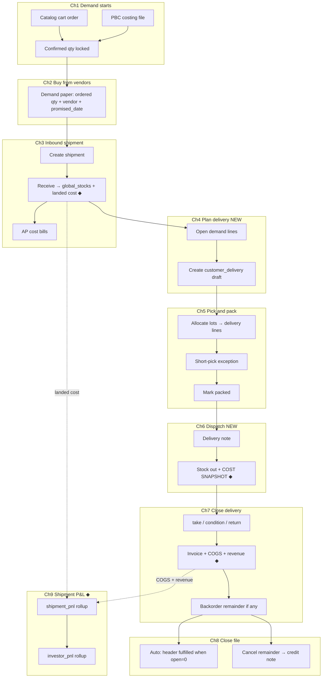

# Pre-order fulfillment flow (target / to-be) — with shipment-level investor P&L

> **Supersedes:** `# Pre-order fulfillment flow (as-built).txt`
>
> **Read top to bottom like a story:** where demand starts → how you buy and receive stock → how you plan, pick, dispatch, and close a **delivery trip** → how the file closes itself → **how investor P&L is derived from each shipment**.
>
> **What changed vs as-built:**
> - Outbound has its own document — **`customer_deliveries`** — mirroring inbound `global_shipments`. ✦G1
> - Header status is **derived** from demand lines, never set by hand. ✦G2
> - Promise dates, backorders, short-pick exceptions, partial cancel are first-class. ✦G6–✦G8
> - **Every delivery line carries an immutable cost snapshot and its COGS, revenue, and gross profit.** ◆G9–◆G12 — **this is what makes investor P&L per shipment possible.**
>
> **Markers:** ✦ = closes a fulfillment gap (G1–G8). ◆ = adds the financial traceability needed for shipment-level investor P&L (G9–G12).

## As-built → target

| | As-built | Target |
| :--- | :--- | :--- |
| Model | Pre-order / BW — catalog + PBC → warehouse → Delivery paper | Same, **+ `customer_deliveries` outbound document** ✦G1 |
| Shared line store | `preorder_demand` (with `stock_picks` JSON) | `preorder_demand` (need / allocation) **+ `customer_delivery_lines`** (trip truth + financial atom) ✦G1 ◆ |
| Header status | Hand-set (`procuring → packed → delivered`) | **Derived** (`confirmed → procuring → partially_fulfilled → fulfilled / cancelled`) ✦G2 |
| Delivery tracking | Picks in JSON on the order | **One row per trip** (`customer_deliveries` + lines) ✦G1 |
| **Cost of goods** | No snapshot; landed cost can drift | **`unit_cost_landed_snapshot` frozen at dispatch** ◆G9 |
| **Revenue traceability** | Invoice has no trip ref; can't tie revenue → shipment | **Invoice line ↔ delivery line ↔ lot ↔ shipment** ◆G10 |
| **Investor P&L** | None — computed ad-hoc from exports | **`shipment_pnl` + `investor_pnl` views** ◆G11 |
| **Returns** | No COGS reversal record | **Restock at original landed cost; credit note references `delivery_line_id`** ◆G12 |
| Shortfall | Bucket / backlog table | **`open_quantity` + `promised_date` + `backorder_status`** on demand line ✦G6 |
| Short pick | Silent manual fix | **`record_short_pick`** + exception reason ✦G7 |
| Partial cancel | Not possible | **`cancel_preorder_demand_remainder`** → credit note ✦G8 |
| Close file | Manual "Mark delivered" flips whole order | **Auto** when `open_quantity = 0`; explicit **Cancel remainder** ✦G2 / ✦G8 |
| Delivered history | Order drops off lists | **Delivered tab** — permanent record ✦G5 |
| `delivered_quantity` | Pick sum | Renamed **`picked_quantity`**; real `delivered_quantity` added ✦G4 |
| Backlog tables | `customer_demand_bucket_items`, `product_based_costing_backlog_items` | Retired — `open_quantity > 0` + `backorder_status` ✦G6 |
| SQL | `procurement/03_rpcs.sql` | Same file, **new RPCs**; `stock_picks` dropped in P6; **new P&L views** ◆ |
| UI | `procurement_stock/`, `shop_order/`, `product_based_costing/` | Same modules, **new Delivery desk tabs** ✦G1 / ✦G5; **new Investor P&L report** ◆G11 |

## Scope

| In this story | Not this story |
| :--- | :--- |
| `vendor_catalog` shop orders | **`fixed_price`** shop (stock-backed checkout; no Delivery paper) |
| PBC costing files | **Dropship** (pick → ship/issue → remittance) |
| Inbound shipment → `global_stocks` | Koba, thrift, ATP / promise engine (promise date is **manual** here) |
| **Investor P&L per shipment** ◆ | Multi-currency consolidation, tax P&L, cash-flow timing (deferred to finance reporting) |

**Dropship in one line:** unchanged — `shop_order_item_stock_picks`, ship/issue bills at ship, remittance at deliver. Not Demand paper / Delivery paper.

---

## Story overview



---

## Financial spine (new — read this before the chapters) ◆

The shipment is the **investor's investment unit**. Profit is realized when goods from that shipment are **delivered and billed** to a customer. Every rupee of cost and revenue must trace back to exactly one shipment.

### The trace chain

```
Shipment (investor's purchase)
  └─ lands stock at unit_cost_landed
       (material + freight + customs + other, breakdown kept)
       └─ global_stocks.shipment_id, unit_cost_landed, landed_cost_breakdown
            └─ picked into customer_delivery_lines at dispatch
                 └─ unit_cost_landed_snapshot  ← IMMUTABLE ◆G9
                      └─ closed as take / condition:
                           cogs_amount = delivered_qty × snapshot
                           invoice_line ↔ delivery_line → revenue_amount
                           gross_profit = revenue_amount − cogs_amount
                      └─ closed as return:
                           cogs_amount = 0; stock restocked at snapshot cost
                 └─ rolls up to shipment_pnl → investor_pnl
```

### Recognition policy (locked in Phase 0)

| Event | Revenue | COGS | Inventory value |
| :--- | :--- | :--- | :--- |
| Receive shipment | — | — | + `qty × unit_cost_landed` |
| Dispatch (Ch 6) | — | snapshot taken, **not recognized** | still inventory (in-transit) |
| Close → **take** | + invoice line | `delivered_qty × snapshot` | − delivered qty |
| Close → **condition** | + invoice line (settled) | `delivered_qty × snapshot` | − delivered qty |
| Close → **return** | 0 | 0 | unchanged (restocked) |
| Post-close return | credit note (references `delivery_line_id`) | reversal on same `delivery_line_id` | + returned qty at snapshot cost |

**Why snapshot at dispatch, not at close:** landed cost can be re-stamped after receipt (freight adjustments, customs true-up). Snapshotting at dispatch freezes what the investor was actually exposed to when the goods left the warehouse. ◆G9

**Why trace to lot, not order:** if stock from shipment S is picked for orders A and B, both trips carry `shipment_id = S` and contribute to S's P&L. This is correct because the investor funded S, regardless of which customer triggered the sale. ◆G10

**Unsold stock is not P&L.** `inventory_value_remaining` is displayed on the P&L view as *capital deployed*, not profit. ◆

---

## Chapter 1 — How customer demand starts

Two front doors feed the **same** procurement desks. Both create **`preorder_demand`** rows when the document enters **`procuring`**. Both **lock `confirmed_quantity`** on the demand line at that moment. ✦G3

### 1A — Catalog shop order (`vendor_catalog`)

**Who:** Customer on the shop (`shop` scope). Order stored in `shop_orders` + `shop_order_items`. Snapshot fields: `shop_type_snapshot = vendor_catalog`, `is_negotiable_snapshot`, prices on lines.

**Shop types (do not mix):**

| Shop type | In this document? | Fulfillment |
| :--- | :--- | :--- |
| `vendor_catalog` | **Yes** | Negotiation → procurement → delivery trips → bills |
| `fixed_price` | **No** | Stock-backed checkout; blocked from `fulfill_shop_order_to_invoice`; not this story |
| `dropship` | **No** | See scope |

#### Negotiable catalog (`is_negotiable_snapshot = true`)

| Step | Who | Order status (normalized) | What happens |
| :--- | :--- | :--- | :--- |
| 1 | Customer | `submitted` | Cart submitted; staff prepare first offer |
| 2 | Staff | `priced` | First offer sent |
| 3 | Customer | `countered` | Customer counters |
| 4 | Staff | `final_offered` | Final offer sent |
| 5 | Customer | `confirmed` | Customer confirms **price and quantity** → `confirmed_quantity` and `confirmed_offer_price` on lines |

`confirmed_offer_price` is the **revenue-side anchor** for P&L — it is what the customer agreed to pay per unit. Final invoice line may differ (condition settlements, credits) but the anchor is locked here. ◆

#### Non-negotiable catalog (`is_negotiable_snapshot = false`)

Shorter bar: submitted → priced → confirmed → fulfillment. Counter / final-offer collapsed in UI. **Confirmed** still locks `confirmed_quantity` and `confirmed_offer_price` the same way.

#### What is *not* different between negotiable and non-negotiable

After **`confirmed`**, both paths are identical: start procurement → Demand paper → inbound shipment → **delivery trips** → bills → P&L. Negotiation only changes **how long Chapter 1 takes**.

#### Enter procurement (end of Chapter 1 for catalog)

| Who | Action | Result |
| :--- | :--- | :--- |
| Staff | **Start procurement** on order detail | RPC `staff_start_catalog_procurement` |
| System | Status `confirmed` → **`procuring`** | Trigger writes **`preorder_demand`** per line: `ensure_preorder_demand_for_procuring_document('shop_order', order_id)` |
| System | | `profile_id` from order; **`confirmed_quantity`** seeded; **`confirmed_offer_price`** seeded; **`open_quantity = confirmed_quantity`**; `cancelled_quantity = 0`; `stock_picks` no longer written ✦G1 |

**Design note:** `confirmed_quantity` is the immutable quantity anchor. `confirmed_offer_price` is the immutable price anchor. Every downstream chapter reconciles against them:
```
open_quantity = confirmed_quantity − delivered_quantity − cancelled_quantity
```

---

### 1B — PBC costing file (pre-order quote)

**Who:** Staff / sourcing in **app** (`product_based_costing`). Same Demand and Delivery desks once in procurement.

#### Quote phase (before procurement)

File lives in `product_based_costing_files` with enum `costing_file_status`. UI workflow (`normalizePbcFileStatus`):

| UI phase | Typical meaning |
| :--- | :--- |
| pending / offered | Customer or staff pricing |
| confirmed | Customer accepted lines, qty, and offer price |
| **procuring** | Buying and fulfilling (DB may show `procuring` or legacy `placing_order`) |
| packed | Ready to dispatch (delivery-level, not file-level) ✦ |
| delivered | File complete (legacy alias `invoicing`) |

Lines: `product_based_costing_items` with quantities, offer prices, optional **`assigned_shipment_id`** (already used for PBC → shipment linkage — this is the P&L origin hint for PBC). ◆

#### Enter procurement (end of Chapter 1 for PBC)

| Who | Action | Result |
| :--- | :--- | :--- |
| Staff | Move file status to **procuring** | Trigger `ensure_preorder_demand_for_procuring_document('pbc_costing_file', file_id)` |
| System | | One **`preorder_demand`** row per item (`source_type = pbc_costing_item`), `confirmed_quantity` + `confirmed_offer_price` + `open_quantity` seeded; **`origin_shipment_id` carried from `assigned_shipment_id` if set** ◆ |

**Difference from catalog:** no shop negotiation statuses; quote workflow on the file. **Same** Chapter 2–9 desks.

**PBC spec resolved in Phase 0:** "stay procuring through PO" is **not** a real state; procurement lifecycle is identical to catalog. Backlog table retired in Phase 7. ✦G6

---

## Chapter 2 — Staff buys from suppliers (Demand paper)

**Where:** `/:slug/app/procurement/demand` — desk mode **`buy`** ("Demand paper").

**When:** Header document is **`procuring`** (catalog order or PBC file).

| Step | Staff action | Data |
| :--- | :--- | :--- |
| 1 | Open customer document in list | `list_procurement_demand_groups(p_procurement_status = procuring)` |
| 2 | Enter **ordered quantity** per line | `preorder_demand.ordered_quantity` (was `placed_quantity`) ✦ |
| 3 | Set **vendor** per line | `vendor_id`, bulk vendor dialog |
| 4 | **Set promise date** per line | `preorder_demand.promised_date` ✦G6 |
| 5 | **Link demand line to inbound shipment** (catalog) | `preorder_demand.origin_shipment_id` — optional at buy time, required by allocation time ◆G10 |
| 6 | Save | `upsert_preorder_demand`, `set_preorder_demand_vendor_for_document`, `set_demand_promised_date`, `link_demand_to_shipment` |

**Auto backorder status** (trigger on `ordered_quantity` vs `confirmed_quantity`): ✦G6

| Condition | `backorder_status` |
| :--- | :--- |
| `ordered_quantity ≥ confirmed_quantity` | `none` |
| `ordered_quantity < confirmed_quantity` and vendor set | `awaiting_vendor` |
| `ordered_quantity < confirmed_quantity` and no vendor | `awaiting_stock` |
| Partial delivered, remainder open | `partial` |

**Meaning for P&L:** Demand paper tracks the **purchase side** (cost origin) but does not yet fix the cost — that comes when the shipment is received and landed cost is stamped (Ch 3). `origin_shipment_id` is the **intent**; the actual cost follows the **lot** picked at dispatch. ◆

---

## Chapter 3 — Inbound shipment (warehouse entry + landed cost) ◆

**Where:** `/:slug/app/procurement/shipment/*` — **inbound** `global_shipments` (vendor → your warehouse). **Not** customer delivery.

This is where the investor's **capital becomes costed inventory**. Every receivable cost line on the shipment must flow into `unit_cost_landed` on the resulting lots.

### 3.1 Create and plan shipment

| Step | Staff action | System |
| :--- | :--- | :--- |
| 1 | Create shipment (draft) | `global_shipments`, line items, vendors; **`investor_party_id` set on header** ◆G11 |
| 2 | Optional | `in_transit` |
| 3 | PBC | Assign costing lines to shipment (`assigned_shipment_id`) |
| 4 | Catalog demand | Ops creates shipment separately; demand line can later be linked via `origin_shipment_id` |

Shipment statuses: `draft` | `in_transit` | `received` | `cancelled`.

### 3.2 Receive and post stock

| Step | Staff action | System |
| :--- | :--- | :--- |
| 1 | Land splits on lines (ordered vs extras) | Case A receive rules |
| 2 | **Confirm all cost lines** (material, freight, customs, other) before posting | **Cost rows complete on shipment header** ◆ |
| 3 | Post sellable outcomes | `post_shipment_outcome_stock` → lots / `global_stocks` **with `shipment_id`, `unit_cost_landed`, `landed_cost_breakdown` (material/freight/customs/other)** ◆G9 |
| 4 | Vendor credits when received | Outcome credits (Cases C–E) — **reduce landed cost basis** ◆ |
| 5 | Put stock in bins | Movements |
| 6 | Close shipment | `is_closed` — UI read-only; **cost lines freeze** ◆ |

**Landed-cost stamping rule (locked in Phase 0):**
```
unit_cost_landed = (material_cost + freight + customs + other_capitalizable) / sellable_qty
landed_cost_breakdown = { material, freight, customs, other }  -- per unit or per lot
```
Freight/customs allocation method (by value vs by weight vs by qty) is a Phase 0 decision, but **once stamped, the lot's cost is immutable**. Re-stamps only via an explicit `restamp_landed_cost` RPC that also writes an adjustment audit row (used for late freight invoices).

### 3.3 Shipment money (vendor AP — not customer bill)

| Step | What | Notes |
| :--- | :--- | :--- |
| Cost rows on shipment | Material, freight, customs, other | **Feed landed cost** ◆G9; sync AP bucket bills (WA15 / PS14) |
| Pay vendor | AP bills + pay out | **Different paper** from customer `delivery_close` |
| Stamp landed cost | Capitalizable rows | Feeds `unit_cost_landed` on stock — **this is the investor's cost basis** ◆ |
| Optional `overhead_allocation` | Per-shipment overhead not capitalized to stock | Reported separately on `shipment_pnl`; does **not** change `unit_cost_landed` |

**Design note:** inbound and outbound now mirror each other (`global_shipments` ↔ `customer_deliveries`). The inbound side carries **cost**; the outbound side carries **cost snapshot + revenue**. The P&L view joins them. ✦G1 ◆

---

## Chapter 4 — Plan delivery (NEW)

**Where:** `/:slug/app/procurement/fulfill` — desk mode **`fulfill`**. Tab: **Open demand**.

**When:** Order / file is `procuring` or `partially_fulfilled` with `open_quantity > 0`.

| Step | Staff action | Data / RPC |
| :--- | :--- | :--- |
| 1 | Open **Open demand** tab | `list_open_demand_groups()` — order / file, `open_quantity`, `promised_date` ✦G3 / ✦G6 |
| 2 | Select lines + qty for this trip | qty ≤ `open_quantity`; **show expected gross profit preview** = `qty × (confirmed_offer_price − estimated_landed_cost_from_linked_shipment)` ◆ |
| 3 | **Create delivery** | RPC `create_customer_delivery(source_type, source_id, allocations[])` ✦G1 |
| 4 | System creates | `customer_deliveries` (`status = draft`, `delivery_number = DLV-…`) + one `customer_delivery_lines` per allocation with `requested_quantity` |

**This is the chapter the as-built did not have.** One order can have **any number of delivery documents**, each covering a subset of open demand. ✦G1

**Profit preview at plan time** is indicative only — actual COGS is fixed at dispatch (Ch 6) from the picked lot. It helps ops choose which lot / shipment to prioritize if multiple are available. ◆

**Edge case modeled here:** *"deliver 3 now, 7 later."* → Trip A = 3 units, Trip B = 7 units. Each trip becomes its own P&L row. ✦G1

---

## Chapter 5 — Pick and pack

### 5.1 Allocate lots

| Step | Staff action | Data |
| :--- | :--- | :--- |
| 1 | Open the delivery draft | `customer_delivery_lines` |
| 2 | Pick lots per line | `global_stock_id`, `picked_quantity`; **UI shows lot's `unit_cost_landed` and `shipment_id`** ◆ |
| 3 | Bulk fill oldest stock | `fill_customer_delivery_oldest_stock(delivery_id)` |
| 4 | Save | `picked_quantity` on each line; **`shipment_id` denormalized onto delivery line** ◆G10 |

**Multi-warehouse:** each lot is its own delivery line (`global_stock_id` FK). If a single demand line is fulfilled from two shipments, it becomes **two delivery lines**, each with its own `shipment_id` — correct for P&L attribution. ✦G1 ◆

### 5.2 Short-pick exception (closes G7) ✦G7

If the bin has less than requested:

| Step | Staff action | System |
| :--- | :--- | :--- |
| 1 | Enter `picked_quantity < requested_quantity` | Exception banner on the line |
| 2 | Choose reason | `exception_reason`: `short_stock`, `damaged`, `substitute_refused`, `other` |
| 3 | Confirm | RPC `record_short_pick(delivery_line_id, picked_qty, reason)` |
| 4 | System | Remainder stays **open** on demand line → re-enters Open demand / Backorders; **no cost effect** (nothing shipped) |

### 5.3 Mark packed

| Step | Staff action | Result |
| :--- | :--- | :--- |
| 1 | **Mark packed** on the delivery | RPC `mark_delivery_packed(delivery_id)` ✦ |
| 2 | `customer_deliveries.status` | **`draft` / `picking` → `packed`** |
| 3 | Header (`shop_orders` / PBC file) | **Unchanged** — header is derived ✦G2 |
| 4 | Cost effect | **None yet** — COGS not recognized until close |

Old RPCs `staff_set_catalog_ordered_qty(orderId, [])` and `staff_mark_pbc_packed` are **removed**. ✦G2

---

## Chapter 6 — Dispatch (NEW) — **cost snapshot taken here** ◆G9

**Where:** Delivery desk — tab **Dispatched**.

**When:** Delivery is `packed`.

| Step | Staff action | System |
| :--- | :--- | :--- |
| 1 | **Dispatch** delivery | RPC `dispatch_customer_delivery(delivery_id)` ✦G1 |
| 2 | Print delivery note | PDF: `delivery_number`, lines, quantities, order ref |
| 3 | System | `status = dispatched`, `dispatched_at = now()` |
| 4 | System | Stock movement out — lots decremented from `global_stocks`; movement rows stamped with `delivery_id` |
| 5 | **System: cost snapshot** | For each delivery line: **`unit_cost_landed_snapshot = global_stocks.unit_cost_landed`**, **`landed_cost_breakdown_snapshot = global_stocks.landed_cost_breakdown`** ◆G9 |
| 6 | System | `customer_delivery_lines.shipment_id` already set at allocation; assert it matches `global_stocks.shipment_id` |

**Why snapshot at dispatch:**
- Landed cost can be restamped after receipt (late freight invoice). Snapshot freezes what the investor was exposed to at the moment goods left.
- If a lot is later revalued, historical trips keep their original COGS — auditable investor statements stay stable.
- If goods return at the door (Ch 7), they restock at **snapshot cost**, not current lot cost.

**Why not snapshot at close:** between dispatch and close (delivery in transit, customer rejection window), landed cost may still change. Freezing at dispatch ties the cost to the trip event, which is what investor statements refer to.

---

## Chapter 7 — Close delivery (revenue + COGS recognized here) ◆G10 ◆G12

**Where:** Delivery desk — tab **Dispatched** → close action.

**When:** Delivery is `dispatched` (or `packed` — same mechanics).

### 7.1 Per-line close action

| Close action | Revenue | COGS | Stock | Invoice |
| :--- | :--- | :--- | :--- | :--- |
| **take** | + `invoice_line.amount` (from `confirmed_offer_price`) | `delivered_qty × unit_cost_landed_snapshot` | Sold path | Draft bill line, `delivery_close`, take settlement |
| **condition** | + `invoice_line.amount` (condition settlement, may differ from offer) | `delivered_qty × unit_cost_landed_snapshot` | Sold path | Draft bill line, condition settlement |
| **return** | 0 | **0** | **Restock at `unit_cost_landed_snapshot`** ◆G12 | None |

**Financial fields set on `customer_delivery_lines` at close:**
```
delivered_quantity       -- take/condition only
revenue_amount           -- invoice line amount (net of any line discount)
cogs_amount              -- delivered_qty × unit_cost_landed_snapshot (take/condition only; 0 on return)
gross_profit             -- revenue_amount − cogs_amount
invoice_line_id          -- FK to invoice line (take/condition only)
returned_quantity        -- return only
returned_at              -- return only
```

**Invoice linkage:** invoice lines now carry `delivery_line_id` (FK). This is the **revenue ↔ trip** bridge that makes P&L possible. ◆G10

### 7.2 Close the delivery

| Step | Staff action | System |
| :--- | :--- | :--- |
| 1 | **Close delivery** | RPC `close_customer_delivery(delivery_id, actions[])` |
| 2 | System | Creates draft bill (if any take/condition); links `invoice_line_id` on each delivery line |
| 3 | System | Writes `revenue_amount`, `cogs_amount`, `gross_profit` on each line |
| 4 | System | Updates demand lines: `delivered_quantity += …`, `cancelled_quantity += …` (returns), recompute `open_quantity` ✦G3 / ✦G4 |
| 5 | System | Rolls up delivery totals: `customer_deliveries.revenue_total`, `cogs_total`, `gross_profit` |
| 6 | System | `status = delivered`, `delivered_at = now()` |
| 7 | System | **If `open_quantity > 0`** → line stays open, `backorder_status = partial`, re-enters Open demand ✦G6 |
| 8 | System | **If all `open_quantity = 0`** → header auto-derives to `fulfilled` ✦G2 |
| 9 | System | **Emits `delivery_pnl_updated` event** — P&L views are live queries, but this event triggers any downstream reporting/cache invalidation ◆ |

**Partial handoff is native:** each close batch = one delivery = one bill = one P&L row. ✦G1 ◆

### 7.3 Post-close returns (credit note reversal) ◆G12

If a customer returns goods **after** close (invoice issued), the return creates a credit note whose lines **reference the original `delivery_line_id`**:

| Step | Staff action | System |
| :--- | :--- | :--- |
| 1 | Create return / credit note from delivery detail | `credit_note_lines.original_delivery_line_id` set |
| 2 | System | Reverses `revenue_amount` on the original delivery line (net effect in P&L view) |
| 3 | System | Reverses `cogs_amount` on the original delivery line |
| 4 | System | Restocks at `unit_cost_landed_snapshot` (not current lot cost) |
| 5 | P&L view | Nets the credit note automatically via the FK |

This keeps historical trips stable while allowing post-hoc corrections to flow through.

---

## Chapter 8 — Close the file (header derivation + remainder)

### 8.1 Header is derived — never set by hand ✦G2 / ✦G5

| Header state | Derived when |
| :--- | :--- |
| `confirmed` | before procurement |
| `procuring` | at least one demand line, none delivered |
| `partially_fulfilled` | some `open_quantity > 0`, some delivered |
| `fulfilled` | **all** `open_quantity = 0` |
| `cancelled` | all `cancelled_quantity = confirmed_quantity` |

**No "Mark delivered" button.** `staff_set_catalog_delivered_qty` and PBC "move file to delivered" are **removed**. Header cannot lie. ✦G2 ✦G5

### 8.2 Cancel remainder (closes G8) ✦G8

**When:** remaining `open_quantity > 0` will never be delivered.

| Step | Staff action | System |
| :--- | :--- | :--- |
| 1 | **Cancel remainder** | RPC `cancel_preorder_demand_remainder(demand_id, reason)` |
| 2 | System | `cancelled_quantity += open_quantity`; `open_quantity = 0` |
| 3 | System | **P&L effect:** no revenue, no COGS on cancelled qty — the investor retains the unsold stock at landed cost (it shows as `inventory_value_remaining` on `shipment_pnl` unless physically scrapped/returned to vendor) ◆ |
| 4 | System | Emits credit note **if** a partial bill exists — reduces revenue and reverses COGS proportionally, referencing original `delivery_line_id`(s) |

### 8.3 PBC parity

PBC uses the **same** demand lines, delivery documents, derivation, and P&L views. `product_based_costing_backlog_items` is **retired**. PBC UI shows the same fulfillment widget and P&L rollup. ✦G6 ◆

---

## Chapter 9 — Shipment P&L (investor view) ◆G11

**Where:** `/app/investors/:id/pnl` (investor detail) and `/app/procurement/shipment/:id` (per-shipment P&L tab).

**Who:** Investor, finance, ops lead, admin.

### 9.1 Data model — two read views

```sql
-- Per shipment: the investment unit
CREATE VIEW shipment_pnl AS
SELECT
  s.id                                AS shipment_id,
  s.investor_party_id,
  s.landed_cost_total,                -- sum of cost rows (material+freight+customs+other)
  s.overhead_allocation,              -- optional, not capitalized
  SUM(dl.cogs_amount)                 AS cogs_to_date,
  SUM(dl.revenue_amount)              AS revenue_to_date,
  SUM(dl.revenue_amount) - SUM(dl.cogs_amount) AS gross_profit_to_date,
  CASE WHEN SUM(dl.revenue_amount) > 0
       THEN (SUM(dl.revenue_amount) - SUM(dl.cogs_amount)) / SUM(dl.revenue_amount)
       ELSE NULL END                  AS margin_pct,
  SUM(gs.qty_on_hand) * AVG(gs.unit_cost_landed) AS inventory_value_remaining,
  SUM(dl.delivered_quantity)          AS units_delivered,
  SUM(gs.qty_on_hand)                 AS units_in_stock,
  SUM(CASE WHEN cd.status = 'dispatched' THEN dl.shipped_quantity ELSE 0 END) AS units_in_transit
FROM global_shipments s
LEFT JOIN global_stocks gs           ON gs.shipment_id = s.id
LEFT JOIN customer_delivery_lines dl ON dl.global_stock_id = gs.id
LEFT JOIN customer_deliveries cd     ON cd.id = dl.delivery_id
GROUP BY s.id;

-- Per investor: rollup across shipments
CREATE VIEW investor_pnl AS
SELECT
  investor_party_id,
  SUM(landed_cost_total)     AS total_invested,
  SUM(cogs_to_date)          AS cogs_to_date,
  SUM(revenue_to_date)       AS revenue_to_date,
  SUM(gross_profit_to_date)  AS gross_profit_to_date,
  AVG(margin_pct)            AS avg_margin_pct,
  SUM(inventory_value_remaining) AS inventory_value_remaining,
  SUM(units_delivered)       AS units_delivered,
  SUM(units_in_stock)        AS units_in_stock
FROM shipment_pnl
GROUP BY investor_party_id;
```

### 9.2 Recognition rules baked into the view

| Line on `shipment_pnl` | What counts |
| :--- | :--- |
| `cogs_to_date` | `SUM(customer_delivery_lines.cogs_amount)` — **only take/condition closes** |
| `revenue_to_date` | `SUM(customer_delivery_lines.revenue_amount)` — invoice lines, net of credits |
| `gross_profit_to_date` | revenue − COGS |
| `inventory_value_remaining` | unsold lots at `unit_cost_landed` — **capital, not profit** |
| `units_in_transit` | dispatched, not closed — **no P&L yet** |
| Returns (at-door) | `cogs_amount = 0` → no P&L effect |
| Post-close returns | credit note FK → netted automatically via `original_delivery_line_id` |

### 9.3 Investor report UI

**Investor detail page (`/app/investors/:id/pnl`):**

```
┌─────────────────────────────────────────────────────────────┐
│ Investor: ACME Capital          Period: 2026-01 → 2026-11  │
├─────────────────────────────────────────────────────────────┤
│ Total invested (landed cost):        ₹ 48,00,000            │
│ COGS to date:                        ₹ 31,20,000            │
│ Revenue to date:                     ₹ 42,90,000            │
│ Gross profit to date:                ₹ 11,70,000            │
│ Gross margin:                              27.3%            │
│ Inventory value remaining:           ₹ 16,80,000 (capital)  │
│ Units delivered:                     3,120                  │
│ Units in stock:                      1,680                  │
├─────────────────────────────────────────────────────────────┤
│ Shipments:                                                  │
│  SHP-0142  ₹ 18,00,000  COGS ₹ 12,40,000  Rev ₹ 17,10,000  │
│            GP  ₹ 4,70,000  Margin 27.5%   Stock ₹ 5,60,000 │
│  SHP-0158  ₹ 30,00,000  COGS ₹ 18,80,000  Rev ₹ 25,80,000  │
│            GP  ₹ 7,00,000  Margin 27.1%   Stock ₹ 11,20,000│
└─────────────────────────────────────────────────────────────┘
```

**Per-shipment P&L tab (on shipment detail):**

| Section | Content |
| :--- | :--- |
| Cost basis | Landed cost breakdown: material / freight / customs / other; per-unit cost |
| Realized | COGS, revenue, gross profit, margin %, units delivered |
| Capital | Inventory value remaining, units in stock, units in transit |
| Trip detail | List of `customer_deliveries` contributing to this shipment, each with revenue / COGS / GP |
| Adjustments | Restamps (with audit), post-close returns (credit notes), cancelled qty |

### 9.4 What this answers (investor P&L from shipment)

- **"How much did I invest?"** → `landed_cost_total`
- **"What's my realized profit?"** → `gross_profit_to_date`
- **"What's my margin?"** → `margin_pct`
- **"What's still sitting in stock?"** → `inventory_value_remaining` (capital, not P&L)
- **"Which trips drove this?"** → trip list on shipment detail
- **"Was this trip profitable?"** → per-delivery `gross_profit` on delivery detail
- **"What did a return cost me?"** → credit note → original delivery line → `gross_profit` delta

### 9.5 Reporting periods and snapshots (deferred, but structured for)

The views are **live** — they reflect the current state of all transactions. For **period statements** (monthly investor report), add a `shipment_pnl_snapshots` table written by a scheduled job at month-end: `(shipment_id, period, cogs_to_date, revenue_to_date, gross_profit_to_date, inventory_value_remaining)`. This is **out of scope for P1–P7** but the view structure supports it directly — a snapshot job just inserts the view's current output with a period tag.

---

## State machines

### `preorder_demand` (line)
```
confirmed ──► open ──► allocated ──► packed ──► dispatched ──► delivered
                 │                                              │
                 └──────────────► backordered ◄─────────────────┘
                 └──────────────► cancelled (partial / full)
```
**Invariant:** `confirmed = delivered + cancelled + open`.

### `customer_delivery` (trip)
```
draft ──► picking ──► packed ──► dispatched ──► delivered
  │           │           │            │
  └───────────┴───────────┴────────────┴──► cancelled
```

### `customer_delivery_line` (financial state) ◆
```
requested ──► picked ──► shipped ──► closed(take/condition): revenue + COGS recognized
                                      └─► closed(return):        no P&L; restocked at snapshot
                                            └─► post-close return: credit note reverses revenue + COGS
```

### Header (derived)
```
confirmed ──► procuring ──► partially_fulfilled ──► fulfilled
                                  │
                                  └──────────────► cancelled
```

### `shipment_pnl` (always live)
```
received ──► (inventory value) ──► (COGS + revenue as trips close) ──► (inventory reduces)
```

---

## Flow fix map (read against the story)

| Story step | As-built broken behavior | Target behavior | Gap ID |
| :--- | :--- | :--- | :--- |
| Ch 1 → 4 | One header status; picks in JSON | `customer_deliveries` document per trip; header derived | **✦G1 / PS15** |
| Ch 8 header | Mark delivered flips whole order | Header auto-derives from `open_quantity` | **✦G2 / PS16** |
| Visibility | procuring / packed / delivered only | "3 of 10 delivered, 7 pending, promised 15 Nov" | **✦G3 / PS17** |
| `delivered_quantity` | Pick sum (misnamed) | Renamed `picked_quantity`; real `delivered_quantity` added | **✦G4 / PS18** |
| After delivered | Order drops off lists | Permanent **Delivered** tab | **✦G5 / PS19** |
| Ch 2 shortfall | Bucket / backlog, no dates | `open_quantity` + `promised_date` + `backorder_status` | **✦G6 / PS20** |
| Ch 5 pick | Silent manual fix | `record_short_pick` + reason + backorder | **✦G7 / PS21** |
| Ch 8 remainder | No RPC | `cancel_preorder_demand_remainder` + credit note | **✦G8 / PS22** |
| **Cost of goods** | Landed cost can drift after receipt; COGS not frozen | `unit_cost_landed_snapshot` at dispatch; restock at snapshot | **◆G9 / PS23** |
| **Revenue traceability** | Invoice has no trip ref; can't tie revenue → shipment | `invoice_line.delivery_line_id` FK; `delivery_line.shipment_id` denormalized | **◆G10 / PS24** |
| **Investor P&L** | Ad-hoc exports; no view | `shipment_pnl` + `investor_pnl` views; investor report UI | **◆G11 / PS25** |
| **Returns** | No COGS reversal record | Restock at snapshot; credit note references `original_delivery_line_id` | **◆G12 / PS26** |

### Edge scenarios (story stress tests) — all now modeled ✦ ◆

| Scenario | Chapter | Modeled? | How |
| :--- | :--- | :--- | :--- |
| Deliver 3 now, 7 later | 4 + 7 | **Yes** | Two trips; each has its own P&L row |
| Never deliver 7 | 8.2 | **Yes** | Cancel remainder; no P&L; stock stays as investor capital |
| Substitute SKU | 5.1 | **Yes** | Different `global_stock_id` on delivery line; offer price carried on close |
| Reject one line at door | 7.1 | **Yes** | Return close: no revenue, no COGS, restock at snapshot |
| Overship | 5.1 | **Yes** | Validation on `create` + `close` |
| Short pick | 5.2 | **Yes** | Exception + backorder; no cost effect |
| Shipment AP paid, customer bill draft | 3 + 7 | **Yes** | Two money threads with `delivery_id` cross-ref |
| "What went on the van Tuesday?" | 6 | **Yes** | Query `customer_deliveries.dispatched_at` |
| Multi-warehouse trip | 5.1 | **Yes** | Multiple delivery lines, one delivery doc |
| **Same demand line from 2 shipments** ◆ | 5.1 | **Yes** | Two delivery lines, each with own `shipment_id`; P&L splits correctly |
| **Post-close return** ◆ | 7.3 | **Yes** | Credit note references `original_delivery_line_id`; P&L nets |
| **Landed cost restamp after dispatch** ◆ | 3.2 + 6 | **Yes** | Snapshot frozen at dispatch; later restamp affects only new dispatches |
| **Freight invoice arrives after shipment closed** ◆ | 3.2 | **Yes** | Explicit `restamp_landed_cost` with audit row; historical snapshots unaffected |
| **Cancelled remainder — investor still owns stock** ◆ | 8.2 | **Yes** | Shows as `inventory_value_remaining`; not P&L until scrapped/vendor-returned |

---

## Appendix A — Analysis checklist (one order or file)

### Fulfillment
1. Header derived state? (`confirmed → procuring → partially_fulfilled → fulfilled / cancelled`) ✦
2. Every demand line: `confirmed = delivered + cancelled + open`? ✦
3. How many `customer_deliveries`? Which `delivery_number`s? ✦
4. Every delivery line: `requested` vs `picked` vs `shipped` vs `delivered` vs `returned`? ✦
5. Any `exception_reason` rows? ✦G7
6. Bills: one per `delivery_id`? Any `issue: false` still open? ✦
7. Open demand lines with `promised_date` in the past? ✦G6
8. `cancel_preorder_demand_remainder` used? Credit note issued? ✦G8
9. Inbound: do picked `global_stock_id`s exist and belong to the tenant?

### Financial (P&L) ◆
10. Every delivery line: `unit_cost_landed_snapshot` present? (Should be, if dispatched.)
11. Every take/condition line: `cogs_amount > 0`, `revenue_amount > 0`, `invoice_line_id` set?
12. Every return line: `cogs_amount = 0`, `revenue_amount = 0`, `returned_at` set?
13. Any credit note lines with `original_delivery_line_id`? P&L nets them.
14. `shipment_id` on delivery line matches `global_stocks.shipment_id` for the lot?
15. Sum of `cogs_amount` across all deliveries for shipment S ≤ `shipment.landed_cost_total`? (Over-cost means double-counting or wrong snapshot.)
16. Sum of `revenue_amount` across all deliveries for shipment S — does it reconcile to invoice line sum on those trips?
17. `inventory_value_remaining` on shipment S = `(qty_on_hand × unit_cost_landed)` — reconcile to `global_stocks`?
18. Any `restamp_landed_cost` audit rows since last period? Do they affect historical snapshots? (Should not.)

---

## Appendix B — Data model

**Implemented (2026-11):** outbound trip tables are **`delivery_paper`** + **`delivery_paper_line`** (same roles as `customer_deliveries` / `customer_delivery_lines` below). Vendor buy lines: **`preorder_demand.vendor_placements`** jsonb `[{ vendor_code, quantity }]`. Legacy **`stock_picks`** still dual-writes into delivery paper lines until UI retires picks JSON.

### `preorder_demand` (UPDATED) ✦ ◆

| Field | Change | Meaning |
| :--- | :--- | :--- |
| `source_type` | unchanged | `shop_order_item` \| `pbc_costing_item` |
| `ordered_quantity` | **rename** from `placed_quantity` | Vendor order qty (Ch 2) |
| `confirmed_quantity` | **keep** | Customer-locked need (Ch 1) |
| `confirmed_offer_price` | **NEW** ◆ | Customer-agreed price per unit (Ch 1) — revenue anchor |
| `picked_quantity` | **rename** from `delivered_quantity` | Pick sum — no longer customer delivery ✦G4 |
| `delivered_quantity` | **NEW** | Real sum of `customer_delivery_lines.delivered_quantity` ✦G4 |
| `cancelled_quantity` | **NEW** | Partial / full cancel ✦G8 |
| `open_quantity` | **NEW** | `confirmed − delivered − cancelled` ✦G3 |
| `promised_date` | **NEW** | Ch 2 promise / backorder date ✦G6 |
| `backorder_status` | **NEW** | `none` \| `awaiting_stock` \| `awaiting_vendor` \| `partial` ✦G6 |
| `origin_shipment_id` | **NEW** ◆ | Intent link to inbound shipment (catalog); PBC carries from `assigned_shipment_id` |
| `stock_picks` | **DROP** (P6) | Replaced by `customer_delivery_lines` ✦G1 |

**Invariant:** `confirmed_quantity = delivered_quantity + cancelled_quantity + open_quantity`.

### `customer_deliveries` (NEW) ✦G1 ◆

| Field | Type | Meaning |
| :--- | :--- | :--- |
| `id` | uuid pk | |
| `tenant_id` | uuid | |
| `source_type` | enum | `shop_order` \| `pbc_costing_file` |
| `source_id` | uuid | order or file |
| `status` | enum | `draft` \| `picking` \| `packed` \| `dispatched` \| `delivered` \| `cancelled` |
| `delivery_number` | text | human trip ref (`DLV-2026-0142`) |
| `dispatched_at` | timestamptz | Ch 6 |
| `delivered_at` | timestamptz | Ch 7 |
| `carrier` / `notes` | text | |
| `invoice_id` | uuid null | set at close |
| `revenue_total` | numeric ◆ | sum of line `revenue_amount` |
| `cogs_total` | numeric ◆ | sum of line `cogs_amount` |
| `gross_profit` | numeric ◆ | `revenue_total − cogs_total` |

### `customer_delivery_lines` (NEW) ✦G1 ◆

| Field | Type | Meaning |
| :--- | :--- | :--- |
| `id` | uuid pk | |
| `delivery_id` | uuid fk | → `customer_deliveries` |
| `preorder_demand_id` | uuid fk | demand line fulfilled |
| `global_stock_id` | uuid fk | lot picked |
| `shipment_id` | uuid fk ◆ | denormalized from `global_stocks` for fast P&L queries |
| `requested_quantity` | numeric | intended (Ch 4) |
| `picked_quantity` | numeric | actually in bin (Ch 5) |
| `shipped_quantity` | numeric | left warehouse (Ch 6) |
| `delivered_quantity` | numeric | post take / condition (Ch 7) |
| `returned_quantity` | numeric | post return (Ch 7) |
| `close_action` | enum null | `take` \| `condition` \| `return` |
| `exception_reason` | text null | short / damage / substitute ✦G7 |
| `unit_cost_landed_snapshot` | numeric ◆ | frozen at dispatch from lot ◆G9 |
| `landed_cost_breakdown_snapshot` | jsonb ◆ | material / freight / customs / other per unit at dispatch |
| `revenue_amount` | numeric ◆ | invoice line amount (take/condition only) |
| `cogs_amount` | numeric ◆ | `delivered_qty × unit_cost_landed_snapshot` (take/condition only) |
| `gross_profit` | numeric ◆ | `revenue_amount − cogs_amount` |
| `invoice_line_id` | uuid null | ◆G10 |
| `returned_at` | timestamptz null | |

### `global_stocks` (confirm / add) ◆

| Field | Type | Meaning |
| :--- | :--- | :--- |
| `shipment_id` | uuid fk | origin shipment ◆G10 |
| `unit_cost_landed` | numeric | material + freight + customs + other, per unit ◆G9 |
| `landed_cost_breakdown` | jsonb | `{ material, freight, customs, other }` per unit ◆ |

### `global_shipments` (additions) ◆

| Field | Type | Meaning |
| :--- | :--- | :--- |
| `investor_party_id` | uuid fk null | who funded this shipment ◆G11 |
| `landed_cost_total` | numeric | sum of cost rows |
| `overhead_allocation` | numeric null | per-shipment overhead not capitalized to stock |

### `invoice_lines` (additions) ◆

| Field | Type | Meaning |
| :--- | :--- | :--- |
| `delivery_line_id` | uuid fk null | reverse link to delivery line ◆G10 |

### `credit_note_lines` (additions) ◆

| Field | Type | Meaning |
| :--- | :--- | :--- |
| `original_delivery_line_id` | uuid fk null | for post-close returns; P&L nets via this FK ◆G12 |

### Views (NEW) ◆G11

| View | Purpose |
| :--- | :--- |
| `shipment_pnl` | per-shipment: landed cost, COGS, revenue, GP, margin, inventory remaining |
| `investor_pnl` | rollup across shipments per `investor_party_id` |

---

## Appendix C — RPC index

| RPC | Chapter | Status |
| :--- | :--- | :--- |
| `staff_start_catalog_procurement` | 1A | unchanged |
| `ensure_preorder_demand_for_procuring_document` | 1A / 1B | seeds `confirmed_quantity`, `confirmed_offer_price`, `open_quantity` ✦ ◆ |
| `upsert_preorder_demand`, `set_preorder_demand_vendor_for_document` | 2 | unchanged |
| `set_demand_promised_date` | 2 | **NEW** ✦G6 |
| `link_demand_to_shipment` | 2 | **NEW** ◆G10 |
| `post_shipment_outcome_stock` | 3 | updated — stamps `unit_cost_landed` + breakdown on lots ◆G9 |
| `restamp_landed_cost` | 3 | **NEW** ◆ — audit-logged; affects new dispatches only |
| shipment close / archive RPCs | 3 | unchanged |
| `list_open_demand_groups` | 4 | **NEW** ✦G3 |
| `create_customer_delivery(source_type, source_id, allocations[])` | 4 | **NEW** ✦G1 |
| `fill_customer_delivery_oldest_stock` | 5.1 | **NEW** ✦ |
| `record_short_pick(delivery_line_id, picked_qty, reason)` | 5.2 | **NEW** ✦G7 |
| `mark_delivery_packed(delivery_id)` | 5.3 | **NEW** ✦G2 |
| `dispatch_customer_delivery(delivery_id)` | 6 | **NEW** ✦G1 — **also snapshots cost** ◆G9 |
| `close_customer_delivery(delivery_id, actions[])` | 7 | **NEW** — writes COGS/revenue/GP ◆G10 |
| `create_sales_invoice_from_payload` | 7 | unchanged (called with `delivery_id`; sets `invoice_line.delivery_line_id`) ◆G10 |
| `create_credit_note_from_return(delivery_line_id)` | 7.3 | **NEW** ◆G12 |
| `cancel_preorder_demand_remainder(demand_id, reason)` | 8.2 | **NEW** ✦G8 |
| `get_shipment_pnl(shipment_id)` | 9 | **NEW** ◆G11 |
| `get_investor_pnl(investor_party_id, from, to)` | 9 | **NEW** ◆G11 |
| `list_procurement_demand_groups` | 2 | unchanged |
| `list_customer_deliveries(status[])` | 4–7 | **NEW** ✦G5 |
| `staff_set_catalog_delivered_qty` | — | **REMOVED** ✦G2 |
| `staff_set_catalog_ordered_qty(orderId, [])` | — | **REMOVED** ✦G2 |
| `staff_mark_pbc_packed` | — | **REMOVED** ✦G2 |
| `fill_preorder_demand_oldest_stock_for_document` | — | **REMOVED** ✦ |
| `close_preorder_demand_document` | — | **REMOVED** ✦ |
| `list_procurement_fulfill_groups` | — | **REMOVED** ✦G5 |

---

## Appendix D — Routes and code

| Route | Chapter | UI change |
| :--- | :--- | :--- |
| `/app/procurement/demand` | 2 | + promise date, backorder badge, shipment link |
| `/app/procurement/shipment/*` | 3 | + cost breakdown, `investor_party_id`, **P&L tab** ◆ |
| `/app/procurement/fulfill` | 4–7 | **new tabs:** Open demand / Picking / Packed / Dispatched / **Delivered** / **Backorders** ✦ |
| `/app/procurement/fulfill/deliveries/:id` | 5–7 | **NEW** — delivery detail with cost snapshot + revenue + GP per line ◆ |
| `/app/shop/orders/:id` | 1A, 8 | **fulfillment widget** replaces Mark delivered ✦ |
| `/app/investors/:id/pnl` | 9 | **NEW** — investor P&L report ◆G11 |
| PBC file details page | 1B, 8 | same widget; backlog retired ✦ |

**Order detail widget (target):**

```
┌─────────────────────────────────────────────┐
│ Order SO-1234 · Partially delivered          │
│ Confirmed: 10   Delivered: 3   Open: 7       │
│ ▓▓▓░░░░░░░  Deliveries: DLV-0142 ✓, open 7   │
│ Next promised: 2026-11-15 (7 units)          │
│ [ Create delivery ]  [ Cancel remainder ]    │
└─────────────────────────────────────────────┘
```

**Delivery detail (new) — P&L per trip:**

```
┌─────────────────────────────────────────────────────────────┐
│ DLV-2026-0142 · Delivered 2026-11-08 · SO-1234              │
│ Shipment: SHP-0142    Invoice: INV-2026-0891 (issued)       │
├─────────────────────────────────────────────────────────────┤
│ Line  SKU   Qty  Take  Return  Cost/unit  Revenue  GP        │
│  1    A-22   3     3      0     ₹2,400     ₹10,500   ₹3,300  │
│  2    B-05   2     1      1     ₹1,800     ₹ 3,200   ₹1,400  │
├─────────────────────────────────────────────────────────────┤
│ Totals:      Revenue ₹13,700   COGS ₹10,800   GP ₹4,700     │
└─────────────────────────────────────────────────────────────┘
```

| Code | Change |
| :--- | :--- |
| `ProcurementDemandDesk.vue` | + promise date, shipment link |
| `ProcurementFulfillDesk.vue` | rewritten around deliveries ✦ |
| `CustomerDeliveryDetail.vue` | **NEW** — line-level cost/revenue/GP ◆ |
| `ShipmentPnlTab.vue` | **NEW** ◆ |
| `InvestorPnlReport.vue` | **NEW** ◆ |
| `deliveryCloseAction.ts` | replaces `demandClosePickFilter.ts` ✦ |
| `catalogOrderStatus.ts` | header derived only ✦G2 |
| `useProductBasedCostingFileDetailsState.ts` | backlog retired ✦ |

---

## Appendix E — Migration summary (phased)

| Phase | Scope | Risk | Rollback |
| :--- | :--- | :--- | :--- |
| **P0 — Discovery** | Ops interview; PBC spec reconciliation; backfill audit; proration rule; **freight/customs allocation method; investor party model; restamp policy** ◆ | None | — |
| **P1 — Schema** | Add `customer_deliveries`, `customer_delivery_lines`, new `preorder_demand` columns, **new `global_stocks` and `global_shipments` columns, `invoice_lines.delivery_line_id`, `credit_note_lines.original_delivery_line_id`** ◆. Keep `stock_picks` JSON (dual-write). | Low | Drop new tables |
| **P2 — Backfill** | One `customer_deliveries` per historical close batch from `stock_picks`. Populate `picked_quantity`, `delivered_quantity`, `open_quantity`. **Backfill `unit_cost_landed_snapshot` from current lot cost (best-effort — historical snapshots are approximate, flagged in audit)** ◆ | Medium | Read from JSON |
| **P3 — Write path** | New RPCs write both JSON and delivery lines. **Cost snapshot at dispatch. COGS/revenue at close. Credit note linkage.** ◆ | Medium | Flag off |
| **P4 — UI** | New Delivery desk tabs, order widget, customer page, Backorders, Delivered. **Delivery detail P&L. Shipment P&L tab. Investor P&L report.** ◆ | Medium | Flag off |
| **P5 — Read cutover** | New tables are source of truth. Legacy reads removed. Pilot → all tenants. **P&L views go live; reconcile to finance's current ad-hoc numbers.** ◆ | Low–Medium | Flag off |
| **P6 — Cleanup** | Drop `stock_picks`; drop removed RPCs; rename columns; validate invariant constraint. | Low (point of no return on 6.1–6.5) | After soak |
| **P7 — PBC parity** | PBC uses same delivery model + P&L views; retire `product_based_costing_backlog_items`, `customer_demand_bucket_items`. | Low | — |

**Invariants to assert before P5:**

```
-- fulfillment
for every demand line:
  sum(delivery_lines.delivered) + cancelled_quantity + open_quantity = confirmed_quantity

-- financial
for every shipment:
  sum(delivery_lines.cogs_amount) + inventory_value_remaining ≤ landed_cost_total + overhead_allocation
for every delivery line with close_action in (take, condition):
  unit_cost_landed_snapshot IS NOT NULL
  cogs_amount = delivered_quantity × unit_cost_landed_snapshot
  invoice_line_id IS NOT NULL
for every delivery line with close_action = return:
  cogs_amount = 0 AND revenue_amount = 0
```

**Backfill caveat:** historical `unit_cost_landed_snapshot` is **approximate** (current lot cost applied retroactively). Flag these rows with `snapshot_source = 'backfill_approx'` so the investor report can show a footnote. New dispatches carry `snapshot_source = 'dispatch_frozen'`. ◆

---

## Appendix F — Gap closure summary

| Gap | As-built symptom | Closed by | Phase |
| :--- | :--- | :--- | :--- |
| **G1** | No trip record; picks in JSON | `customer_deliveries` document (Ch 4–6) | P1, P3, P4 |
| **G2** | Mark delivered flips whole order | Header derived; RPC removed (Ch 8.1) | P1, P3, P4 |
| **G3** | "3 of 10" invisible | `open_quantity` + fulfillment widget (Ch 8) | P1, P4 |
| **G4** | `delivered_quantity` = pick sum | Renamed `picked_quantity`; real `delivered_quantity` (App. B) | P1, P3 |
| **G5** | No Delivered tab | Permanent Delivered tab (Ch 8.1) | P4, P5 |
| **G6** | No promise date / backorder | `promised_date` + `backorder_status` (Ch 2) | P1, P3, P4 |
| **G7** | Short pick silent | `record_short_pick` exception (Ch 5.2) | P1, P3, P4 |
| **G8** | No partial cancel | `cancel_preorder_demand_remainder` + credit note (Ch 8.2) | P1, P3, P4 |
| **G9** | Landed cost drifts; COGS not frozen | `unit_cost_landed_snapshot` at dispatch (Ch 6) | P1, P3, P4 |
| **G10** | Revenue untraceable to shipment | `invoice_line.delivery_line_id` + `delivery_line.shipment_id` (Ch 7, App. B) | P1, P3 |
| **G11** | No investor P&L view | `shipment_pnl` + `investor_pnl` views + report UI (Ch 9) | P1, P4, P5 |
| **G12** | Returns don't reverse COGS | Restock at snapshot; credit note FK (Ch 7.3) | P1, P3 |

Procurement gap IDs **PS15–PS22** (fulfillment) and **PS23–PS26** (financial) in `docs/features/procurement_stock/00-gaps.md` are marked **closed** by this story and cross-referenced to the chapters above.

---

**One sentence:** `customer_deliveries` gives each trip a home; the **cost snapshot at dispatch** and **invoice↔delivery line bridge at close** give each trip an immutable P&L; `shipment_pnl` rolls those trips back to the shipment the investor funded — so "profit/loss from the shipment" is a live query, not a month-end reconciliation.