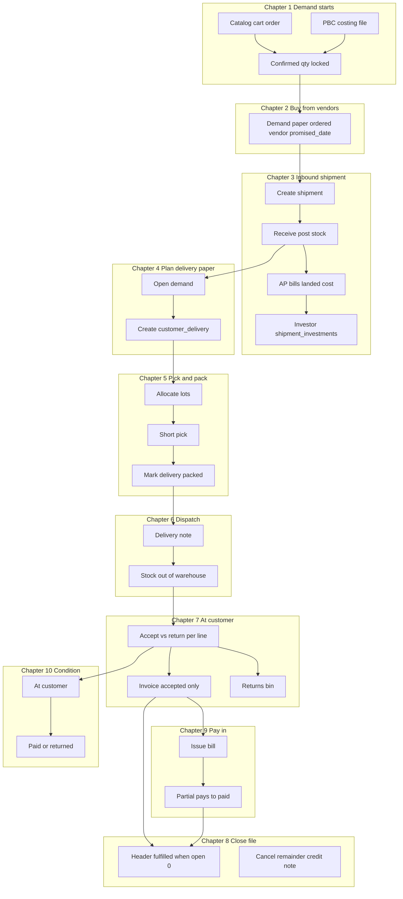
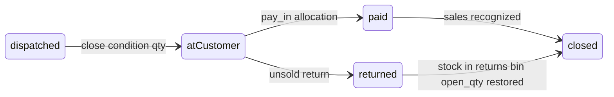

# Pre-order fulfillment flow (target story)

| | |
| :--- | :--- |
| **Purpose** | Single **product + ops truth** for pre-order / BW: what staff and customers experience from confirm → pay, trip by trip. |
| **Not in this doc** | SQL migrations, sprint status, or “already built in prod.” Those live in code, [00-gaps](features/procurement_stock/00-gaps.md), and the as-built story. |
| **As-built (code today)** | [preorder-fulfillment-flow-as-built.md](preorder-fulfillment-flow-as-built.md) — where the live flow diverges (**G1–G8** there; **G9–G14** only in this target story). |
| **Story doc status** | **Ch 1–10 narrative locked** in this file. Gaps **G1–G14** = “real story says X; as-built still Y” until engineering ships the target model. |

Read top to bottom: demand → buy → **inbound shipment(s)** → **delivery paper per trip** → **door truth** → **one bill per trip** → **partial pays** → header closes when nothing left to deliver.

**Design spine (what the real story assumes):** outbound **`customer_deliveries`** mirrors inbound **`global_shipments`**. Trip lines hold pick, ship, accept, and return — not a JSON blob on the order. Order/file header status is **derived** from demand lines. Returns land in the **returns area**, not sellable by default. Condition stock is **consignment at the customer** until pay-in or unsold return. Investor share is read from **inbound shipment P&L**, not from the delivery-close button.

## As-built vs real story (summary)

| | As-built (live) | Real story (this doc) |
| :--- | :--- | :--- |
| Model | Pre-order / BW — catalog + PBC → warehouse → Delivery paper | Same, **+ `customer_deliveries` outbound document** |
| Shared line store | `preorder_demand` (with `stock_picks` JSON) | `preorder_demand` (need/allocation) **+ `customer_delivery_lines`** (trip truth) |
| Header status | Hand-set (`procuring → packed → delivered`) | **Derived** (`confirmed → procuring → partially_fulfilled → fulfilled / cancelled`) |
| Delivery tracking | Picks in JSON on the order | **One delivery paper per trip** (`customer_deliveries` + lines); **many trips + many bills** per order |
| Door outcome | Close action chosen before visit (packed tab) | **Plan** optional at pack; **actual** accept/return at customer (authoritative) |
| Returns | Often held → sellable | **`returns` location** (`default_returns_stock_location_id`); grade to sellable later |
| Condition | Bill at close; pay later | **Consignment at customer** until pay-in or return unsold (Ch 10) |
| Bills | Draft per close batch, no trip ref | One bill per **`delivery_id`**; lines = **accepted** take/condition only |
| Customer pay | `partially_paid` on bill (no schedule) | Same money spine — **multiple pay-ins**, no installment scheduler (**G9**) |
| Investor | Shipment `shipment_investments` on inbound | Profit share on **inbound shipment P&L**; not computed at delivery close (**Ch 3.5**) |
| Shortfall | Bucket/backlog table | **`open_quantity` + `promised_date` + `backorder_status`** on demand line |
| Close file | Manual "Mark delivered" | **Auto** when `open_quantity = 0`; **Cancel remainder** for the rest |
| SQL | `procurement/03_rpcs.sql` | New RPCs; `stock_picks` dropped in P4 |
| UI | Demand + fulfill desks | Fulfill tabs: Open demand / Picking / Packed / Dispatched / Delivered / Backorders |

## Scope

| In this story | Not this story |
| :--- | :--- |
| `vendor_catalog` shop orders | **`fixed_price`** shop (stock-backed checkout; no Delivery paper) |
| PBC costing files | **Dropship** (pick → ship/issue → remittance) |
| Inbound shipment → `global_stocks` | Koba, thrift, ATP engine (promise date is **manual** here) |

**Dropship in one line:** unchanged — `shop_order_item_stock_picks`, ship/issue bills at ship, remittance at deliver. Not Demand paper / Delivery paper.

---

## Ops story in plain language

1. Customer order or PBC file locks **what they want** (`confirmed_quantity`).
2. Staff **buy** on Demand paper; goods arrive on **one or more inbound shipments** → warehouse stock.
3. Staff create a **delivery paper** (`customer_delivery`) for **this trip only** — what leaves the warehouse today (not the whole order).
4. **Delivery note** at dispatch; at the door staff record **accepted vs returned** per line.
5. System creates **one customer bill per delivery** for **accepted** take/condition lines only; immediate returns **skip invoice lines** and stock goes to the **returns area**.
6. **Condition** lines: consignment at customer until they **pay you** (pay-in) or **return unsold** to returns area.
7. Same order repeats inbound + delivery until `open_quantity = 0` — **many shipments, many delivery papers, many invoices** is normal.
8. Customer may **pay each bill in parts** (no installment schedule — free partial pays on Bills/Payments). **Investor profit** comes from **inbound shipment P&L**, not from the delivery close button.

---

## Four layers of “status” (real story)

Ops need **four different progress bars**. They must not be collapsed into one “Delivered” button on the order.

| Layer | What it tracks | Who cares | Target rule |
| :--- | :--- | :--- | :--- |
| **A — Order / PBC file header** | Is this file still live? | Customer shop, CRM | **Derived:** `procuring` → `partially_fulfilled` → `fulfilled` (or `cancelled`). Never hand-set “delivered” while lines still open (**G2**, **G3**). |
| **B — Demand line** (`preorder_demand`) | How much of the **confirmed** qty is still owed? | Demand desk, backorders | `open_quantity = confirmed − customer_delivered − cancelled`. Buy side (`ordered_quantity`, `promised_date`) is separate from deliver side (**G4**, **G6**). |
| **C — Delivery trip** (`customer_delivery`) | One van run / one handover | Warehouse, driver | `draft` → `picking` → `packed` → `dispatched` → `delivered`. **One trip = one delivery note + at most one customer bill** for accepted lines (**G1**). |
| **D — Customer bill** | Money for **this trip’s accepted** take/condition | Treasury, customer | `draft` → `issued` → `partially_paid` → `paid`. Multiple pay-ins; **no** installment schedule entity (**G9**). Condition revenue counts when **paid**, not at door (**Ch 9–10**). |

**Stock is a fifth thread (not a “status” on the order):** inbound shipment posts **sellable** lots; dispatch moves qty **out of warehouse**; door **return** moves qty into **returns bins**; condition qty is **at customer** until paid or returned (**G11**, **G12**).

---

## Chapter map — real story vs as-built

Use this table to see **what should happen** (target story) and **where live product still differs** (as-built). “Story” column = whether this doc fully specifies ops behavior.

| Ch | Real ops question | Target story answer | Story in doc | As-built gap |
| :--- | :--- | :--- | :--- | :--- |
| **1** | What did the customer commit to? | Lock `confirmed_quantity`; enter procurement → demand rows | **Defined** | Same entry RPCs; PBC still uses legacy file labels |
| **2** | What are we buying and when? | Demand paper: vendor, ordered qty, **promise date**, backorder badge | **Defined** | No `promised_date` / line backorder (**G6**) |
| **3** | When does stock exist? Who funded the batch? | Inbound receive → lots; AP on shipment; **investor % on shipment** | **Defined** | Inbound + investments exist; trace to delivery line missing (**G10**) |
| **4** | What leaves **today**? | **Delivery paper** = one trip; qty ≤ `open_quantity`; many trips per order | **Defined** | No trip entity; picks on order JSON (**G1**) |
| **5** | Did we pick what we planned? | Pick lots; optional **plan** take/condition; short-pick exception | **Defined** | Short pick not first-class (**G7**) |
| **6** | Proof leaving warehouse | Delivery note PDF; stock out of bin; not a tax invoice | **Defined** | Close often before “dispatch” mentally |
| **7** | What did customer **actually** keep? | **Door truth:** accept / return; bill **accepted** only; returns → returns area | **Defined** | Close at packed tab; return → sellable (**G4**, **G12**) |
| **8** | When is the **file** done? | Header when all `open_quantity = 0`; cancel remainder + CN | **Defined** | Mark delivered whole order (**G2**); no partial header (**G3**); no cancel remainder (**G8**) |
| **9** | How do they pay? | Issue bill; **partial pays** until paid; cashbook overpay | **Defined** | Bills work; story ties bill to **trip** not batch close |
| **10** | Condition unsold? | Consignment at customer → pay-in **or** return to returns bin | **Defined** | No consignment ledger (**G11**) |

Per-trip customer comms (**G13**) and optional investor rollup on delivery UI (**G14**) are **defined as target hooks**, not blockers for the rest of the story.

---

## Worked example — one order, two shipments (real story)

**Setup:** Catalog order **10 units** of SKU X after negotiation (`confirmed_quantity = 10`). Customer expects a mix of **take** and **condition** over two visits.

| When | Ops | Target story (what should happen) |
| :--- | :--- | :--- |
| **T0** | Customer confirms | Header `confirmed` → staff **start procurement** → demand line: `open_quantity = 10`. |
| **T1** | Demand desk | Order 10 from Vendor V; promise **15 Nov** → `backorder_status` tracks short orders. |
| **T2** | Inbound **Shipment A** (3 pcs) | Receive → 3 sellable lots; AP + landed cost; investor row on **this shipment** if applicable. |
| **T3** | **Delivery trip 1** | Create delivery for **3** pcs (not 10). Pick 3 lots (trace **Shipment A** — **G10**). Pack → dispatch → **delivery note DLV-001**. |
| **T4** | At customer door | Accept **2 take**, **return 1** at door. Close trip: **bill 2 take** only; **1 pc** `receive_customer_return` → **returns bin**; demand `delivered_quantity += 2`, **`open_quantity = 8`** (returned 1 is not “delivered”). Header **`partially_fulfilled`**. |
| **T5** | Treasury | Issue bill for trip 1; customer pays **half** → `partially_paid` (**G9**). |
| **T6** | Inbound **Shipment B** (7 pcs) | Second wave; same order line still `open_quantity = 8` until trips close. |
| **T7** | **Delivery trip 2** | Delivery for **7** pcs (≤ open 8). Dispatch **DLV-002**. At door: all **7 condition** accepted → bill 7 condition lines; **`condition_status = at_customer`**. |
| **T8** | Later | Customer sells 3 condition → **pay-in** → sales recognized. **4 unsold** returned → **returns bin** + restore/cancel on demand line (**Ch 10**). |
| **T9** | File close | When every line `open_quantity = 0` (and cancels accounted for), header **`fulfilled`** — **no** “Mark delivered” (**G2**). |

**Invoices:** **two** (DLV-001 and DLV-002), not one lump sum when trip 1 closes. **Investor:** profit read from Shipment A/B P&L reports, not computed on trip close (**Ch 3.5**).

---

## Story overview



---

## Chapter 1 — How customer demand starts

Two front doors feed the **same** procurement desks. Both create **`preorder_demand`** rows when the document enters **`procuring`**. Both **lock `confirmed_quantity`** on the demand line at that moment.

### 1A — Catalog shop order (`vendor_catalog`)

**Who:** Customer on the shop (`shop` scope). Order stored in `shop_orders` + `shop_order_items`. Snapshot fields: `shop_type_snapshot = vendor_catalog`, `is_negotiable_snapshot`, prices on lines.

**Shop types (do not mix):**

| Shop type | In this document? | Fulfillment |
| :--- | :--- | :--- |
| `vendor_catalog` | **Yes** | Negotiation → procurement → delivery trips |
| `fixed_price` | **No** | Stock-backed checkout; not this story |
| `dropship` | **No** | See scope |

#### Negotiable catalog (`is_negotiable_snapshot = true`)

| Step | Who | Order status (normalized) | What happens |
| :--- | :--- | :--- | :--- |
| 1 | Customer | `submitted` | Cart submitted |
| 2 | Staff | `priced` | First offer sent |
| 3 | Customer | `countered` | Customer counters |
| 4 | Staff | `final_offered` | Final offer sent |
| 5 | Customer | `confirmed` | Customer confirms **price and quantity** → `confirmed_quantity` on lines |

Workflow bar: submitted → priced → countered → final_offered → confirmed → fulfillment.

#### Non-negotiable catalog (`is_negotiable_snapshot = false`)

Shorter bar: submitted → priced → confirmed → fulfillment. Counter/final-offer collapsed in UI. **Confirmed** still locks `confirmed_quantity` the same way.

#### What is *not* different between negotiable and non-negotiable

After **`confirmed`**, both paths are identical: start procurement → Demand paper → inbound shipment(s) → **delivery paper(s)** → bills. Negotiation only changes **how long Chapter 1 takes**.

#### Enter procurement (end of Chapter 1 for catalog)

| Who | Action | Result |
| :--- | :--- | :--- |
| Staff | **Start procurement** on order detail | RPC `staff_start_catalog_procurement` |
| System | Status `confirmed` → **`procuring`** | Trigger writes **`preorder_demand`** per line: `ensure_preorder_demand_for_procuring_document('shop_order', order_id)` |
| System | | `profile_id` from order; `confirmed_quantity` seeded; **`open_quantity = confirmed_quantity`**; `cancelled_quantity = 0` |

**Design note:** `confirmed_quantity` is the immutable anchor:
```
open_quantity = confirmed_quantity − delivered_quantity − cancelled_quantity
```

---

### 1B — PBC costing file (pre-order quote)

**Who:** Staff/sourcing in **app** (`product_based_costing`). Same Demand and Delivery desks once in procurement.

#### Quote phase (before procurement)

File lives in `product_based_costing_files` with enum `costing_file_status`. UI workflow (`normalizePbcFileStatus`):

| UI phase | Typical meaning |
| :--- | :--- |
| pending / offered | Customer or staff pricing |
| confirmed | Customer accepted lines and qty |
| **procuring** | Buying and fulfilling (DB may show `procuring` or legacy `placing_order`) |
| packed | Legacy file-level label; **target:** trip status lives on `customer_deliveries` |
| delivered | File complete (legacy alias `invoicing`) → **target:** derived **`fulfilled`** |

Lines: `product_based_costing_items` with quantities, offer prices, optional **`assigned_shipment_id`**.

#### Enter procurement (end of Chapter 1 for PBC)

| Who | Action | Result |
| :--- | :--- | :--- |
| Staff | Move file status to **procuring** | Trigger `ensure_preorder_demand_for_procuring_document('pbc_costing_file', file_id)` |
| System | | One **`preorder_demand`** row per item (`source_type = pbc_costing_item`), `confirmed_quantity` + `open_quantity` seeded |

**Same Chapter 2–10 desks.** No shop negotiation statuses.

---

## Chapter 2 — Staff buys from suppliers (Demand paper)

**Where:** `/:slug/app/procurement/demand` — desk mode **`buy`**.

**When:** Header document is **`procuring`**.

| Step | Staff action | Data |
| :--- | :--- | :--- |
| 1 | Open customer document in list | `list_procurement_demand_groups(p_procurement_status = procuring)` |
| 2 | Enter **ordered quantity** per line | `preorder_demand.ordered_quantity` (was `placed_quantity`) |
| 3 | Set **vendor** per line | `vendor_id`, bulk vendor dialog |
| 4 | **Set promise date** per line | `preorder_demand.promised_date` — **G6** |
| 5 | Save | `upsert_preorder_demand`, `set_preorder_demand_vendor_for_document`, `set_demand_promised_date` |

**Auto backorder status** (trigger on `ordered_quantity` vs `confirmed_quantity`):

| Condition | `backorder_status` |
| :--- | :--- |
| `ordered_quantity ≥ confirmed_quantity` | `none` |
| `ordered_quantity < confirmed_quantity` and vendor set | `awaiting_vendor` |
| `ordered_quantity < confirmed_quantity` and no vendor | `awaiting_stock` |
| Partial delivered, remainder open | `partial` |

Demand paper = **purchase side**, not customer delivery.

---

## Chapter 3 — Inbound shipment (warehouse entry)

**Where:** `/:slug/app/procurement/shipment/*` — **inbound** `global_shipments` (vendor → your warehouse).

Runs **in parallel** with Chapter 2. Stock must exist as **`global_stocks`** before Chapter 5 can allocate.

### 3.1 Create and plan shipment

| Step | Staff action | System |
| :--- | :--- | :--- |
| 1 | Create shipment (draft) | `global_shipments`, line items, vendors |
| 2 | Optional | `in_transit` |
| 3 | PBC | Assign costing lines to shipment (`assigned_shipment_id`) |
| 4 | Catalog demand | Ops creates shipment separately |

Shipment statuses: `draft` | `in_transit` | `received` | `cancelled`.

### 3.2 Receive and post stock

| Step | Staff action | System |
| :--- | :--- | :--- |
| 1 | Land splits on lines (ordered vs extras) | Case A receive rules |
| 2 | Post sellable outcomes | `post_shipment_outcome_stock` → lots / `global_stocks` |
| 3 | Vendor credits when received | Outcome credits (Cases C–E) |
| 4 | Put stock in bins | Movements |
| 5 | Close shipment | `is_closed` — shipment UI read-only (PS10 guard) |

### 3.3 Shipment money (vendor AP — not customer bill)

| Step | What | Notes |
| :--- | :--- | :--- |
| Cost rows on shipment | Material, freight, customs, … | Sync AP bucket bills (WA15 / PS14) |
| Pay vendor | AP bills + pay out | **Different paper** from customer `delivery_close` |
| Stamp landed cost | Capitalizable rows | Feeds unit cost on stock picked for delivery |

**Design note:** inbound **`global_shipments`** ↔ outbound **`customer_deliveries`**. Same document-with-status pattern, opposite direction (**G1**).

### 3.4 Multi-wave supply for one order

One catalog/PBC order often spans **several inbound shipments**:

| Wave | Ops | Demand line |
| :--- | :--- | :--- |
| Shipment A arrives | Post stock; pick on delivery trip 1 | `open_quantity` decreases only when trip 1 **closes** accepted |
| Shipment B arrives later | More stock for same order lines | New delivery paper trip 2; **second invoice** |

Header does **not** flip to fulfilled when shipment A lands — only when **`open_quantity = 0`** on all lines (**G3**, multi-invoice).

### 3.5 Investor economics (inbound shipment)

Detail: [investor_capital spec](features/investor_capital/spec.md). Summary for this story:

| Concept | Where |
| :--- | :--- |
| Partner identity | `investors` |
| Capital on a batch | `shipment_investments` — amount + **`cost_share_pct`** per **inbound** shipment |
| Profit share | Shipment gross × pct; sum of pct ≤ 100% per shipment |
| Portal | Read-only dashboard + shipment list (v1) |
| Pre-order delivery | Uses **landed cost** from received shipments; **does not** allocate investor profit at `close_customer_delivery` |
| Reporting | Shipment P&L after AP / landed stamp ([reporting_treasury spec](features/reporting_treasury/spec.md)) |

**G14:** Optional future read-only rollup on delivery detail (“stock from invested shipment X”) — not required to close a trip.

---

## Chapter 4 — Plan delivery (delivery paper = one trip)

**Delivery paper (UI name)** = one row in **`customer_deliveries`** — **not** the whole order.

**Where:** `/:slug/app/procurement/fulfill` — tab **Open demand**.

**When:** Order/file is `procuring` or `partially_fulfilled` and lines have `open_quantity > 0`.

| Step | Staff action | Data / RPC |
| :--- | :--- | :--- |
| 1 | Open **Open demand** tab | `list_open_demand_groups()` — `open_quantity`, `promised_date` |
| 2 | Select lines + qty for **this trip** | qty ≤ `open_quantity` per line |
| 3 | **Create delivery** | `create_customer_delivery(source_type, source_id, allocations[])` |
| 4 | System | `customer_deliveries`: `status = draft`, `delivery_number = DLV-…`; `customer_delivery_lines` with `requested_quantity` |

**Same order → many `customer_deliveries` → many `delivery_number`s → many bills** when items arrive on different inbound shipments or you deliver in batches.

**Edge case:** *Deliver 3 now, 7 later* → Trip A (3), Trip B (7). **G10:** delivery line traces `global_stock_id` → inbound shipment (via stock lot / `shipment_item_id`).

---

## Chapter 5 — Pick and pack

**Where:** Delivery desk — tabs **Picking**, then **Packed**.

**When:** A `customer_delivery` exists in `draft` / `picking`.

### 5.1 Allocate lots

| Step | Staff action | Data |
| :--- | :--- | :--- |
| 1 | Open delivery | `customer_delivery_lines` |
| 2 | Pick lots | `global_stock_id`, `picked_quantity` |
| 3 | Fill oldest stock | `fill_customer_delivery_oldest_stock(delivery_id)` |
| 4 | Optional **plan** | `planned_close_action`: `take` \| `condition` (hint for visit — editable later) |

Multi-warehouse = multiple delivery lines, one trip document.

### 5.2 Short-pick exception (G7)

| Step | Staff action | System |
| :--- | :--- | :--- |
| 1 | `picked_quantity < requested_quantity` | Exception banner |
| 2 | Reason | `exception_reason`: `short_stock`, `damaged`, `substitute_refused`, `other` |
| 3 | Confirm | `record_short_pick(delivery_line_id, picked_qty, reason)` |
| 4 | System | Remainder stays on demand `open_quantity` |

### 5.3 Mark packed (delivery only)

| Step | Staff action | Result |
| :--- | :--- | :--- |
| 1 | **Mark packed** on **delivery** | `mark_delivery_packed(delivery_id)` |
| 2 | `customer_deliveries.status` | → **`packed`** |
| 3 | Order/file header | **Unchanged** (derived) — **G2** |

No customer bill at pack.

---

## Chapter 6 — Dispatch

**Where:** Tab **Dispatched**. **When:** Delivery is `packed`.

| Step | Staff action | System |
| :--- | :--- | :--- |
| 1 | **Dispatch** | `dispatch_customer_delivery(delivery_id)` |
| 2 | Print **delivery note** | PDF: `delivery_number`, lines, order ref — **not** a tax invoice |
| 3 | System | `status = dispatched`, `dispatched_at` |
| 4 | System | Movement **`delivery_dispatch_out`**: `shipped_quantity`; stock leaves warehouse bins |

**Condition lines:** physically with customer but **not sold** until close + pay-in (Ch 7–10). **Take lines:** not AR until close issues bill.

Optional **G13:** notify customer on dispatch/close (`notify_catalog_shop_order` pattern).

---

## Chapter 7 — At customer: accept, return, invoice

**Where:** After visit — delivery detail or **Dispatched** tab close.

**When:** Delivery is `dispatched` (or `packed` for on-site close — same RPC).

### 7.1 Plan vs actual

| Phase | When | Authority |
| :--- | :--- | :--- |
| **Plan** | At pack (optional) | `planned_close_action` on line |
| **Actual** | At customer / immediately after | **`accepted_quantity`**, **`returned_at_door_quantity`**, final **`close_action`** outcome |

Staff record what the customer **kept**, **returned immediately**, and whether kept stock is **take** (invoice now) or **condition** (consignment).

### 7.2 Outcomes (authoritative)

| Outcome | Customer bill | Stock / location |
| :--- | :--- | :--- |
| **Take accepted** | Invoice line, `settlement_kind=take`, qty = accepted | Sold / AR path after issue |
| **Condition accepted** | Invoice line, `settlement_kind=condition`, qty = accepted | **Consignment at customer** (Ch 10) until pay-in or return |
| **Returned at door** | **No line** on this delivery bill | `receive_customer_return` → **`returns` bin** (`default_returns_stock_location_id` / returns tree — [procurement US-3](features/procurement_stock/spec.md)); grade to sellable later if needed |
| **Mixed on one line** | Bill qty = accepted only | Returned qty → returns bin; demand `open_quantity` unchanged for returned portion |

**G12:** Same trip: accepted 2, returned 1 → bill 2 units; 1 unit to returns bin. If a draft bill was wrong, **`process_wholesale_invoice_return`** / credit note ([bills_pays tests](features/bills_pays/tests.md)).

### 7.3 Close the delivery

| Step | Staff action | System |
| :--- | :--- | :--- |
| 1 | **Close delivery** | `close_customer_delivery(delivery_id, line_outcomes[])` |
| 2 | System | Draft bill from **accepted take/condition only**; `invoice_id` on delivery; `issue: false` |
| 3 | System | Demand: `delivered_quantity += accepted` (take/condition); door returns do not count as delivered; recompute `open_quantity` |
| 4 | System | `status = delivered`, `delivered_at` |
| 5 | System | Remainder open → Open demand / Backorders; header → **`partially_fulfilled`** until all lines `open_quantity = 0` |

One delivery → one bill (for that trip’s accepted lines).

---

## Chapter 8 — Close the file (header derivation + remainder)

### 8.1 Header derived — never set by hand

| Header state | Derived when |
| :--- | :--- |
| `confirmed` | before procurement |
| `procuring` | demand exists; nothing customer-delivered yet |
| `partially_fulfilled` | some `open_quantity > 0`, some delivered |
| `fulfilled` | all lines `open_quantity = 0` |
| `cancelled` | all `cancelled_quantity = confirmed_quantity` |

**Removed:** `staff_set_catalog_delivered_qty`, manual PBC “mark delivered”. **G2**, **G5** (Delivered tab keeps history).

### 8.2 Cancel remainder (G8)

`cancel_preorder_demand_remainder(demand_id, reason, prorate_bill_id?)` → `cancelled_quantity += open_quantity`; credit note if needed; header re-derives.

### 8.3 PBC parity

Same widgets and demand fields; **`product_based_costing_backlog_items` retired** in favor of `open_quantity` + `promised_date` + `backorder_status`.

---

## Chapter 9 — Customer payments (money spine)

After staff **issue** the delivery bill (`draft` → `issued`):

| Step | System | Notes |
| :--- | :--- | :--- |
| Customer pays part | Pay-in + allocation | `payment_status` → **`partially_paid`** |
| Customer pays again | More allocations | Until **`paid`** |
| Overpay | Profile **cashbook** custody | [money-spine take example](features/bills_pays/money-spine.md#worked-examples) |
| Condition stock sold | Pay-in against condition lines | Sales in reports when **paid** ([reporting_treasury spec](features/reporting_treasury/spec.md)) |

**G9:** No installment **scheduler** — customer pays in parts freely; staff track on Bills / Payments. Future dated installment plan = new entity (out of scope).

---

## Chapter 10 — Condition lifecycle (consignment)

For lines closed as **condition** at Ch 7:



| State | `condition_status` | Stock |
| :--- | :--- | :--- |
| With customer | `at_customer` | Movement `consignment_out` (target) |
| They sold and paid | `paid` | Sale recognized |
| Unsold returned | `returned` | `condition_return_in` → **returns bin**; demand line open qty restored or cancel |

**G11:** Consignment at customer uses `condition_status` + movements — specified here; as-built lacks ledger (**PS25**).

Unpaid condition is **not** counted as sales until paid ([bills_pays spec](features/bills_pays/spec.md) US-1b).

---

## State machines

### `preorder_demand` (line)

```
confirmed ──► open ──► on_delivery ──► delivered_qty accumulated
                 │         │
                 └─────────┴──► backordered / cancelled
```

Invariant: `confirmed_quantity = delivered_quantity + cancelled_quantity + open_quantity`.

### `customer_delivery` (trip)

```
draft ──► picking ──► packed ──► dispatched ──► delivered
  │           │           │            │
  └───────────┴───────────┴────────────┴──► cancelled
```

### Header (derived)

```
confirmed ──► procuring ──► partially_fulfilled ──► fulfilled
                                  │
                                  └──────────────► cancelled
```

---

## Edge scenarios (story stress tests)

| Scenario | Chapter | Real story? | How ops should see it |
| :--- | :--- | :--- | :--- |
| Items on shipment A now, B later | 3.4 + 4 | **Yes** | Multiple inbound + multiple delivery papers |
| Same order, several invoices | 4 + 7 | **Yes** | One bill per `delivery_id` |
| Deliver 3 now, 7 later | 4 + 7 | **Yes** | Two trips; header stays partial |
| Immediate return at door | 7.2 | **Yes** | No bill line; returns bin |
| Condition: sell or return | 7 + 10 | **Yes** | Pay-in or `condition_return_in` |
| Customer pays in parts | 9 | **Yes** | `partially_paid`; no schedule |
| Never deliver remainder | 8.2 | **Yes** | Cancel remainder + CN |
| Substitute SKU | 5.1 | **Yes** | Different `global_stock_id` on line |
| Short pick | 5.2 | **Yes** | `record_short_pick` |
| Which inbound shipment? | 3.4 + App B | **Yes** | **G10** trace on stock/line |
| Investor profit | 3.5 | **Yes** | Shipment investments; not on close RPC |
| Notify customer per trip | 6 / 7 | **Yes (G13)** | Hook on dispatch/close — optional product |

---

## Appendix A — Analysis checklist

1. Header derived state?
2. Every demand line: `confirmed = delivered + cancelled + open`?
3. How many **`customer_deliveries`** / **`delivery_number`s** / bills?
4. Per delivery line: requested, picked, shipped, **accepted**, **returned_at_door**?
5. Returns: **`return_location_id`** in returns tree?
6. Condition lines: `condition_status` and pay-ins?
7. Bill **`partially_paid`** vs **`paid`** (Ch 9)?
8. Inbound **`shipment_investments`** on shipments that fed picked lots?
9. `cancel_preorder_demand_remainder` + credit notes?

---

## Appendix B — Data the real story needs

Shapes below are **target contract** (bigint IDs like live `shop_orders`, `preorder_demand`, `global_stocks`). As-built uses `stock_picks` JSON instead of trip lines until cutover (Appendix E).

### `customer_deliveries` (trip document)

| Field | Type | Meaning |
| :--- | :--- | :--- |
| `id` | bigint pk | |
| `tenant_id` | bigint | |
| `source_type` | enum | `shop_order` \| `pbc_costing_file` |
| `source_id` | bigint | order or file |
| `status` | enum | `draft` \| `picking` \| `packed` \| `dispatched` \| `delivered` \| `cancelled` |
| `delivery_number` | text | `DLV-…` |
| `dispatched_at` / `delivered_at` | timestamptz | |
| `invoice_id` | bigint null | Ch 7 |
| `carrier` / `notes` | text | |

### `customer_delivery_lines` (trip lines)

| Field | Type | Meaning |
| :--- | :--- | :--- |
| `id` | bigint pk | |
| `delivery_id` | bigint fk | |
| `preorder_demand_id` | bigint fk | |
| `global_stock_id` | bigint fk | lot |
| `shipment_item_id` | bigint null | **G10** inbound trace |
| `requested_quantity` | numeric | Ch 4 |
| `picked_quantity` | numeric | Ch 5 |
| `shipped_quantity` | numeric | Ch 6 |
| `accepted_quantity` | numeric | Ch 7 door |
| `returned_at_door_quantity` | numeric | Ch 7 door |
| `delivered_quantity` | numeric | take/condition accepted (feeds demand) |
| `planned_close_action` | enum null | take \| condition |
| `close_action` | enum null | actual take \| condition \| return |
| `condition_status` | enum null | `at_customer` \| `paid` \| `returned` (**G11**) |
| `return_location_id` | bigint null | returns bin FK |
| `exception_reason` | text null | |
| `invoice_line_id` | bigint null | |
| `returned_at` | timestamptz null | condition return |

**Movement types (target):** `delivery_dispatch_out`, `customer_return_in`, `condition_return_in`, `consignment_out`.

### `preorder_demand` (line — story fields)

| Field | Change vs as-built | Meaning |
| :--- | :--- | :--- |
| `ordered_quantity` | rename from `placed_quantity` | Ch 2 |
| `confirmed_quantity` | keep | Ch 1 |
| `picked_quantity` | rename from conflated `delivered_quantity` | warehouse pick sum (**G4**) |
| `delivered_quantity` | NEW | sum of customer-accepted qty from closed trips |
| `cancelled_quantity` / `open_quantity` | NEW | Ch 8 |
| `promised_date` / `backorder_status` | NEW | Ch 2 (**G6**) |
| `stock_picks` | DROP P4 | → delivery lines |

---

## Appendix C — Target capabilities (RPC / kernel names)

Names the **real story** expects at each step. As-built equivalents are in [as-built Appendix C](preorder-fulfillment-flow-as-built.md).

| Capability | Chapter | Role in the story |
| :--- | :--- | :--- |
| `staff_start_catalog_procurement` | 1A | Lock procurement; seed demand |
| `ensure_preorder_demand_for_procuring_document` | 1A / 1B | One demand row per line; seed `open_quantity` |
| `upsert_preorder_demand`, `set_preorder_demand_vendor_for_document` | 2 | Demand paper buy side |
| `set_demand_promised_date` | 2 | Promise date + backorder (**G6**) |
| `post_shipment_outcome_stock`, shipment close RPCs | 3 | Inbound stock + AP path |
| `list_open_demand_groups` | 4 | Open demand tab |
| `create_customer_delivery` | 4 | One trip document |
| `fill_customer_delivery_oldest_stock` | 5 | FIFO pick |
| `record_short_pick` | 5 | Short-pick exception (**G7**) |
| `mark_delivery_packed` | 5 | Trip → packed (header unchanged) |
| `dispatch_customer_delivery` | 6 | Delivery note + warehouse out |
| `close_customer_delivery(delivery_id, line_outcomes[])` | 7 | Door truth → bill + demand update |
| `receive_customer_return(delivery_line_id, qty, location_id)` | 7 | Door return → returns bin (**G12**) |
| `create_sales_invoice_from_payload` | 7 | Bill linked to `delivery_id` |
| `process_wholesale_invoice_return` | 7 | Credit note if bill wrong |
| `cancel_preorder_demand_remainder` | 8 | Cancel open qty + CN (**G8**) |
| Pay-in + allocation (money kernel) | 9 | `partially_paid` → `paid` (**G9**) |
| `list_customer_deliveries` | 4–7 | Trip list / Delivered tab (**G5**) |

**Retire in target story (as-built still has):** `staff_set_catalog_delivered_qty`, `close_preorder_demand_document` as the primary close path — replaced by trip **`close_customer_delivery`** + derived header.

---

## Appendix D — Routes and UI

| Route | Chapter | UI change |
| :--- | :--- | :--- |
| `/app/procurement/demand` | 2 | promise date, backorder badge |
| `/app/procurement/shipment/*` | 3 | + investor rows on shipment detail |
| `/app/procurement/fulfill` | 4–7 | Open demand / Picking / Packed / Dispatched / Delivered / Backorders |
| `/app/shop/orders/:id` | 1A, 8, 9 | fulfillment widget; pay status link |
| PBC file details | 1B, 8 | same widget |
| `/app/capital/investors` | 3.5 | shipment investment table (existing app) |

**Order detail widget (target):** confirmed / delivered / open; delivery list; promised date; **Create delivery**; **Cancel remainder**; no Mark delivered.

**Customer shop:** “3 of 10 delivered, 7 pending — promised 15 Nov” (**G3**).

| Code | Change |
| :--- | :--- |
| `ProcurementDemandDesk.vue` | Ch 2 promise date |
| `ProcurementFulfillDesk.vue` | Ch 4–7 deliveries |
| `CustomerDeliveryDetail.vue` | Ch 5–7 door close **NEW** |
| `deliveryCloseAction.ts` | replaces `demandClosePickFilter.ts` |
| `catalogOrderStatus.ts` | derived header only |

---

## Appendix E — Engineering migration (not ops story)

Phased cutover from as-built `stock_picks` → target deliveries. **Ops should follow Ch 1–10 above;** this table is for builders only.

| Phase | Scope | Risk | Rollback |
| :--- | :--- | :--- | :--- |
| **P0** | Tables + new demand columns; dual-write `stock_picks` | Low | Drop new tables |
| **P1** | Backfill one `customer_delivery` per historical close batch | Medium | Read JSON |
| **P2** | New RPCs dual-write; UI reads deliveries | Medium | Feature flag |
| **P3** | Read path on deliveries; Delivered tab | Low | Flag |
| **P4** | Drop `stock_picks`; remove `staff_set_catalog_delivered_qty` | Low | — |

**P1 backfill:** historical **`return`** close → **returns location**, not sellable.

**Invariant before P3:**
```
sum(delivery_lines customer-delivered) + cancelled_quantity + open_quantity = confirmed_quantity
```

---

## Gap closure summary (real story vs as-built)

Each gap is a **story defect in production today**. The **real story** column is what ops should experience after the target model ships. Status here = **documented in this file**, not “done in code.”

| Gap | As-built today (symptom) | Real story (target) | Doc § | Procurement |
| :--- | :--- | :--- | :--- | :--- |
| **G1** | Picks live in JSON; no trip id | One **delivery paper** per trip with `delivery_number` | Ch 4–6 | PS15 |
| **G2** | **Mark delivered** flips whole order | Header **derived**; no manual delivered RPC | Ch 8 | PS16 |
| **G3** | Only procuring / packed / delivered | Customer sees **partially fulfilled**; “3 of 10” | Ch 8, shop widget | PS17 |
| **G4** | `delivered_quantity` = warehouse pick sum | **Picked** vs **customer-delivered** split on demand | App B | PS18 |
| **G5** | Fulfill desk: no delivered history tab | **Delivered** tab = closed trips | Ch 8, App D | PS19 |
| **G6** | No line promise / ATP | **`promised_date`** + **`backorder_status`** on demand | Ch 2 | PS20 |
| **G7** | Short pick invisible | **`record_short_pick`** + reason on trip line | Ch 5.2 | PS21 |
| **G8** | Cannot cancel undelivered remainder cleanly | **`cancel_preorder_demand_remainder`** + CN | Ch 8.2 | PS22 |
| **G9** | Staff ask for “installment plan” | **Partial pay-ins** on bill; no schedule entity | Ch 9 | PS23 |
| **G10** | “Which shipment was this?” | Trace **`shipment_item_id`** / lot on delivery line | Ch 3.4, App B | PS24 |
| **G11** | Condition billed but stock unclear | **`condition_status`** + consignment movements | Ch 10 | PS25 |
| **G12** | Return at close → sellable | Door return → **returns bin**; bill net of returns | Ch 7.2 | PS26 |
| **G13** | Order-level notify only | Optional notify on **dispatch / close** per trip | Ch 6–7 | PS27 |
| **G14** | Investor only on inbound UI | Shipment P&L + portal; optional trip rollup | Ch 3.5 | PS28 |

Track build progress in [procurement_stock/00-gaps.md](features/procurement_stock/00-gaps.md) (**PS15–PS28** = design rows pointing here).
