# Kernels

Shared engines that sell modules call. A bug here corrupts money, stock, or access.

Sell modules (wholesale, shop, pre-order, inbound) **plug in**; they do not own kernel tables or duplicate books logic.

**Read order (dependency):** Access gates who runs what → Warehouse holds qty → Landed cost stamps unit cost from inbound → Money records bills, pays, and cashbook on the parent books.

## Overview

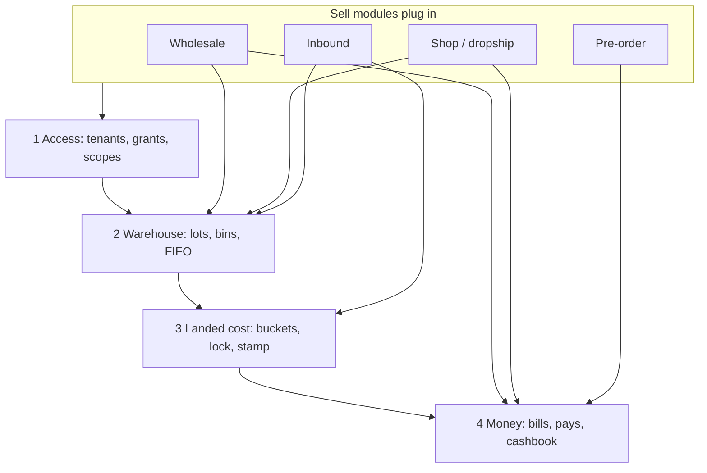

| Order | Kernel | One-line job |
| ---: | --- | --- |
| 1 | **Access** | Parent and child tenants, module grants, four login scopes |
| 2 | **Warehouse** | Parent warehouse lots, bins, movements, availability for picks and FIFO issue |
| 3 | **Landed cost** | Shipment cost buckets, lock, FX from AP pays, unit stamp on lots |
| 4 | **Money** | One books layer: parties, paper, settlement, cash on hand and profile leftover |

[Scopes](/docs/scopes) · [Tenants](/docs/modules/tenants) · [Shop](/docs/modules/shop) · [Inbound](/docs/modules/inbound) · [Money](/docs/modules/money).

---

## Access kernel

**Who can log in where**, and **what each surface may do**. Parent company owns books and stock; child brands and shops run under the same kernels with **grants** — not separate apps.

OAuth (Google via Supabase) establishes identity; this kernel binds identity to **tenant**, **scope**, and **module actions**. ERP screens live in feature modules; access only gates routes, nav, and server RPCs.

Scope summary page: [Scopes](/docs/scopes). Company vs shop: [Tenants](/docs/modules/tenants) · [Shop](/docs/modules/shop) · [Shop admin](/docs/modules/shop-admin).

### Core objects

| Object | Role |
| --- | --- |
| **Tenant** | Company or child brand; `parent_id` null = parent books owner |
| **Membership** | User ↔ tenant link with role (staff, investor, …) |
| **Login scope** | `platform`, `app`, `shop`, `investor` — URL tree and theme, not a job title |
| **Tenant module** | Which sell packs are enabled for this company (`tenant_modules`) |
| **Grant** | Per-membership allow: module + action (`view`, `create`, `edit`, `delete`, `manage`) |
| **effectiveGrants** | Bootstrap payload the SPA uses for nav and `createAccessGuard` |

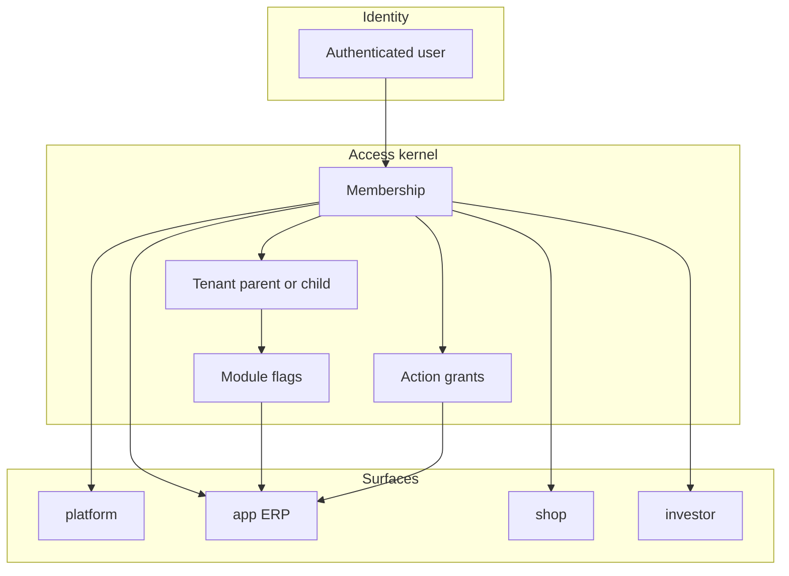

### Four login scopes

| Scope | URL | Who | Typical work |
| --- | --- | --- | --- |
| **platform** | `/auth/platform/login` → `/platform/*` | Superadmin | Provision tenants, module catalog, global reference |
| **app** | `/:slug/app/*` | Tenant staff | Full ERP desks when module + grant allow |
| **shop** | `/:slug/shop/*` or custom host | Buyer / reseller | Catalog, cart, orders, merchant statement |
| **investor** | `/:slug/investor/*` | Capital partner | Read-only portal; no withdraw in v1 |

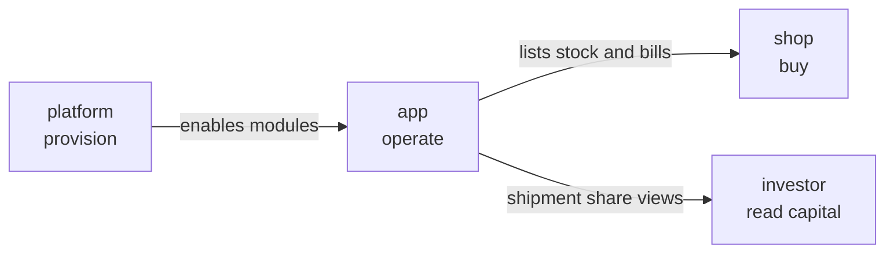

**Shop** and **investor** never get: warehouse bin admin, landed-cost lock, or platform tenant provision. **Platform** never runs company bills or stock.

### Parent and child tenants

- **Parent** (`parent_id` null): owns **money books**, **warehouse stock**, and cashbook at company level.
- **Child brand**: issues under parent; workspace switcher lists companies and child refs (`list_child_tenant_refs`).
- One-level brand hierarchy as-built; books stay at parent.

Staff usually work in **app** on the slug they belong to; grants decide which desks appear.

### Three-layer RBAC (app)

| Layer | Rule |
| --- | --- |
| 1. Module enabled | `tenant_modules` — pack off → no nav, RPCs denied |
| 2. Admin bypass | Tenant admin roles skip per-action checks where spec allows |
| 3. Explicit grants | `view` / `create` / `edit` / `delete` / `manage` per module |

UI hides actions without grant; server uses `has_module_action()` / `membership_has_module_action()` on sensitive RPCs. Client grants can lag until `permissionVersion` refresh — treat server as source of truth.

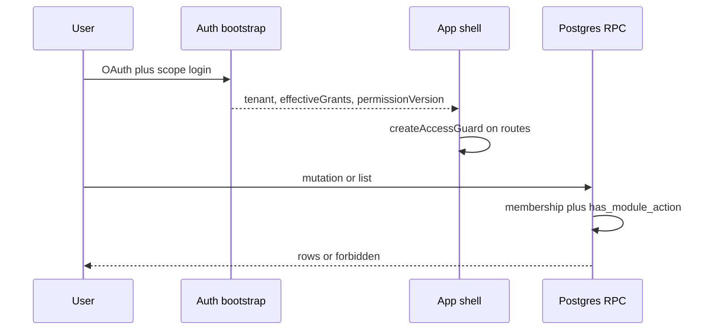

### Feature × surface (condensed)

| Area | platform | app | shop | investor |
| --- | :---: | :---: | :---: | :---: |
| Tenant / membership | yes | yes | login | login |
| Procurement, bins, landed lock | — | yes | — | — |
| Bills, payments, cashbook | — | yes | statement | — |
| Shop config, dropship ops | — | yes | cart, orders | — |
| Reporting / treasury | — | yes | — | — |
| Investor capital | — | staff | — | portal read-only |
| Global reference catalogs | yes | read | — | — |

Full matrix: in-app [Scopes](/docs/scopes) (same as architecture scopes doc).

### Modules plug in

| Pattern | Access responsibility |
| --- | --- |
| Feature pack | Declares module id in registry; routes under `app` or `shop` |
| Page / button | `effectiveGrants` + `createAccessGuard` |
| RPC | RLS + `has_module_action()` for cross-tenant safety |
| Platform screens | Separate router tree; no `moduleRegistry` |

Sell modules **do not** implement their own login — they assume bootstrap already resolved tenant and grants.

### Three worked patterns

**Staff invoice clerk** — `app` login on company slug; `sales_invoice` module enabled; grant `view`+`create` on bills → compose and issue. No grant → nav hidden, RPC 403.

**Dropship reseller** — `shop` login; sees only their shop catalog and orders; merchant statement from money kernel; cannot open bin tree or lock shipment costs.

**Platform ops** — `platform` login; creates tenant, toggles `tenant_modules` for BW vs Koba vs thrift; company staff then get `app` with grants — platform user does not post pays.

### Links to other kernels

| Kernel | Relationship |
| --- | --- |
| **Money** | Parent tenant profile for books; child may `issued_by_tenant_id` on bills |
| **Warehouse** | Stock owned by **parent**; app grants gate receive and movements |
| **Landed cost** | Lock and cost matrix **app** only, under procurement grants |

### Out of scope for access kernel

Per-screen business rules inside feature specs; shop checkout pricing logic; investor withdraw workflow; thrift/Koba permission copies; custom OAuth providers beyond current Supabase Google flow.

## Warehouse kernel

**One quantity picture** for BW (Brandwala wholesale). The **parent tenant** owns stock. Child brands and shops sell from the same lots — not separate channel stock books.

Product work happens on the **app** scope (shipments, bins, receive, movements). **Shop** and **investor** do not manage bins or receive inbound. **Platform** does not touch warehouse rows.

Desk detail for inbound: [Inbound shipment module](/docs/modules/inbound).

### Core objects

| Object | Role |
| --- | --- |
| **Shipment** | Inbound paper: ordered lines, land splits, outcomes — not on-hand until posted |
| **Lot (`global_stocks`)** | Sellable or unsellable qty tied to product, shipment/outcome, kind and reason |
| **Bin tree** | Warehouse → zone → shelf → level → **bin** (leaf). Lots sit in bins |
| **Movement** | Qty moves between bins or grades on the shelf — shipment paper stays unchanged |
| **Availability** | What staff and RPCs can sell or pick right now (same lots for desk, shop, dropship) |

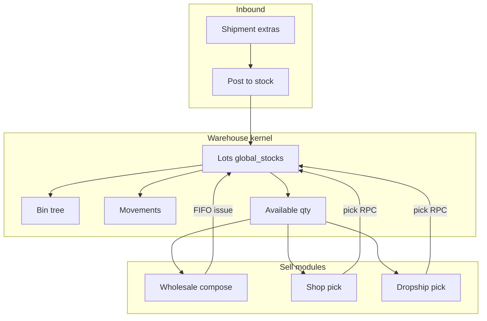

**Pre-order and PBC** have no warehouse row until goods are **received** on a shipment and posted. **K-beauty** and **thrift** use their own stock tables — not this kernel.

### Bin tree

Staff place lots on **leaf bins** only. The tree is for finding and moving stock, not for money or AP.

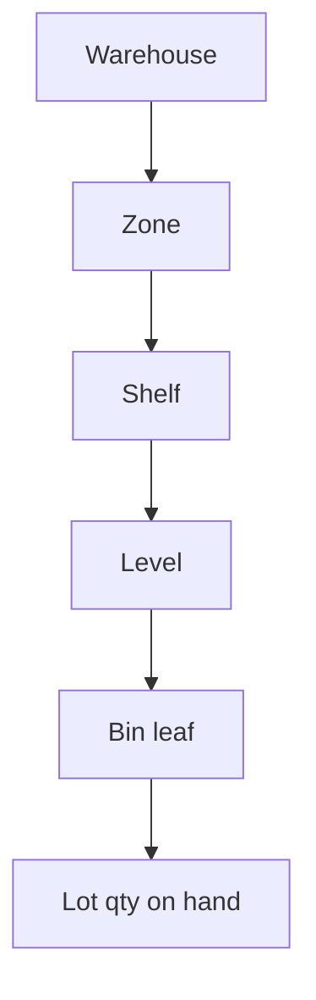

Returns and damaged grading use **movements** and tags on lots. Do not invent a new inbound shipment row for shelf damage.

### Receive path (inbound → lots)

| Shipment status | Post to stock |
| --- | --- |
| `draft` / `in_transit` | Yes when sellable extras exist |
| `received` | Delta posts until close |
| `cancelled` | No |

**Land splits** on shipment extras must sum to ordered qty per line before sellable qty becomes lots. `received` means the first post of sellable extra stock — not “clone ordered” without posting.

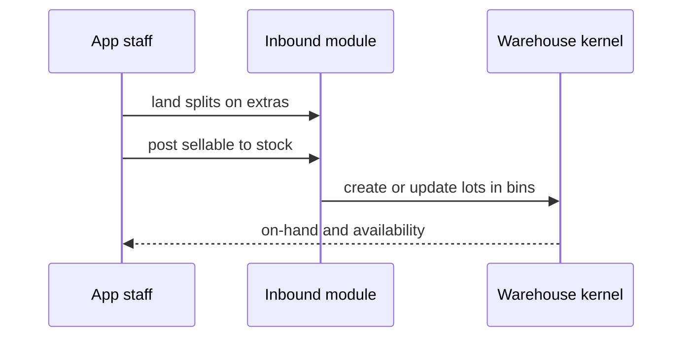

### Modules plug in

Features **debit or move** lots through kernel RPCs. They do not maintain a second on-hand table.

| Caller | Typical action |
| --- | --- |
| Inbound / procurement | Post from shipment extras; archive or purge shipment + lots |
| Wholesale compose | Issue bill with `global_stock_id` lines → **FIFO issue** |
| Shop / dropship | Reserve and pick against same lots; server enforces qty |
| Delivery close (return) | Return lines back to **sellable** warehouse (no AR bill) |
| After-sales | Returns and adjustments per module rules — still lot movements |

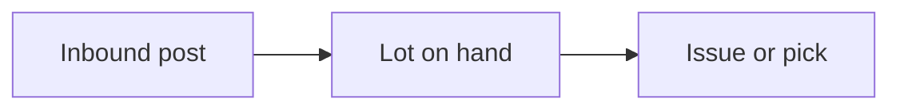

### Three worked patterns

**Receive inbound** — Shipment lands; staff split extras (sellable vs unsellable), post sellable → new **lots** in chosen bins. Unit cost stamp comes from **landed cost** kernel after AP pays; warehouse holds qty and location.

**Wholesale take** — Compose bill with stock lines. On **issue**, money kernel creates the bill; warehouse kernel **FIFO-issues** each line’s `global_stock_id` qty. No stock line → bill can still issue (fees, descriptions only).

**Dropship pick** — Shop order processing picks from the **same parent lots** as the wholesale desk. Overselling is blocked when availability RPCs say qty is gone.

### Kind and reason (on lots)

| Field | Values | Meaning |
| --- | --- | --- |
| **kind** | `sellable`, `unsellable` | Whether the lot can feed sales picks |
| **reason** | `ordered`, `general`, `vendor_discount`, `missing`, `damaged`, `other` | Why this split exists |

Shipment extras mirror kind/reason at receive; later **warehouse-only** changes use movements (case B in procurement spec).

### Links to other kernels

| Kernel | How warehouse uses it |
| --- | --- |
| **Landed cost** | Stamps unit cost on lots from shipment buckets and AP pays — warehouse stores qty, not cost formulas |
| **Money** | Bills reference stock lines; money does not own bin qty. COD face and packing slips are not warehouse rows |
| **Access** | Parent/child tenants; stock owned by **parent**; child issues bills and operates shops under grants |

### Out of scope for warehouse kernel

Koba (`koba_*`) and thrift garments; shop **customer stock** receive (per-shop catalog qty, not `global_stocks`); invoice totals and pays; shipment **cost entry** rows (procurement + landed cost); investor inventory views; platform tenant provisioning.

---

## Landed cost kernel

**Defensible unit cost** on BW warehouse lots. Cost **rows** live on the inbound shipment; **money** turns buckets into AP bills and pays; this kernel **locks**, derives **FX from pays**, and **stamps** each lot’s landed BDT.

Staff work is **app** only. **Shop**, **investor**, and **platform** do not lock costs or edit shipment cost matrices.

Inbound desk context: [Inbound shipment module](/docs/modules/inbound).

### Core objects

| Object | Role |
| --- | --- |
| **Cost entry** | One row on a shipment: bucket, component, amount, currency, `is_capitalizable` |
| **Bucket** | `material`, `freight`, `customs`, `handling`, `finance`, `other` — groups AP and stamp rules |
| **AP sync** | Money adapter: `sync_shipment_ap_bills` — one bill per **bucket × currency** |
| **Lock (`costs_locked`)** | Freezes stamp inputs; issues unpaid bucket AP bills |
| **FX inputs** | Product rate and cargo FX from **paid** material/freight AP — not stored on the shipment header |
| **Unit stamp** | Landed BDT per sellable lot from capitalizable rows + FX rules |

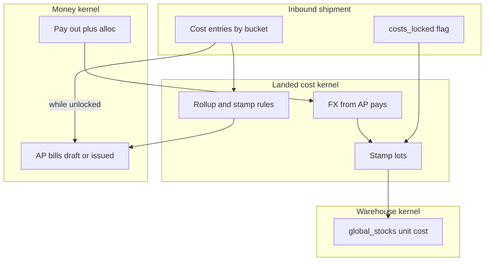

**Capitalizable vs local opex:** `is_capitalizable = true` flows into unit stamp. `false` rows hit **shipment P&L** only (fines, non-cap VAT, misc) — they do not inflate on-hand unit cost.

### Cost buckets (what staff record)

Each row is **bucket** × **component** (`subtotal`, `carriage`, `vat_tax`, `misc`) plus amount and currency.

| Bucket | Typical content | On unit stamp (target) |
| --- | --- | --- |
| `material` | Vendor goods invoice | Goods value × product rate |
| `freight` | Ocean/air freight | Weight share × cargo FX |
| `customs` | CD, RD, AIT | CIF Taka share on line |
| `handling` | Gate, labor | Qty share |
| `finance` | SWIFT, bank fees | Goods Taka share |
| `other` | Dock tips, misc | Qty when capitalized |

As-built today stamps **material + freight** only; other buckets are spec target (procurement **PS13** partial). Reporting GP still uses shipment P&L, not guessed invoice COGS.

### Money adapter (AP bills)

While **`costs_locked` is false**, sync keeps bucket bills in **`draft`** and updates totals when cost rows change.

**Lock** runs sync, then **`issue_shipment_ap_bills`** (draft → **issued**). After issue, money changes use **credit/debit notes** — not silent edits to issued AP totals.

| Plug field | Value |
| --- | --- |
| `source_type` | `shipment_cost` |
| `source_id` | Shipment id |
| `source_key` | `{bucket}:{currency_code}` |

Never mix currencies on one AP bill for the same bucket.

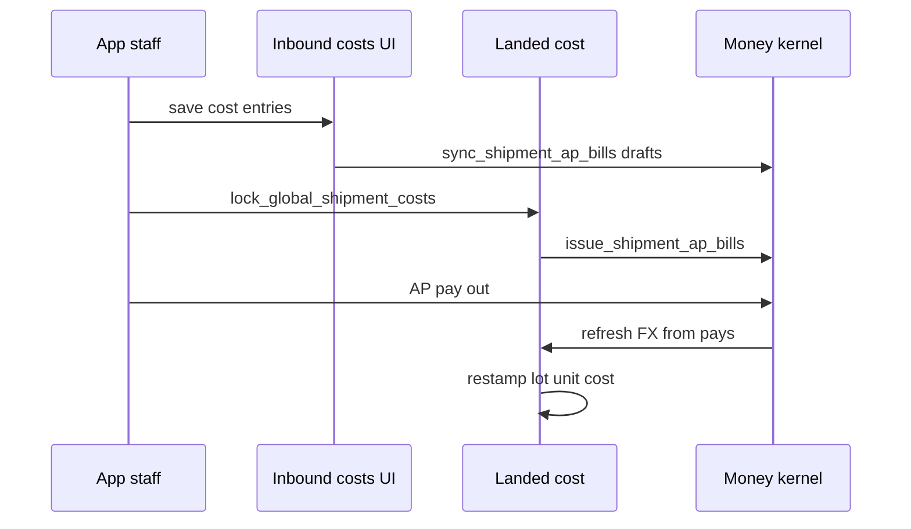

### FX (from pays, not shipment header)

FX is **not** stored on `global_shipments`. Paid AP on **material** and **freight** buckets drive:

| Rate | Meaning |
| --- | --- |
| **Product rate** | BDT paid on material ÷ foreign paid on material |
| **Cargo FX** | Same for freight bucket |
| **Cargo per kg** | Freight foreign ÷ shipment gross kg |
| **Transaction rate** | Blended material + freight (for display; stamp uses product + cargo rules separately) |

`post_ap_payout_with_allocations` triggers **restamp** after pay. Leftover on an FX payout is BDT minus (foreign alloc × rate).

### Unit stamp rule (summary)

Per SKU line on the shipment:

- Goods BDT = `purchase_price` × **product rate** (not whole line at blended rate).
- Freight share = line gross kg share of freight foreign × **cargo FX**.
- Customs/handling/finance/other follow bucket split rules when implemented — do not run everything through the goods+cargo blend.

Outcomes (`global_shipment_item_outcomes`) can **restamp on-hand** when vendor price drops after receive.

### Three worked patterns

**Record and sync** — Staff enter material and freight in foreign currency on the shipment. Sync creates **draft** AP bills per bucket × currency. Warehouse lots may exist before pay; stamp updates when FX inputs exist.

**Lock then pay** — Lock issues AP. Staff pay vendor and cargo from the payments desk with alloc across AP bills. Each pay freezes `exchange_rate`; landed cost refresh restamps open lots on that shipment.

**After issue correction** — Short shipment or VAT adjustment: **credit note** on the AP bill (money kernel), then costing follows the note — do not rewrite the original issued AP total.

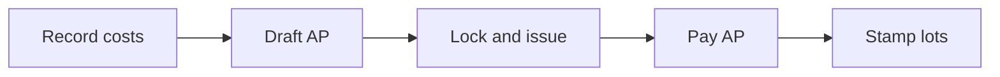

### Modules plug in

| Caller | Action |
| --- | --- |
| Inbound / procurement | CRUD cost entries; lock; outcomes |
| Money / wallet desk | Sync AP, pay out, credit notes on AP |
| Warehouse receive | Lots created on post; stamp reads shipment state |
| Reporting / investor | Shipment P&L and GP use landed + local — not bill-line COGS fiction |

Dropship **courier AP** at ship is money-only (`dropship_courier` source) — not the inbound shipment cost matrix.

### Links to other kernels

| Kernel | Relationship |
| --- | --- |
| **Money** | Owns AP bills and pays; landed cost **reads** pay FX and never duplicates pays |
| **Warehouse** | Holds qty and stamped unit cost on `global_stocks` |
| **Access** | Parent tenant books; lock and cost UI under app grants |

### Out of scope for landed cost kernel

Koba and thrift costing; PBC **offer formulas** (quote-time math, not shipment stamp); retail invoice line COGS; shop gift cost overrides; storing FX on the shipment header; shop/investor cost lock UI.

---

## Money kernel

**Not a wallet.** Product surfaces are **Bills**, **Payments**, and **Cashbook** on the **app** scope. **Platform** provisions tenants; **shop** gets a merchant statement; **investor** is read-only (no kernel writes).

### Five layers

| Layer | Role |
| --- | --- |
| **Profile** | Money party (customer, vendor, cargo, shop merchant, tenant, …) |
| **Bill** | Commercial paper: draft → issued → voided; stock lines optional |
| **Pay** | Money in or out, with instrument and optional FX |
| **Allocation** | Links pay amounts to open bills |
| **Cashbook** | Tenant cash at **points** (till, safe, bank) and **profile leftover** (custody) |

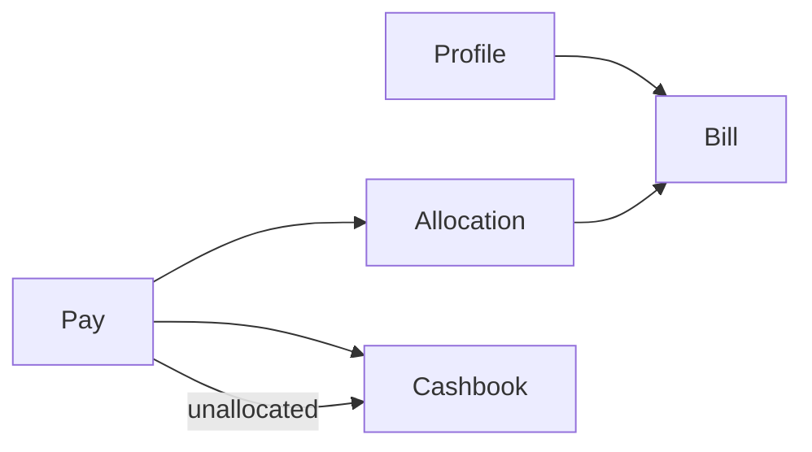

**Issued totals are frozen.** Corrections use **credit** or **debit notes** (`document_kind` + `parent_bill_id`), not silent edits to the issued total.

### Direction: from / to

Every bill has **from_profile** and **to_profile**:

- **They owe us (AR):** tenant is **from**, counterparty is **to** → staff **collect**.
- **We owe (AP):** vendor or cargo is **from**, tenant is **to** → staff **pay out**.

Stock AR settlement:

| Kind | Sales recognized | When customer pays |
| --- | --- | --- |
| **take** | At **issue** | Anytime; bill stays due until paid |
| **condition** | When **paid** | Unpaid is not firm AR for sales reports |

Walk-in is **take** only. AP and fee-only bills use no settlement kind.

### Modules plug in

Features pass **from, to, `source_type`, `source_id`, optional `source_key`, and lines**. They call kernel RPCs; they do not add per-module FKs on `bills`.

| Adapter | `source_type` | Typical trigger |
| --- | --- | --- |
| Compose desk | `compose` | Staff issue take / condition / walk-in |
| Shop / dropship | `shop_order` | Ship + merchant invoice at issue |
| Shipment AP | `shipment_cost` | Sync AP per cost bucket × currency |
| Delivery close | `delivery_close` | Pre-order paper → bill |
| After-sales | parent source | `create_bill_adjustment` |

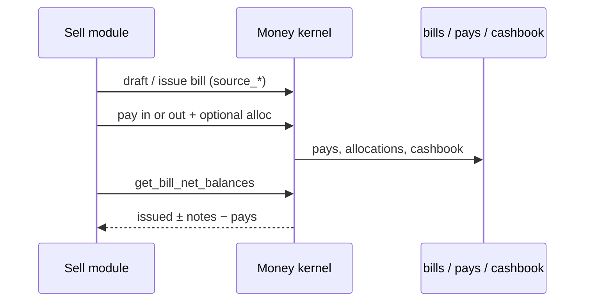

### Paper vs cash vs sales

Reporting keeps these layers separate (COD is not sales).

| Paper | Cash | Sales |
| --- | --- | --- |
| Proforma (delivery) | No | No |
| Take (issued) | When collected | At **issue** |
| Condition | When collected | When **paid** |
| Dropship merchant bill | Net **remittance** | At **issue** (merchant total) |
| AP (shipment bucket) | Pay out | **Never** sales |

### Three worked patterns

**Wholesale take** — Buyer bill 1,500; pay 1,500 cash: bill **paid**, tenant cash **+1,500**, sales **1,500**. Overpay leaves **profile cashbook** leftover; no second bill.

**Dropship** — Merchant bill **1,500** at ship (not recipient COD face). Courier AP at ship. **Remittance** is net bank in; alloc to merchant bill; **leftover** on merchant cashbook, later pay out without alloc.

**Inbound AP** — Cost rows stay on the shipment. AP bills per bucket; pay out with alloc. After issue, shortages use **credit notes**, not rewritten totals.

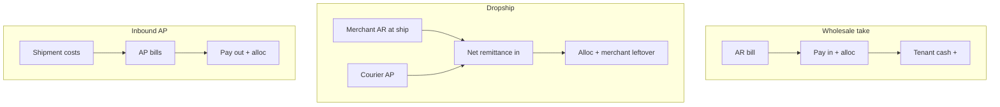

### Cashbook (places and pots)

- **Points** = till, safe, bank counter (a **place**, not a currency).
- **Pots** = on-hand cash per `(point × currency)`.
- Pays record **where** money sat (`cashbook_point_id`); ledger lines **freeze** FX at post time.

Profile custody in v1 does not use points on profile books.

### Out of scope for money kernel

Delivery proforma as issued bill; packing slip / COD face as sales; warehouse qty rows; landed-cost row storage (landed cost kernel; money supplies AP pays); investor withdraw; Koba / thrift ledgers (separate sales models).
