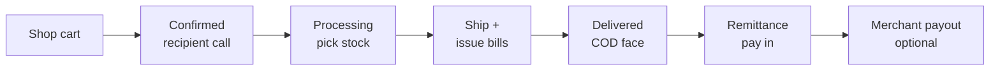
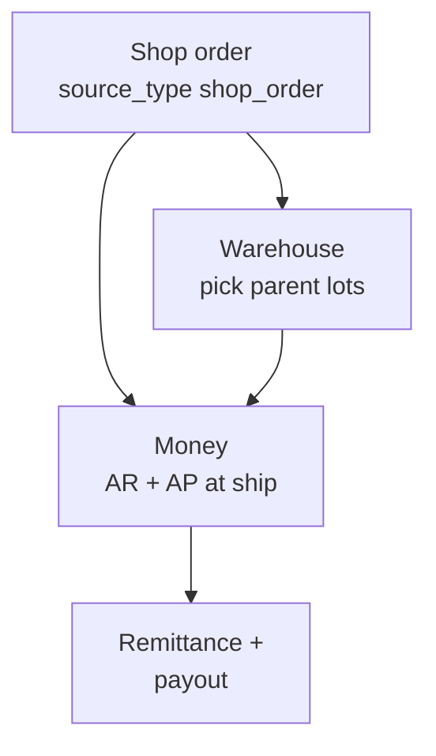
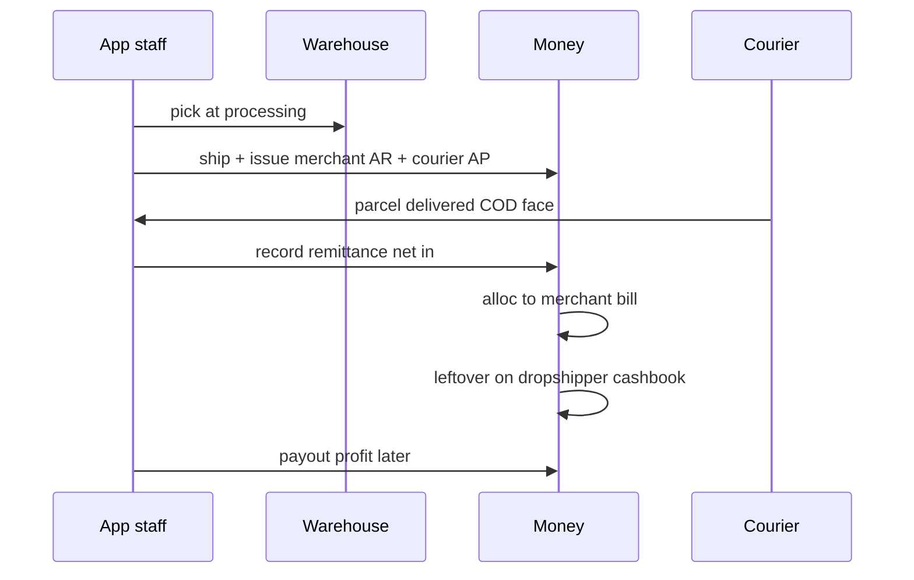

# Dropship

A **BW channel**: the **dropshipper** (reseller) buys at wholesale on a dropship shop; the **supplier** (tenant) picks from parent warehouse stock and ships to an **end customer** (recipient). Money is B2B on the merchant bill — **not** the recipient COD face.

Same kernels as [wholesale](/docs/modules/wholesale): [warehouse](/docs/kernels#warehouse-kernel) picks, [money](/docs/kernels#money-kernel) bills/pays/cashbook, [access](/docs/kernels#access-kernel) for app + shop.

## Terminology

| Plain language | Who | Notes |
| --- | --- | --- |
| **Supplier** | Logged-in tenant | Fulfills stock, issues B2B invoice |
| **Dropshipper** | Shop customer / merchant profile | Buys at wholesale; profit after remittance |
| **End customer** | Recipient on the order | Delivery + COD **face** only — not AR party |
| **Customer invoice** | AR bill at **ship** | Supplier → dropshipper; amount = B2B total |
| **Packing slip** | Ops paper | Not a `bills` row to the recipient |

Code may still say `merchant`, `middleman`, `recipient_*` — UI uses the names above.

## Who uses it

| Surface | Dropship |
| --- | --- |
| **shop** | Dropship cart, recipient address, order tracking |
| **app** | Pick, ship, settlement, remittance, payout, shop config |
| **platform** | — |
| **investor** | — |

## App and shop routes (as-built)

| Area | Route | Job |
| --- | --- | --- |
| Shop checkout | `/:slug/shop/dropship/review`, `.../delivery` | Cart → recipient details → submit order |
| Dropship desk | `/:slug/app/shop/dropship` | Orders list (dropship shops) |
| Order detail | `/:slug/app/shop/orders/:id` | Call confirm, pick, ship, deliver |
| Management | `/:slug/app/shop/dropship-management` | Settlement table, mark delivered |
| Finance hub | `/:slug/app/shop/dropship/.../finance` | Courier remittance, merchant ledger |
| Remittance (money) | `/:slug/app/finance/payments/collect?mode=courier` | Net bank in — same writer as settlement desk |

UI: `web/src/modules/shop_order/`.

## Lifecycle

| Stage | Warehouse | Money |
| --- | --- | --- |
| **Confirmed** | — | Staff verify recipient call before pick |
| **Processing** | Pick lines → `shop_order_item_stock_picks` | Gifts / auto-gifts may add lines |
| **Ship** | Packing slip | **Issued** merchant AR + **issued** courier AP |
| **Delivered** | — | COD receivable on parcel; not tenant sales cash |
| **Remittance** | — | Pay in **net** bank; alloc to merchant bill |
| **Payout** | — | Pay out merchant **cashbook** leftover (profit) |

Advance to `processing` is blocked until `recipient_verified_at` is set (US-4).

## How kernels connect

| Kernel | Dropship use |
| --- | --- |
| **Access** | Shop buyer vs app staff grants; dropship shop type on tenant |
| **Warehouse** | Same `global_stocks` as wholesale desk — no channel stock book |
| **Money** | Merchant bill, courier AP, remittance, profile cashbook, payout |
| **Landed cost** | Unit cost on picked lots — same as inbound stamp |

Wholesale [compose](/docs/modules/wholesale) is **not** the dropship issue path — issue runs from `ship_dropship_order_and_issue_merchant_bill`.

## Money layers (do not mix)

| Layer | What staff/customer sees | In `bills`? |
| --- | --- | --- |
| Recipient **COD face** | e.g. 2,200 on delivery | **No** — order field only |
| **Customer invoice** (merchant AR) | e.g. 1,500 B2B at ship | **Yes** — issued at ship |
| **Courier AP** | Fee supplier owes courier | **Yes** — issued at ship |
| **Remittance** | Net bank in e.g. 2,120 | **Pay** — `source = courier_remittance` |
| **Merchant profit** | Remainder after alloc | **Cashbook** — pay out later, no second AR |

### Worked example

Dropshipper bill **1,500**. Recipient COD **2,200**. Courier fee **80**. Bank **2,120**.

| Step | Result |
| --- | --- |
| At ship | AR 1,500 due; AP ~80 we owe |
| Deliver | COD 2,200 is courier/parcel — **not** sales |
| Remittance | Pay in 2,120; alloc 1,500 → merchant bill **paid** |
| Leftover | **+620** on dropshipper cashbook |
| Later | Pay out 620 — cashbook only, no alloc |

Detail: [Money kernel → Dropship pattern](/docs/kernels#money-kernel).

## Ship and deliver rules

- **One RPC at ship** issues merchant AR and courier AP (`source_type` shop order + `dropship_courier` for AP).
- **Packing slip** ≠ customer invoice; recipient is not `to_profile` on the B2B bill.
- After issue, charge changes vs settlement desk → **credit/debit notes** (`create_bill_adjustment`) — not silent edits to issued totals.
- **Mark as delivered** may apply notes at deliver when settlement draft differs from issued paper.

Remittance requires the merchant bill **issued**. Use **Payments → Pay in → Courier** or settlement desk — same `record_dropship_courier_remittance` writer.

## Gifts and customer stock

| Gift source | Warehouse | On merchant bill at ship |
| --- | --- | --- |
| **Stock** (`gift_source = stock`) | Pick from warehouse | Cost charged to reseller or tenant per desk |
| **Customer provided** | `shop_customer_stocks` — not `global_stocks` | Recipient COD unchanged; merchant bill rules per spec |

Auto-gifts apply once when order enters `processing` from shop settings.

## Shop configuration

- Shop type **`dropship`** with `minimum_sell_price_amount` floor.
- Listing visibility per customer group; display qty padding on storefront.
- Pickup locations, couriers, merchant profiles — app dropship admin routes.

Catalog **negotiation** shops share `shop_order` but close through **delivery paper** — not this ship/issue path. See [Sales models](/docs/models).

## What dropship is not

| Not dropship | Where |
| --- | --- |
| Wholesale counter compose | [Wholesale module](/docs/modules/wholesale) |
| Stock-backed shop without recipient | Fixed-price / catalog shop flows |
| Inbound receive | [Inbound](/docs/modules/inbound) |
| Koba / thrift | Separate models |

Returns: **after-sales** (`finalize_dropship_return`) — not re-opened on the bills compose desk.

## Related

| Doc | Link |
| --- | --- |
| Wholesale | [Wholesale](/docs/modules/wholesale) — same lots, different issue path |
| Money desks | [Money](/docs/modules/money) |
| Tenants · Shop | [Tenants](/docs/modules/tenants) · [Shop](/docs/modules/shop) · [Shop admin](/docs/modules/shop-admin) |
| Kernels overview | [Kernels](/docs/kernels) |
