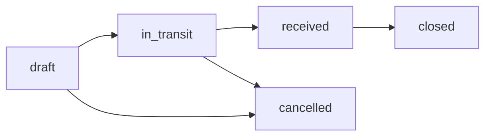
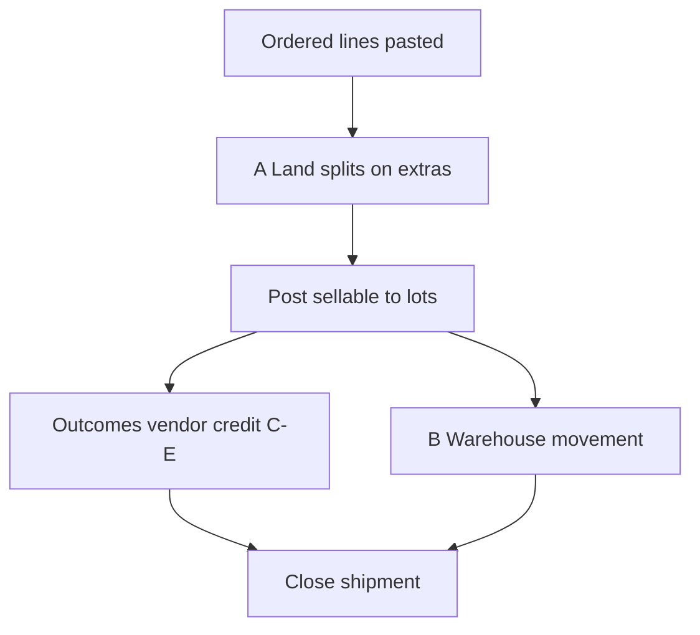
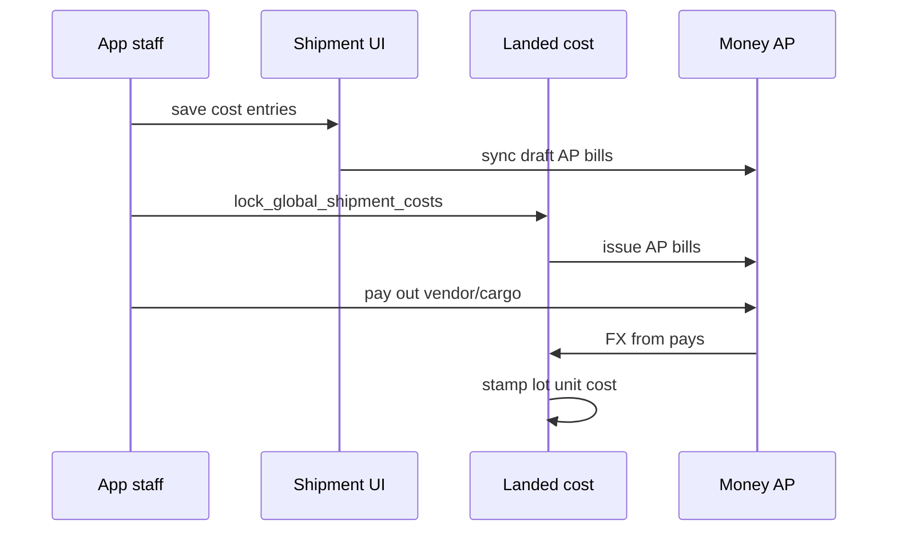
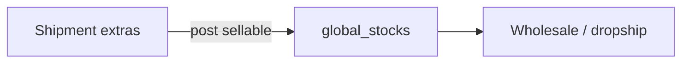

# Inbound shipment

Bring goods **into** the parent warehouse: shipment paper (ordered lines, land splits, outcomes), **post to stock** as `global_stocks` lots, record **landed costs** by bucket, sync **AP bills**, **lock** and pay, then **stamp** unit cost from pays.

This is the BW **procurement & stock** desk — not customer sales. [Wholesale](/docs/modules/wholesale) and [dropship](/docs/modules/dropship) sell lots that inbound creates.

Kernels: [Access](/docs/kernels#access-kernel) (app only) · [Warehouse](/docs/kernels#warehouse-kernel) · [Landed cost](/docs/kernels#landed-cost-kernel) · [Money](/docs/kernels#money-kernel) (AP pays).

## Who uses it

| Surface | Inbound |
| --- | --- |
| **app** | Shipments, costs, receive, bins, movements, demand / delivery paper |
| **shop** | — |
| **platform** | — |
| **investor** | — |

Grant: `global_shipment` (and related procurement modules). Vendors: `vendor/` module.

## App routes (as-built)

| Area | Route | Job |
| --- | --- | --- |
| Procurement hub | `/:slug/app/procurement` | Overview |
| Shipment list | `/:slug/app/procurement/shipment/list` | All inbound shipments |
| Shipment detail | `/:slug/app/procurement/shipment/:id` | Lines, costs, receive, outcomes |
| Stock / bins | `/:slug/app/procurement/stock` | Warehouse tree, lot groups |
| Demand | `/:slug/app/procurement/demand` | Pre-order demand lines |
| Fulfill | `/:slug/app/procurement/fulfill` | **Delivery paper** pack-out |
| AP on shipment | `.../shipment/:id/rates-invoices` | Bucket bills tied to shipment |

Legacy redirects exist from `/app/global/shipment/*` → `/app/procurement/shipment/*`.

UI: `web/src/modules/procurement_stock/`. SQL: `supabase/schemas/procurement/`.

## Shipment status and flags

**Status:** `draft` | `in_transit` | `received` | `cancelled` (progress tags are separate).

| Status | Post sellable to stock |
| --- | --- |
| `draft` / `in_transit` | Yes when sellable **extras** exist |
| `received` | Delta posts until close |
| `cancelled` | No |

`received` means the first **Post to stock** of a sellable extra — not “copy ordered” without posting.

| Flag | Meaning |
| --- | --- |
| `stock_ready` | At least one sellable extra became a lot |
| `costs_locked` | Landed stamp inputs frozen; AP issued on lock |
| `is_closed` | Shipment UI read-only |

## Staff path (cases A–E)

| Case | Where | Rule |
| --- | --- | --- |
| **A Land** | Shipment extras | Splits at receive; land qty sums to ordered per line; post sellable → bins |
| **B Warehouse** | Stock movement | Shelf damage / grade after receive — **movement**, not new shipment row |
| **C–E Vendor credit** | When `received` | Outcome credits; AP via money kernel when applicable |

**Do not:** clone ordered on “mark received”; auto-fill missing; shelf damage as new inbound extra.

### Kind and reason (on extras / lots)

| Field | Values |
| --- | --- |
| **kind** | `sellable`, `unsellable` |
| **reason** | `ordered`, `general`, `vendor_discount`, `missing`, `damaged`, `other` |

## Landed costs and AP

Cost rows live on the shipment (`global_shipment_cost_entries`). **Cash settlement is never on the cost row** — only on [money](/docs/modules/money) pays.

| Bucket | Typical use |
| --- | --- |
| `material` | Vendor goods |
| `freight` | Ocean / air |
| `customs` | CD, RD, AIT |
| `handling` | Gate, labor |
| `finance` | Bank / SWIFT |
| `other` | Misc (cap flag per row) |

| `is_capitalizable` | Effect |
| --- | --- |
| **true** | Flows into **unit stamp** on lots |
| **false** | **Shipment P&L** only — does not inflate on-hand unit cost |

While **`costs_locked` is false**, `sync_shipment_ap_bills` keeps **draft** AP per **bucket × currency**. **Lock** issues AP bills. After issue, use **credit/debit notes** — not silent edits to issued AP.

Detail: [Landed cost kernel](/docs/kernels#landed-cost-kernel). As-built stamp uses **material + freight** buckets first (spec **PS13** partial for other buckets).

## Receive → warehouse

Posting creates or updates **`global_stocks`** lots in **leaf bins**. Same lots feed:

- [Wholesale](/docs/modules/wholesale) compose FIFO issue
- [Dropship](/docs/modules/dropship) picks

Pre-order ([PBC](/docs/modules/product-based-costing)) has **no** lot until receive on a shipment. Demand desk links confirmed qty to inbound.

## Demand and delivery paper

| Desk | Route | Closes into |
| --- | --- | --- |
| Demand | `/app/procurement/demand` | Rows from shop + PBC |
| Fulfill | `/app/procurement/fulfill` | Delivery paper pack-out |

**Packed** close can issue **take** or **condition** bills (`source_type = delivery_close`) — that is money on confirmed pre-order, not the same screen as vendor AP on the shipment.

Returns on delivery close go back to **sellable** warehouse without an AR bill.

## Money pattern (inbound AP)

Example: material **80,000** + cargo/duty **12,000** + local opex **3,000** (as AP / cost rows).

| Layer | Result |
| --- | --- |
| Procurement | Cost rows on shipment |
| Bills | AP **issued** per kind / bucket × currency |
| Pay out | One bank pay with **alloc** across AP bills |
| Cashbook | Tenant cash **−** (not customer collect) |
| GP | Shipment P&L — not invoice-line COGS on sales |

Short/VAT after issue → **credit note** on that AP bill.

Pattern: [Money kernel → Inbound AP](/docs/kernels#money-kernel).

## Archive and purge

- **Archive** hides shipment and related lots from operational lists.
- **Purge** (archived only) deletes shipment + cascaded stock; issued bill lines keep snapshots (`global_stock_id` set null).

## What inbound is not

| Not this module | Where |
| --- | --- |
| Customer AR / compose | [Wholesale](/docs/modules/wholesale) |
| Dropship ship/issue | [Dropship](/docs/modules/dropship) |
| Koba / thrift stock | Separate models |
| Pay in from customer | [Money](/docs/modules/money) payments desk |

## Related

| Doc | Link |
| --- | --- |
| Kernels | [Overview](/docs/kernels) |
| Sales models | [Models](/docs/models) — pre-order → demand → inbound |
| Tenants | [Tenants](/docs/modules/tenants) — parent owns stock |
