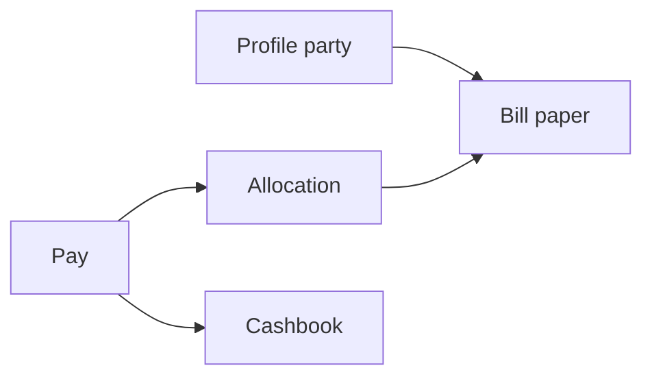
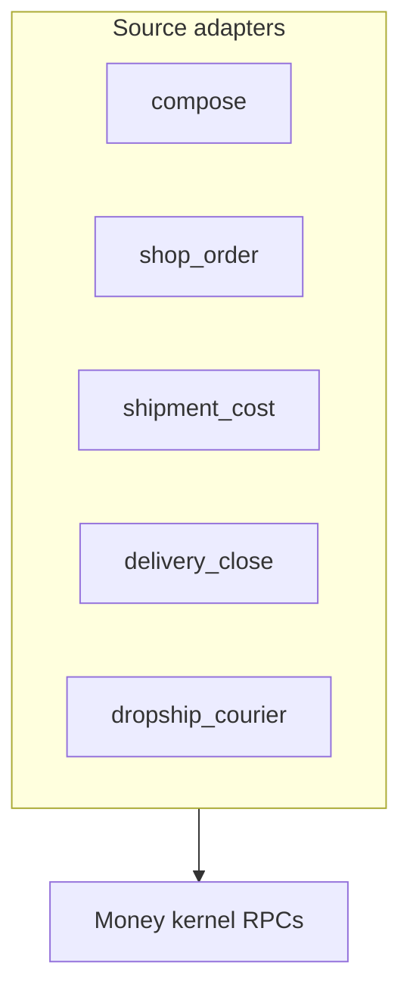

# Money

The **money kernel** in product form: **profiles**, **bills**, **pays**, **allocations**, and **cashbook**. One books layer for the parent tenant — **not** a wallet product.

Sell modules plug in with `source_type` / `source_id`; they do not own pay rows or duplicate invoice tables. Deep dive: [Kernels → Money kernel](/docs/kernels#money-kernel).

## Who uses it

| Surface | Money |
| --- | --- |
| **app** | Bills, payments, cashbook, AP on shipments |
| **shop** | Merchant **statement** (dropship reseller) |
| **platform** | — |
| **investor** | Read-only capital views — no pays, no withdraw v1 |

Grants: `global_invoice` (bills), `payments`, `cashbook`. [Access kernel](/docs/kernels#access-kernel).

## Three desks

| Desk | Route | Job |
| --- | --- | --- |
| **Bills** | `/:slug/app/bills` | List, compose, issue, void, print, notes |
| **Payments** | `/:slug/app/finance/payments` | Pay **in** (collect), pay **out**, courier remittance |
| **Cashbook** | `/:slug/app/cashbook` | Tenant cash, **points** (till/safe/bank), profile leftover |

| Payments sub-routes | Path |
| --- | --- |
| Collect (customer) | `.../payments/collect` |
| Courier remittance | `.../payments/collect?mode=courier` |
| Pay out | `.../payments/payout` |
| Profile ledger | `.../payments/party/:type/:id` |

UI: `web/src/modules/bills_pays/` (legacy names `sales_invoice/`, `wallet/` in older docs).

## Five layers

| Layer | Role |
| --- | --- |
| **Profile** | Customer, vendor, cargo, merchant, tenant — who owes whom |
| **Bill** | `draft` → `issued` → `voided`; optional stock lines |
| **Pay** | Money in or out; FX frozen on post |
| **Allocation** | Pay slice applied to open bill(s) |
| **Cashbook** | Tenant cash at **points**; unallocated pay → profile **leftover** |

**Issued face amounts are frozen.** Fixes use **credit** or **debit notes** (`document_kind` + `parent_bill_id`) — not edits to `total_amount`.

## AR vs AP direction

Bills use **from_profile** and **to_profile** (live data may still use `profile_id` + `invoice_type`):

| Direction | From | To | Staff action |
| --- | --- | --- | --- |
| **They owe (AR)** | Tenant | Customer / merchant | **Collect** |
| **We owe (AP)** | Vendor / cargo | Tenant | **Pay out** |

| Paper type | Examples |
| --- | --- |
| **AR** | [Wholesale](/docs/modules/wholesale) compose, [dropship](/docs/modules/dropship) merchant bill at ship |
| **AP** | [Inbound](/docs/modules/inbound) shipment buckets, dropship courier AP |

AP shipment bills: **no** stock `bill_lines`; sync from cost rows. One bill per **bucket × currency** (`source_key = {bucket}:{currency_code}`).

## Settlement on stock AR

| Kind | Sales in reports | When paid |
| --- | --- | --- |
| **take** | At **issue** | Anytime |
| **condition** | When **paid** | Unpaid ≠ firm sales AR |

Walk-in: **take** only. Live: `channel_meta.delivery_kind`.

## How modules plug in

| `source_type` | Module |
| --- | --- |
| `compose` | [Wholesale](/docs/modules/wholesale) desk |
| `shop_order` | [Dropship](/docs/modules/dropship) merchant bill |
| `shipment_cost` | [Inbound](/docs/modules/inbound) AP sync |
| `delivery_close` | Pre-order delivery paper |
| `dropship_courier` | Courier AP at dropship ship |

Features call: issue/void bill, pay in/out + alloc, `create_bill_adjustment`, `get_bill_net_balances` — they do not re-sum allocations in app code.

## Payments desk (one product)

| Flow | Typical `source` | Alloc |
| --- | --- | --- |
| Customer collect | `customer_cash`, bank, … | To AR bills |
| Courier remittance | `courier_remittance` | To dropship merchant bill; remainder → cashbook |
| AP payout | `ap_payout` | Across shipment AP bills |
| Merchant profit payout | dispense from tenant | **No** alloc — cashbook only |

Split tender: `pay_instruments` per slice; each can tag a **cashbook point** (where cash sat).

## Cashbook

| Concept | Meaning |
| --- | --- |
| **Account** | Books running balance per tenant/profile (BDT books) |
| **Point** | Till, safe, bank counter — a **place**, not a currency |
| **Pot** | On-hand cash per `(point × currency)` |
| **Leftover** | Unallocated pay on a **profile** — custody until applied or paid out |

FX: rate picked at pay time; **ledger line freezes** pair — not looked up again from rate tables.

## Paper vs cash vs sales

Reporting keeps layers separate (COD is **not** sales).

| Paper | Cash | Sales |
| --- | --- | --- |
| Delivery proforma | No | No |
| Wholesale take | On collect | At issue |
| Wholesale condition | On collect | When paid |
| Dropship merchant bill | Net remittance | At issue |
| Shipment AP | Pay out | Never |

## Worked patterns (by channel)

**Wholesale take** — Bill 1,500; collect 1,500 → paid; tenant cash +1,500. Overpay → customer cashbook.

**Dropship** — Merchant bill 1,500 at ship; remittance net in; alloc; profit on merchant cashbook; payout later.

**Inbound AP** — Draft/issued bucket bills; pay out 95k with alloc; cashbook −; stamp via [landed cost](/docs/kernels#landed-cost-kernel).

All three: [Kernels → Money kernel](/docs/kernels#money-kernel) (worked patterns section).

## What money is not

| Not money desk | Where |
| --- | --- |
| Warehouse qty / bins | [Warehouse kernel](/docs/kernels#warehouse-kernel) |
| Shipment cost row editor | [Inbound](/docs/modules/inbound) — pays settle AP only |
| Recipient COD face | Shop order fields — not a bill |
| Koba / thrift ledgers | Separate sales models |
| Investor withdraw | Not v1 |

## Related

| Doc | Link |
| --- | --- |
| Kernels | [Money kernel](/docs/kernels#money-kernel) |
| Wholesale | [Wholesale](/docs/modules/wholesale) |
| Dropship | [Dropship](/docs/modules/dropship) |
| Inbound AP | [Inbound shipment](/docs/modules/inbound) |
| Tenants | [Tenants](/docs/modules/tenants) — parent books |
| Scopes | [Scopes](/docs/scopes) |
