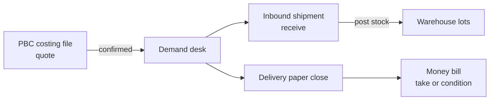

# Product-based costing

**Pre-order (PBC)** — quote and cost **before** goods are on hand. Staff build **costing files** with FX and formulas, publish offers, **confirm** lines, then hand off to **demand** and **inbound**. There is **no** `global_stocks` row until a shipment is received.

Money at the end: **Delivery paper** close issues take/condition bills through the [money kernel](/docs/kernels#money-kernel) (`source_type = delivery_close`). Not the wholesale compose desk.

Sales model context: [Sales models](/docs/models). Demand / delivery: [Inbound shipment](/docs/modules/inbound).

## Who uses it

| Surface | PBC |
| --- | --- |
| **app** | Costing files, backlog, demand linkage |
| **shop** | Catalog **negotiation** can feed the same demand path — not PBC file UI |
| **platform** | — |
| **investor** | — |

Modules: `product_based_costing`, `costing_file` (legacy/alternate entry). Grant per module registry.

## App routes

| Area | Route |
| --- | --- |
| PBC hub & files | `/:slug/app/product-based-costing` |
| File detail (v2) | `/:slug/app/product-based-costing/:id` |
| Add products to file | `/:slug/app/product-based-costing/:id/add-product-cart` |
| Offer preview (external layout) | `/:slug/app/product-based-costing/:id/preview` |
| Costing file (admin/staff/viewer) | `/:slug/app/costing` → role landing |
| Demand desk | `/:slug/app/procurement/demand` |
| Delivery fulfill | `/:slug/app/procurement/fulfill` |

UI: `web/src/modules/product_based_costing/`, `web/src/modules/costingFile/`.

## Position in the BW lifecycle

| Stage | Stock | Money |
| --- | --- | --- |
| Draft / offered file | None | None |
| **Confirmed** → procuring | None | None |
| Inbound received | **Lots** appear | AP on shipment ([inbound](/docs/modules/inbound)) |
| Delivery **packed** close | Pick/issue rules | **Bill** via delivery_close |

Do not treat PBC lines as sellable warehouse qty before receive.

## Costing file (what it holds)

| Concept | Role |
| --- | --- |
| **File** | Header: customer `profile_id`, buy/sell currencies, FX, status |
| **Lines** | SKU, web £, weight, cargo, formula-driven cost and offer |
| **Status flow** | Draft → offered → **confirmed** (then procurement lifecycle) |
| **Lock** | Confirmed lines fix commercial truth for demand |

### Offer pricing modes

| Mode | Behavior |
| --- | --- |
| `landed_cost_plus` (default) | Landed unit cost (GBP path) + markup on sell |
| `gbp_vat_then_profit` | VAT on web £, then cargo + FX + profit like cost-plus |

**Cost** is fixed per line when locked; mode changes **sell** presentation, not inbound landed stamp rules on the shipment.

Landed line math (GBP side): web £ + cargo + package weight → FX to BDT for offer/cost display. Shipment **unit stamp** after receive still follows [landed cost kernel](/docs/kernels#landed-cost-kernel) from AP pays — separate from PBC formula display.

### Offer export

| Format | Use |
| --- | --- |
| **Screenshot** | PNG ~390px wide, 6 rows per image |
| **PDF** | A4 print layout |

## Personas

| Role | Typical work |
| --- | --- |
| Sourcing | Create file, FX, surcharges |
| Account lead | Markup, publish **offered**, **confirm** |
| Procurement | Demand desk, assign shipment |
| Auditor | Formula review, export |

## Demand handoff

When a file enters **procuring**:

- One **demand** row per confirmed line with the file’s `profile_id` (not staff-edited on create).
- Same demand desk as **catalog preorders** from [shop negotiation](/docs/modules/shop).

Staff path: demand → PO / shipment assignment → **inbound** receive → optional **backlog** if short after delivered.

| Desk | Doc |
| --- | --- |
| Demand | [Inbound](/docs/modules/inbound) — US-4 demand & delivery paper |
| Backlog | Shortfalls → `product_based_costing_backlog_items` → import into new drafts |

## Delivery paper close (money)

On **packed** close from fulfill desk:

| Close choice | Warehouse | Money |
| --- | --- | --- |
| **take** | Issue / pick per rules | Bill at issue — sales at issue |
| **condition** | Goods out | Bill issued; sales when **paid** |
| **return** | Back to sellable stock | **No** AR bill |

RPC: `close_preorder_demand_document` with `source_type=delivery_close`. Not dropship ship/issue.

Proforma on delivery paper is **not** an issued bill until close.

## vs other modules

| | PBC | Wholesale | Dropship | Shop catalog |
| --- | --- | --- | --- | --- |
| Stock timing | After inbound | In hand now | Parent lots at pick | After inbound or stock-backed |
| Quote tool | Costing file | Compose bill | Shop cart | Negotiation states |
| Issue path | Delivery close | Compose issue | Ship + merchant bill | Delivery / stock checkout |

## Kernels touched

| Kernel | PBC use |
| --- | --- |
| [Access](/docs/kernels#access-kernel) | App module grants |
| [Warehouse](/docs/kernels#warehouse-kernel) | Only after receive + delivery pick |
| [Landed cost](/docs/kernels#landed-cost-kernel) | Inbound shipment on assigned PO — not PBC formula |
| [Money](/docs/kernels#money-kernel) | Bills only after delivery close (or inbound AP separately) |

## What PBC is not

| Not PBC | Where |
| --- | --- |
| In-hand wholesale sale | [Wholesale](/docs/modules/wholesale) |
| Dropship recipient flow | [Dropship](/docs/modules/dropship) |
| Koba / thrift | [Sales models](/docs/models) |
| Shipment cost bucket editor | [Inbound](/docs/modules/inbound) — AP sync |

## Related

| Doc | Link |
| --- | --- |
| Inbound | [Inbound shipment](/docs/modules/inbound) |
| Money | [Money](/docs/modules/money) |
| Shop negotiation | [Shop storefront](/docs/modules/shop) |
| Tenants | [Tenants](/docs/modules/tenants) |
