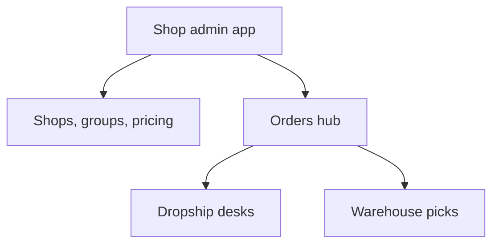

# Shop admin

Staff **app** desks under `/:slug/app/shop/*`: create shops, categories, customer groups, pricing, orders, and fulfillment tools. Buyers never use these routes — they use [Shop storefront](/docs/modules/shop).

Tenants and grants: [Tenants](/docs/modules/tenants). UI: `web/src/modules/shop_order/`.

## Hub routes

| Area | Route |
| --- | --- |
| Shop module home | `/:slug/app/shop` |
| Shops list & settings | `/:slug/app/shop/shops` |
| Shop preview | `/:slug/app/shop/shops/:shopId/preview` |
| Categories | `/:slug/app/shop/categories` |
| Customer groups | `/:slug/app/shop/customer-groups` |
| Pricing (global) | `/:slug/app/shop/pricing` |
| Per-shop pricing | `/:slug/app/shop/shops/:shopId/pricing` |
| Orders (all shop types) | `/:slug/app/shop/orders` |
| Order detail | `/:slug/app/shop/orders/:id` |
| Shipping settings | `/:slug/app/shop/shipping` |
| Fulfillment | `/:slug/app/shop/fulfillment` |

Grant: shop_order module family + `effectiveGrants`.

## Configure a shop

| Task | Where |
| --- | --- |
| Create shop, pick **type** | Shops list |
| Categories & listings | Categories + product visibility per group |
| Group prices & hides | Customer groups + pricing dialogs |
| Customer stock receive | Shop settings (`shop_customer_stocks`) |
| Auto-gifts | Per-shop `shop_auto_gift_items` |

| Shop type | Admin focus |
| --- | --- |
| **vendor_catalog** | Negotiation states, demand handoff |
| **fixed_price** | Listings, cart stock availability |
| **dropship** | Couriers, pickup locations, settlement — [Dropship](/docs/modules/dropship) |

## Orders by channel

| Channel | After order lands in hub |
| --- | --- |
| Fixed / catalog stock | Pick / fulfill per shop_order rules |
| Catalog negotiation | Demand + [inbound](/docs/modules/inbound) / delivery paper |
| Dropship | `/app/shop/dropship*`, management settlement |

Dropship-specific routes (same module):

| Desk | Route |
| --- | --- |
| Dropship orders | `/:slug/app/shop/dropship` |
| Management / settlement | `/:slug/app/shop/dropship-management` |
| Couriers, merchants, ledger | Under `.../shop/dropship/...` |

## Pricing and visibility (staff)

| Tool | Purpose |
| --- | --- |
| Group pricing | `customer_group` price rules |
| `shop_listing_group_hides` | Hide SKU from a group’s catalog |
| Display qty recalc | Admin storefront tab → `recalc_shop_display_quantities` |

Changes apply on next customer browse — storefront doc: [Shop](/docs/modules/shop).

## What shop admin is not

| Not here | Doc |
| --- | --- |
| Buyer cart UX | [Shop storefront](/docs/modules/shop) |
| Wholesale compose | [Wholesale](/docs/modules/wholesale) |
| Shipment receive | [Inbound](/docs/modules/inbound) |
| Platform tenant create | [Tenants](/docs/modules/tenants) |

## Related

| Doc | Link |
| --- | --- |
| Shop (buyer) | [Shop storefront](/docs/modules/shop) |
| Dropship | [Dropship](/docs/modules/dropship) |
| Money | [Money](/docs/modules/money) |
| Tenants | [Tenants](/docs/modules/tenants) |
