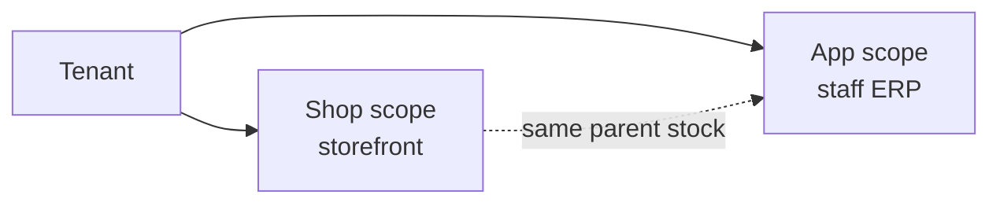

# Shop (storefront)

The **shop** login scope: buyers and resellers browse, negotiate, cart, and place orders on `/:slug/shop/*` (or the tenant **public domain**). Theme: `theme-shop`.

Staff configure shops in **app** — see [Shop admin](/docs/modules/shop-admin). Company and grants: [Tenants](/docs/modules/tenants).

## Shop scope vs app

| | **shop** | **app** |
| --- | --- | --- |
| Who | Buyer, reseller | Tenant staff |
| URL | `/:slug/shop/*` | `/:slug/app/*` |
| Can do | Cart, orders, group membership, Koba retail cart | ERP, receive stock, bills, dropship pick |
| Cannot do | Bins, landed lock, compose bills, platform | — |

Full four scopes: [Scopes](/docs/scopes).

## Many shops per tenant

Each **shop** row has a type (`vendor_catalog`, `fixed_price`, `dropship`). A tenant can run several shops with different prices and visibility.

Stock-backed types sell from **parent** `global_stocks` — not a per-shop warehouse book. See [Shop admin](/docs/modules/shop-admin).

## Shop types (buyer view)

| Type | Buyer flow |
| --- | --- |
| **vendor_catalog** | Browse → negotiate (`submitted` → `confirmed`) → demand / delivery path |
| **fixed_price** | Browse → cart → checkout at listed price |
| **dropship** | Cart for a **recipient** → review → delivery details → submit |

Dropship fulfillment and money: [Dropship](/docs/modules/dropship) — not repeated here.

## Typical shop routes

| Page | Path |
| --- | --- |
| Home / catalog | `/:slug/shop/...` (per shop setup) |
| Cart & checkout | Shop-specific cart routes |
| Dropship review | `/:slug/shop/dropship/review` |
| Dropship delivery | `/:slug/shop/dropship/delivery` |
| Account / orders | Customer shop account pages |

Exact paths vary by shop theme and module registry.

## Pricing the buyer sees

| Mechanism | Effect |
| --- | --- |
| Customer **group** | Price tier and listing visibility |
| Per-shop overrides | `shop` + product pricing rules |
| Display qty padding | `display_quantity_add` — catalog may show padded qty when stock > 2 |
| Dropship floor | `minimum_sell_price_amount` on dropship shops |

Hidden products: `shop_listing_group_hides` — configured in app, enforced on browse/cart.

## Customer profile vs recipient

| | Shop **customer** | **Recipient** (dropship only) |
| --- | --- | --- |
| Login | Shop scope membership | No login — fields on order |
| Money | Merchant statement (dropship reseller) | COD face on parcel — not a bill |
| CRM | Groups, negotiation history | Name, phone, address on order |

## Negotiation → pre-order path

Catalog shops can lock **confirmed** qty into **demand** (`/app/procurement/demand`) → inbound or **delivery paper** close → bills via money kernel.

That is **not** the wholesale compose desk and **not** the dropship ship RPC path.

## What shop storefront is not

| Not storefront | Where |
| --- | --- |
| Staff shop settings | [Shop admin](/docs/modules/shop-admin) |
| Wholesale counter | [Wholesale](/docs/modules/wholesale) |
| Koba retail | Koba module — separate tables |
| Investor portal | `/:slug/investor/*` |

## Related

| Doc | Link |
| --- | --- |
| Shop admin | [Shop admin](/docs/modules/shop-admin) |
| Tenants | [Tenants](/docs/modules/tenants) |
| Dropship | [Dropship](/docs/modules/dropship) |
| Models | [Sales models](/docs/models) |
