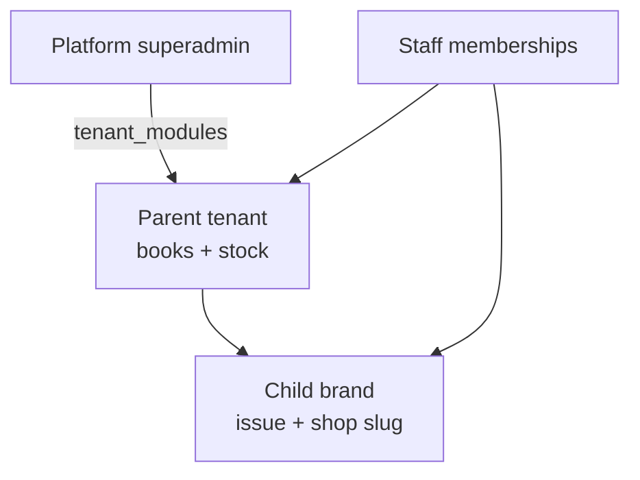
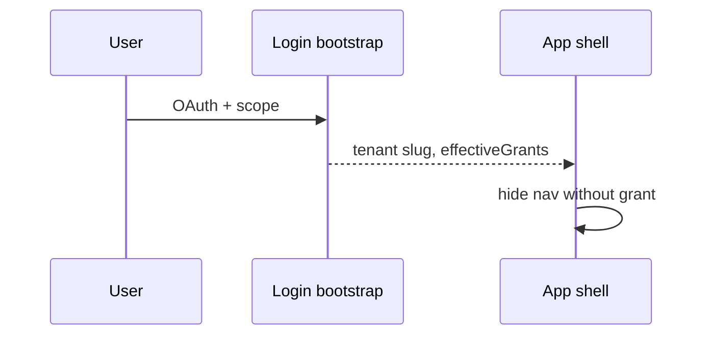

# Tenants

**Companies and brands** on TradeFlow: who owns books and stock, which **modules** are on, who may log in on **app** / **shop** / **investor**, and how **grants** gate desks.

Shop surfaces: [Shop storefront](/docs/modules/shop) · [Shop admin](/docs/modules/shop-admin). Access kernel: [Kernels → Access](/docs/kernels#access-kernel).

## Parent and child

| | Parent company | Child brand |
| --- | --- | --- |
| `parent_id` | `null` | Points to parent |
| **Books** | Owns money books and cashbook | Issues under parent; `issued_by_tenant_id` on bills |
| **Stock** | Owns `global_stocks` | Sells same parent lots |
| **Workspace** | Switcher lists company + child refs | Staff work in granted slug |

One-level brand hierarchy as-built. Do not treat child as a separate warehouse or cashbook owner.

## Four login scopes (not job titles)

| Scope | URL | Tenant role |
| --- | --- | --- |
| **platform** | `/platform/*` | Provision tenants — not company ERP |
| **app** | `/:slug/app/*` | Staff ERP for that slug |
| **shop** | `/:slug/shop/*` | Buyers on that tenant’s shops |
| **investor** | `/:slug/investor/*` | Read-only capital portal |

Detail: [Scopes](/docs/scopes).

## Platform provisioning

| Task | Where |
| --- | --- |
| Create / edit tenant | `/platform/tenants` |
| Enable modules (`tenant_modules`) | Tenant detail — BW vs Koba vs thrift sets |
| Domains / flags | Platform tenant admin |

Platform users do **not** post pays or receive stock for the company.

## Company admin (app)

| Task | Typical module |
| --- | --- |
| Invite staff, memberships | `tenant/`, `membership/` |
| Module action grants | `access_control/` |
| Customer groups, profiles | `customer/` |

### Three-layer RBAC

1. **Module enabled** on tenant (`tenant_modules`)
2. **Admin bypass** for tenant admins where spec allows
3. **Explicit grants** — `view` / `create` / `edit` / `delete` / `manage`

UI: `effectiveGrants` + `createAccessGuard`. Server: `has_module_action()` on RPCs.

## What owns what (kernels)

| Asset | Owner |
| --- | --- |
| Money books, AP/AR at company level | **Parent** tenant profile |
| Warehouse lots | **Parent** |
| Landed cost lock | **App** staff on parent procurement |
| Shop config | Tenant (many shops per company) |

Child brand issues bills and runs shops **under grants** — not a second stock ledger.

## Modules per tenant

Turn packs on per company — see [Sales models](/docs/models).

| Pack | Example |
| --- | --- |
| BW core | `procurement_stock`, `global_invoice`, `shop_order`, … |
| Pre-order | `product_based_costing` |
| Koba | `koba_*` — separate stock tables |
| Thrift | `thrift_*` — [Thrift module](/docs/modules/thrift) |

Do not enable every pack on every tenant.

## What tenants module is not

| Not here | Doc |
| --- | --- |
| Shop storefront & admin | [Shop](/docs/modules/shop) · [Shop admin](/docs/modules/shop-admin) |
| Bill compose | [Wholesale](/docs/modules/wholesale) |
| Shipment receive | [Inbound](/docs/modules/inbound) |

## Related

| Link | |
| --- | --- |
| [Shop](/docs/modules/shop) · [Shop admin](/docs/modules/shop-admin) | Storefront vs staff desks |
| [Access kernel](/docs/kernels#access-kernel) | Grants and hierarchy |
| [Kernels](/docs/kernels) | Dependency order |
