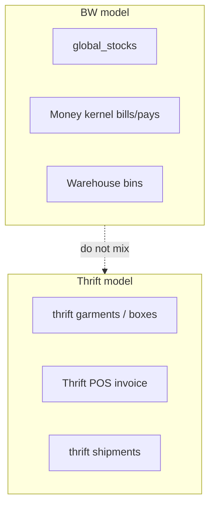
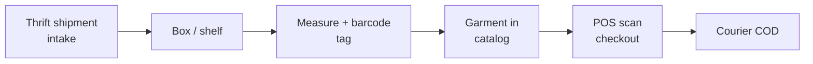
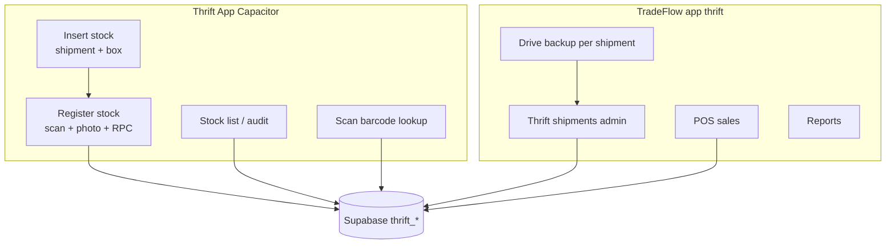

# Thrift

A **separate sales model** on TradeFlow: one-off **garments**, intake from **boxes** and **shipments**, thrift-specific **stock**, **POS** checkout, courier **COD**, and thrift **reports**. It does **not** use BW `global_stocks`, wholesale compose, or the money kernel’s main bills desk.

Enable via `tenant_modules` (thrift_* packs). Architecture stays in `web/src/modules/thrift/` — do not copy this pattern into BW modules.

Context: [Sales models](/docs/models) · [Tenants](/docs/modules/tenants) (module flags).

## Who uses it

| Surface | Thrift |
| --- | --- |
| **app** | Full vertical under `/:slug/app/thrift/*` |
| **shop** | — (no BW storefront for thrift garments) |
| **platform** | — |
| **investor** | — |

Access: **app** scope + per-submodule grants (`thrift_sales`, `thrift_stock`, …).

## Separate from BW kernels

| | BW wholesale | Thrift |
| --- | --- | --- |
| Inventory | Parent warehouse lots | `thrift_*` garments, boxes, shelves |
| Sales desk | Bills compose / shop | `create_thrift_sales_invoice` POS |
| Inbound | `global_shipments` + landed cost lock | **Thrift shipments** (own UI) |
| Money | Bills & pays kernel | Thrift POS + ledger (not BW cashbook desk) |

## Submodule map (grants)

| Module key | Area |
| --- | --- |
| `thrift_shipment` | Inbound thrift shipments |
| `thrift_stock` | Garment catalog / stock list |
| `thrift_box` | Intake boxes |
| `thrift_sales` | POS, invoices, returns |
| `thrift_customers` | Thrift customers |
| `thrift_reports` | Sales, COD, shipment reports |
| `thrift_*` settings | Categories, types, shelves, couriers, barcodes, tags |

Exact keys match `moduleRegistry` / navigation — grep `thrift_` in `web/src/modules/thrift/routes/`.

## App routes

| Desk | Route |
| --- | --- |
| **Sales** (list) | `/:slug/app/thrift/sales` |
| **POS / create invoice** | `/:slug/app/thrift/sales/create` |
| Invoice detail | `/:slug/app/thrift/sales/:invoiceId` |
| Print preview | `/:slug/app/thrift/sales/:invoiceId/preview` |
| **Returns** | `/:slug/app/thrift/sales/returns` |
| **Stocks** (garments) | `/:slug/app/thrift/stocks` |
| **Shipments** | `/:slug/app/thrift/shipments` |
| Shipment detail | `/:slug/app/thrift/shipments/:id` |
| **Boxes** | `/:slug/app/thrift/boxes` |
| **Shelves** | `/:slug/app/thrift/shelves` |
| **Categories** | `/:slug/app/thrift/categories` |
| **Types** | `/:slug/app/thrift/types` |
| **Customers** | `/:slug/app/thrift/customers` |
| **Couriers** | `/:slug/app/thrift/couriers` |
| **Barcodes** | `/:slug/app/thrift/barcodes` |
| Barcode print preview | `/:slug/app/thrift/barcodes/print-preview` |
| **Stock tags** | `/:slug/app/thrift/stock-tags` |
| Tag preview | `/:slug/app/thrift/stock-tags/:shipmentId/preview` |
| **Ledger** | `/:slug/app/thrift/ledger` |
| **Reports** | `/:slug/app/thrift/reports` |
| Sales / COD / shipment reports | Under `.../reports/...` |
| **Settings** | `/:slug/app/thrift/settings` |
| Currencies (reference) | `/:slug/app/thrift/currencies` |

UI root: `web/src/modules/thrift/`. SQL: grep `thrift_` in `public.sql` (schema split stub: `supabase/schemas/thrift/`).

## Lifecycle (conceptual)

1. **Shipment** — thrift-specific inbound (not procurement `global_shipments`).
2. **Intake** — box/shelf placement, garment registration.
3. **Costing** — landed unit (origin + freight apportion + packaging); ceiling retail from markup presets (spec target; confirm as-built in UI).
4. **Tagging** — measurements (tops/bottoms), hang-tag / barcode print.
5. **POS** — barcode scan, `create_thrift_sales_invoice`; courier COD with **risk** check (`get_thrift_customer_sales_risk`).
6. **Returns** — thrift returns desk linked to sales invoices.

## Personas

| Role | Work |
| --- | --- |
| Shop manager | Intake, costing presets, returns, dashboards |
| Tagging clerk | SKU register, measurements, print tags — often **Thrift App** on the floor |
| Warehouse operator | Shipment/box pick, barcode scan, register garment — **Thrift App** |
| POS clerk | Scan checkout, COD, risk flags — TradeFlow **app** `/app/thrift/sales` |
| Auditor | Sales, COD, margin, aging reports — TradeFlow **app** reports |

## Thrift App (mobile warehouse)

**Thrift App** is a separate Quasar + **Capacitor 8** project (`thrift-app`, repo **`Thrift-app`**) for **warehouse floor** work. It shares the same **Supabase** project and `thrift_*` tables as TradeFlow BD — it is not a second stock system.

| | TradeFlow BD `web/` | Thrift App |
| --- | --- | --- |
| **Users** | Staff ERP (`app` scope) | Tagging clerks, intake on phone/tablet |
| **Best for** | POS, reports, shipment admin, barcodes print, settings | Fast **scan**, photo, **register stock**, audit |
| **Deploy** | Cloudflare Pages SPA | **Android APK/AAB** (+ web dev server) |
| **Images** | Admin flows | **Cloudinary** upload from device camera |
| **Google Drive backup** | **Web admin** — Thrift → Shipments upload | **Off** on mobile (`VITE_GOOGLE_DRIVE_UPLOAD_ENABLED=false`) |

### Thrift App — features

- **Inventory intake**: choose shipment + box, register garments with measurements, condition, section, pricing fields.
- **Barcode**: hardware / **ML Kit** camera scan (`@capacitor-mlkit/barcode-scanning`).
- **i18n**: English and **Bengali (বাংলা)** with persisted locale.
- **Help**: in-app `AppHelpDialog` on main flows for operators.
- **Auth**: Supabase Google OAuth (web); **native Google** on Android via `signInWithIdToken` (see repo `docs/GOOGLE_SIGNIN_SHA_SETUP.md`).

### Thrift App — screens (routes)

| Route | Job |
| --- | --- |
| `/login` | OAuth or email |
| `/` (dashboard) | Home metrics |
| `/insert-stock` | Pick **shipment** + **box** (saved in `thriftStore`) |
| `/register-stock` | Scan barcode, photo, form → save |
| `/stock-list` | Browse / filter paginated stock |
| `/stock/:id` | Stock detail |
| `/scan-barcode` | Lookup by barcode |
| `/audit-mode` | Stock audit workflow |

### Thrift App — data wiring

| RPC | Called from mobile |
| --- | --- |
| `register_thrift_stock_from_app` | Register stock save |
| `resolve_thrift_barcode` | Barcode validation |
| `list_thrift_stocks_paginated` | Stock list |

Key tables: `thrift_shipments`, `thrift_boxes`, `thrift_barcodes`, `thrift_stocks`, `thrift_pricings`, `thrift_stock_images`, catalog dropdowns (`thrift_categories`, `thrift_types`, `thrift_shelves`, `thrift_currencies`).

**Enums** must match Postgres (`thrift_condition`, `thrift_section`) — e.g. use `NEW_WITH_TAGS`, `MALE`, not legacy `MENS` / `NEW` labels.

**Money on register:** purchase currency from shipment `purchase_currency_id` (`origin_unit_price`); cost/list currency from `cost_currency_id` (`listed_unit_price`). Weight in **grams**.

### Thrift App — stack & env

| Layer | Tech |
| --- | --- |
| UI | Vue 3, Quasar 2, TypeScript |
| State | Pinia + TanStack Vue Query |
| Native | Capacitor 8 (camera, barcode) |
| Backend | Same Supabase as TradeFlow BD |

| Env var | Purpose |
| --- | --- |
| `VITE_SUPABASE_URL` / `VITE_SUPABASE_ANON_KEY` | Backend (typically same project as `web/.env`) |
| `VITE_CLOUDINARY_*` | Product photos on register |
| `VITE_GOOGLE_DRIVE_UPLOAD_ENABLED` | Keep **`false`** on mobile |

**Build Android release:** `npm run build:android` in Thrift App repo. **Dev on device:** `npx quasar dev -m capacitor -T android`.

Operator docs and architecture detail live in the Thrift App repo (`README.md`, `AI_ARCHITECTURE.md`).

## POS and risk

| RPC / behavior | Purpose |
| --- | --- |
| `create_thrift_sales_invoice` | Atomic POS sale |
| `get_thrift_customer_sales_risk` | Phone/history flags before courier COD |

Courier setup: **Couriers** desk under thrift — not dropship remittance ([Dropship](/docs/modules/dropship) is BW).

## Reports and ledger

| Area | Examples |
| --- | --- |
| Reports hub | Sales, COD, shipment summaries |
| Ledger | Thrift financial movements (module ledger — not universal BW cashbook) |

Use thrift reports for thrift margins — do not map thrift COGS to BW shipment P&L.

## What thrift is not

| Do not use for thrift | Use instead |
| --- | --- |
| `global_stocks` / FIFO compose | Thrift stock + POS |
| Bills desk `/app/sales/invoices` | Thrift sales create |
| Procurement landed-cost lock | Thrift shipment + thrift costing rules |
| Shop dropship | Thrift couriers + POS |
| Koba catalog | Separate Koba module |

## Implementation notes

- State: **Vue Query** in thrift module — keep isolated from BW Pinia patterns.
- SQL split: live tables still largely in `public.sql`; stub schema folder for future split (**TH1** in gaps).
- Hang-tag PDF voucher: confirm UI vs PRD (**TH3**).

## Related

| Doc | Link |
| --- | --- |
| Sales models | [Models](/docs/models) |
| BW wholesale | [Wholesale](/docs/modules/wholesale) |
| Tenants / modules on | [Tenants](/docs/modules/tenants) |
| Kernels | [Kernels](/docs/kernels) — thrift sits **outside** BW money/warehouse kernels |
