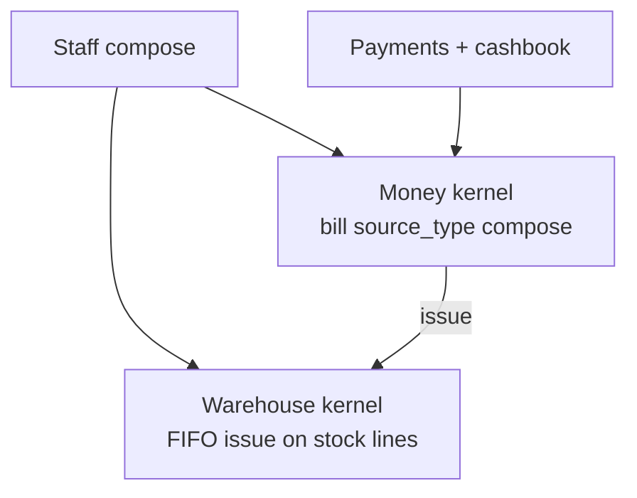
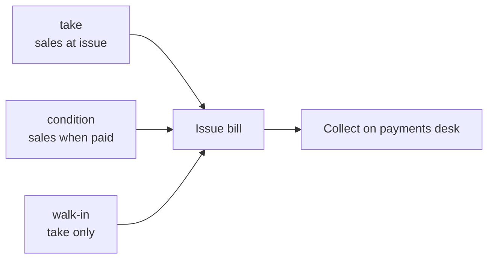
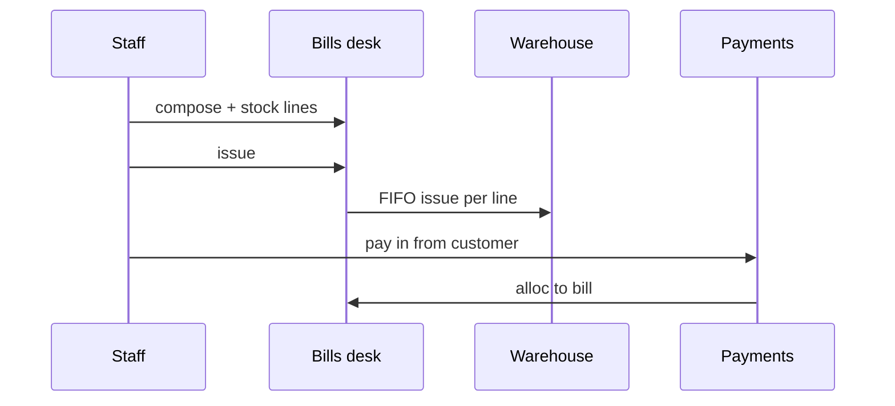

# Wholesale

Sell **goods in hand** from the parent warehouse: staff compose **bills** for B2B buyers (and walk-in retail), **issue** with FIFO stock when lines carry `global_stock_id`, then **collect** through payments and cashbook.

Wholesale is the core **BW** (Brandwala wholesale) desk — not a separate app. It shares [money](/docs/kernels#money-kernel), [warehouse](/docs/kernels#warehouse-kernel), and [access](/docs/kernels#access-kernel) with shop and inbound. [Dropship](/docs/modules/dropship) is another **channel** on the same stock and money kernels.

## Who uses it

| Surface | Wholesale |
| --- | --- |
| **app** | Bills list, compose, print, payments, cashbook |
| **shop** | Stock-backed catalog — buyers order; staff still issue from ops desks |
| **platform** | — |
| **investor** | — |

Grants: `global_invoice` (bills), `payments` (pay in/out). See [Scopes](/docs/scopes).

## App routes (as-built)

| Desk | Route | Job |
| --- | --- | --- |
| Bills | `/:slug/app/bills` | List, open, print |
| Compose | `/:slug/app/bills/create` | New take / condition / walk-in bill |
| Payments | `/:slug/app/finance/payments` | Collect from customer, pay out |
| Cashbook | `/:slug/app/cashbook` | Tenant cash and profile leftover |

UI code lives under `bills_pays/` (legacy folder name `sales_invoice/` in older docs).

## How it plugs into kernels

| Step | Kernel | What happens |
| --- | --- | --- |
| Pick customer (profile) | Money | Bill **to** customer; tenant is **from** on AR |
| Add stock lines | Warehouse | Lines reference `global_stock_id` and qty |
| Issue bill | Money + Warehouse | Paper **issued**; FIFO debits lots when stock present |
| Collect | Money | Pay in + alloc; optional profile **leftover** on overpay |

Kernel detail: [Money](/docs/kernels#money-kernel) · [Warehouse](/docs/kernels#warehouse-kernel).

## Settlement kinds (trade compose)

One kind per bill on trade compose. Walk-in is **take** only.

| Kind | Meaning | Sales in reports | Bill after issue |
| --- | --- | --- | --- |
| **take** | Sell now, pay later (credit sale) | At **issue** | Due until paid |
| **condition** | Goods out; sale firms when paid | When **paid** | Due; unpaid is not firm AR for sales |

Live column: `channel_meta.delivery_kind` → target `settlement_kind` on the bill.

## Compose flow (staff)

1. Choose **customer** (money profile — not delivery recipient only).
2. Choose **take**, **condition**, or **walk-in** mode.
3. Add **stock lines** (search parent warehouse) and/or description/charge lines.
4. **Issue** — stock lines trigger FIFO issue; bill gets `source_type = compose`.
5. **Print** preview; hand paper or send PDF.
6. **Collect** on payments desk (same day or later); alloc to bill; overpay → customer cashbook.

**Modular compose (target):** party + direction (they owe / we owe) without requiring stock (spec gap **BP13**). Today: stock take/condition/walk-in is the main path.

## Walk-in vs trade buyer

| | Walk-in | Trade (B2B) |
| --- | --- | --- |
| Customer | Often casual / counter | Named customer profile, groups |
| Settlement | **Take** only | Take or **condition** |
| Stock | In-hand lines typical | Same; may mix fees as non-stock lines |
| Credit | Collect now or later | Credit sales common on **take** |

## Money pattern (wholesale take)

Example: buyer owes **1,500**; pays **1,500** cash.

| Layer | Result |
| --- | --- |
| Bill | Take, issued, due 1,500 → **paid** after alloc |
| Warehouse | Qty left parent lots |
| Cashbook | Tenant cash **+1,500** |
| Reports | Sales **1,500** (GP from shipment P&L, not invoice-line COGS) |

Overpay **2,000**: alloc 1,500; **+500** on customer profile cashbook — no second bill.

Full walkthrough: [Money kernel → Three worked patterns](/docs/kernels#money-kernel).

## What wholesale is not

| Not wholesale desk | Where it lives |
| --- | --- |
| Dropship to recipient | [Dropship module](/docs/modules/dropship) — merchant bill at ship, remittance |
| Pre-order / quote before stock | [Product-based costing](/docs/modules/product-based-costing), delivery paper close |
| Inbound AP and receive | [Inbound shipment](/docs/modules/inbound) |
| Koba / thrift POS | Separate sales models — not `global_stocks` FIFO desk |
| Delivery **proforma** | Delivery paper — not an issued bill until close |

## Paper and corrections

| State | Rule |
| --- | --- |
| `draft` / `issued` / `voided` | Paper lifecycle |
| `due` / `partially_paid` / `paid` | Settlement on issued AR |
| Credit / debit **note** | Child bill; fixes issued total — do not silently edit face amount |

Returns and RMA: **after-sales** module executes `process_wholesale_invoice_return` — does not re-compose the original sale on the bills desk.

## Related modules

| Module | Link to wholesale |
| --- | --- |
| [Money](/docs/modules/money) | Bills, pays, cashbook desks |
| [Tenants](/docs/modules/tenants) · [Shop admin](/docs/modules/shop-admin) | Parent stock, child brands, customer groups |
| [Inbound](/docs/modules/inbound) | Stock that compose sells must be received first |
| [Dropship](/docs/modules/dropship) | Same warehouse lots; different order + settlement path |
| [Sales models](/docs/models) | BW vs pre-order vs Koba vs thrift |
